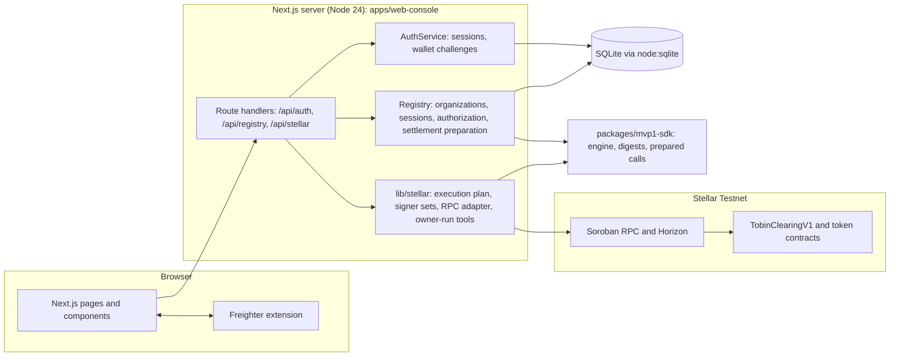
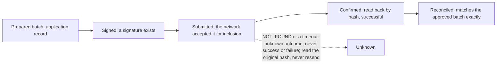

# AGENTS.md: instructions for AI coding agents

This is the canonical, repository-wide guide for AI coding agents (Claude Code, OpenAI Codex, GitHub Copilot and others). Human contributors follow [`CONTRIBUTING.md`](CONTRIBUTING.md); agents follow both, and these rules win where they are stricter. [`CLAUDE.md`](CLAUDE.md) is a short entry point that points here.

A nested instruction file applies inside its own directory: `apps/landing/AGENTS.md` (the landing page uses a Next.js version that differs from common knowledge; read `node_modules/next/dist/docs/` before changing it).

## 1. Project identity

Tobin is open-source clearing and settlement software for financial institutions on Stellar. Institutions record the payment obligations they owe each other; Tobin computes net positions deterministically, requires a reviewer to approve the exact result, prepares settlement instructions for only the net amounts, and settles them through a Soroban contract.

- **Users:** institutions with recurring obligations to several counterparties (anchors, payment institutions, cross-border payment providers, institutional Stellar applications).
- **Stage:** pre-production institutional infrastructure, **Stellar Testnet only**. Milestones MVP-1.2 to MVP-1.5 and wallet-first authentication are implemented; the settlement path was demonstrated on Testnet in one owner-run execution. Production deployment has not been approved and Mainnet and real-value use are not authorized. The evidence is same-author, no independent security review has been performed, and the release gates for a versioned or production release are blocked.
- **Wording:** when you write or change any project description, documentation or public-facing text, follow [`docs/COMMUNICATION-AND-MATURITY-TERMINOLOGY.md`](docs/COMMUNICATION-AND-MATURITY-TERMINOLOGY.md): use its maturity vocabulary, never claim more than the evidence supports, and do not rewrite historical records to change their maturity claims.
- **Not:** an anchor, custodian, payment processor, DEX, lender or bank; not a universal clearing network and not a fully decentralized protocol.

## 2. Required reading order

Read before you change code. Do not assume a document is current: check it against the code (see section 3 for known stale spots).

1. [`README.md`](README.md): status, capabilities, lifecycle, limitations.
2. Product requirements: **not published in this repository.** Do not invent them.
3. Architecture for the area you will touch:
   - persistence and operations: `docs/product/architecture/mvp-1.2/BACKEND_PERSISTENCE_ARCHITECTURE.md`, `BACKEND_PERSISTENCE_DATA_MODEL.md`, `BACKEND_PERSISTENCE_OPERATIONS.md`;
   - Stellar: `docs/product/architecture/mvp-1.5/MVP-1.5-ARCHITECTURE.md`, `MVP-1.5-WALLET-AND-SIGNING.md`, `MVP-1.5-CONTRACT-COMPATIBILITY.md`, `MVP-1.5-THREAT-MODEL.md`;
   - authentication and onboarding: `docs/product/architecture/wallet-first-auth/WALLET-FIRST-AUTH-ARCHITECTURE.md` and `WALLET-FIRST-AUTH-SECURITY-REVIEW.md`.
4. The milestone record for the area: `docs/product/architecture/mvp-1.3/` (authorization), `mvp-1.4/` (settlement preparation), `mvp-1.5/` (Stellar; read `MVP-1.5-CLOSURE.md` and `MVP-1.5-ACCEPTANCE.md` for the limitations), `wallet-first-auth/`.
5. Decisions: there is **no ADR directory**. Decisions live inside the milestone documents, `docs/product/architecture/w1/W1-DECISION-PAPERS.md`, and `docs/reference/MVP-1-ABI-AND-AUTHORIZATION-REFERENCE.md` for the contracts. Treat accepted decisions as binding.
6. The subsystem source (section 8), then **its tests**.

## 3. Source of truth and known stale spots

When sources disagree: the **code and its tests** show what the system does; an acceptance or closure document shows what was accepted; older reports and comments may predate later work. Do not silently change the implementation to match a document, and do not copy a stale claim into new text. Report the discrepancy.

Known discrepancies (as of this writing):

- The header comment of `apps/web-console/lib/registry/settlement-state.ts` says no wallet, signing or submission exists in this build. That predates MVP-1.5: the owner-run tools do sign and submit (they do not go through this module).
- `docs/product/architecture/mvp-1.2` to `mvp-1.5` and the older reports describe state **at their date**. Their "BLOCKED" or "not implemented" sections are history where a later document supersedes them (the MVP-1.5 documents mark which parts).
- Older documents use the pre-monorepo paths `core/` and `ts/`; map them with `docs/PATH-MAP.md`.
- There is no single API reference for the institutional API. `W1-API-REFERENCE.md` documents only the mock `/api/w0/*` API.
- The operator script `node scripts/db.ts asset-add` still accepts the `public` network for asset configuration; no Mainnet execution path exists.
- Untracked files in a contributor's working tree (for example loose files under `docs/product/architecture/`) are **not part of the repository**. Only tracked files count.

## 4. Architecture



| Part | Reality |
|---|---|
| Frontend | Next.js 16 App Router, React 19. Institutional pages under `apps/web-console/app/(institution)`; client components in `components/`. `/` is the MVP-1 local sandbox Console (needs the Rust bridge); `/w0` is a mock-adapter console |
| Backend and API | Route handlers (Node runtime) in `app/api`. `proxy.ts` enforces loopback Host/Origin guards, JSON-only POST and a per-request CSP nonce |
| Database | SQLite file through `node:sqlite`, one app instance. Migrations 1 to 8 in `lib/db/database.ts`; triggers make many tables immutable or append-only |
| Authentication | `lib/auth`: opaque HttpOnly session cookie, hash at rest; email accounts and wallet sign-in (challenge, verify, rotate) |
| Authorization | `Registry` (`lib/registry/service.ts`): membership, role, reviewer and organization checks on the server. `lib/stellar/owner-access.ts` gates the owner tools |
| Stellar integration | `lib/stellar`: `@stellar/stellar-sdk` 17.4.0, `@stellar/freighter-api` 6.0.1; plan builder, signer-set verifier, RPC adapter, comparison, owner-run tools (`/wallet-check`, `/cosign-check`, `/settle-run`) |
| Smart contracts | `contracts/clearing` (`TobinClearingV1`) and `contracts/token` (`TobinTestToken`); Rust 1.96.0, Soroban SDK 29.0.0; Testnet manifest in `contracts/deployments/testnet.json` |
| SDK | `packages/mvp1-sdk`: netting engine, digests, strkey, prepared contract calls, local bridge client. Shared by the app and tests |
| Tests | `node:test`; real-browser journeys over CDP in `apps/web-console/test/browser`; the Rust development bridge for contract-backed tests |
| CI and release | `.github/workflows/*`, `ci/`, `scripts/ci`, `scripts/release`, `release/` |

## 5. Core domain concepts

Use the project's terms. The code says `Organization` for an institution.

| Concept | Meaning and where it lives |
|---|---|
| **Institution** | an `Organization` (`organizations`); has a type and jurisdiction; it is application data |
| **User** | an internal Tobin account (`users`); signs in by email or by wallet; has no authority by itself |
| **Wallet** | a verified Stellar key of a user (`user_wallets`, Testnet only). A separate, organization-scoped ownership proof exists (`wallet_challenges`, `wallet_verifications`) used to map participants to accounts for execution |
| **Membership** | a user in an organization with role `admin` or `member` and status `active` or `suspended` (`memberships`) |
| **Reviewer** | an explicit grant (`org_reviewers`); not implied by `admin` |
| **Clearing session** | a `SessionRecord` (`sessions`) with a provenance label and a workflow state `configuring`, `ready` or `closed` |
| **Participant** | a member added to a session (`session_participants`) |
| **Obligation** | debtor, creditor and a positive integer amount in one canonical asset (`obligations`) |
| **Calculation** | an immutable snapshot of deterministic net positions (`calculations`, with an input hash); `current` only while participants and obligations are unchanged |
| **Approval** | a reviewer decision (`authorization_decisions`) bound to one exact calculation; `active`, `superseded` or `invalidated` |
| **Settlement batch** | an immutable batch derived from an approved calculation (`settlement_batches`), with instructions (`settlement_instructions`) and a batch review; `awaiting-review`, `approved`, `rejected`, `invalidated`, `superseded` |
| **Execution preconditions** | `settlement_executions` and attempts: which accounts are verified and the planned steps. They do not contact the network |
| **Stellar transaction** | one of the contract calls built by `lib/stellar/execution-plan.ts` and sent by the owner-run tool |
| **Confirmation** | a transaction read back from the network by hash with a successful result |
| **Reconciliation** | comparing the confirmed on-chain state with the approved batch (`lib/stellar/compare.ts`); any difference means stop |
| **Signer set** | the keys and weights that may sign for a multisig account, read from Horizon and the RPC (`signer_set_snapshots`) |

On chain, the clearing contract has its own session lifecycle: `Open`, `Committed`, `Approved`, `Settled`. A proposal is data, not a state; replacing it clears all approvals.

## 6. State and trust boundaries (mandatory)

Hold these distinctions in every change, comment and document:

- **Application records are not on-chain records.**
- **Local drafts are not persisted or confirmed records.**
- **A prepared settlement batch is not a submitted transaction.**
- **A signed transaction is not proof of submission.**
- **A submitted transaction is not proof of confirmation.**
- **A confirmed chain transaction must be independently verified** by reading the network, never inferred from an API reply or a simulation.
- **A confirmed transaction must be reconciled** against the approved Tobin settlement batch.
- **Wallet address claims are not proof of wallet ownership.** Only a verified signature over a server-issued challenge is.
- **Wallet authentication is not institutional authorization.**
- **Institutional roles are not Stellar signing authority.**
- **Reviewer approval is not settlement execution.**



**Provenance labels** on a session record (`lib/registry/types.ts`) have exact meanings; do not add labels or blur them:

- `fixture`: demonstration data, never on-chain.
- `local-draft`: created in the application, nothing submitted.
- `chain-read`: a read-only RPC observation of the session id exists, not tied to a verified transaction.
- `chain-confirmed`: a read matched the id **and** the creating transaction was confirmed successful. Only this label carries a transaction hash.

**Execution states** are defined in `lib/registry/settlement-state.ts`: `awaiting-signer`, `signing`, `signed`, `submission-pending`, `submitted`, `confirmed`, `reconciled`, `failed`, `expired`, `unknown-outcome`, `reconciliation-required`. Do not collapse stages into a generic "settled".

## 7. Non-negotiable invariants

- Preserve financial correctness. Use integer or fixed-precision arithmetic (`bigint`; checked integers in Rust); never floating point for money.
- Preserve conservation of value: net positions sum to zero and a plan moves exactly what the obligations require.
- Prevent stale approvals: a decision binds to one calculation and a batch approval to the instruction hash; changes invalidate them.
- Preserve immutable historical records (decisions, batches, attempts, signer-set snapshots, audit events). Do not add `UPDATE` or `DELETE` paths for them.
- Maintain separation of duties: nobody decides on a result they recorded, changed or calculated; an administrator is not a reviewer.
- Enforce authorization **server-side**; never trust a client-supplied role, user id or organization id.
- Preserve wallet ownership verification: single-use, expiring, server-rebuilt challenges.
- Prevent duplicate execution: steps run in order from the observed chain state, a completed step is never prepared again, and there is no automatic retry.
- Verify transaction outcomes independently and reconcile against the approved record.
- Do not claim the netting result is the only valid or a globally optimal plan; the contract accepts any valid plan.

## 8. Repository navigation

| Looking for | Go to |
|---|---|
| Clearing operations (sessions, obligations, calculations) | `apps/web-console/lib/registry/{clearing,service,session-view}.ts`; tests `clearing*.test.ts`, `sessions.test.ts`; netting in `packages/mvp1-sdk/src/engine/` |
| Institutional authorization | `lib/registry/authorization.ts` and the `decide`/`authorization` methods in `service.ts`; tests `authorization*.test.ts` |
| Settlement preparation | `lib/registry/settlement.ts`, `asset-identity.ts`; tests `settlement*.test.ts`, `asset-identity.test.ts` |
| Stellar execution | `lib/stellar/{execution-plan,compare,rpc,run,cosign,signer-set,live,freighter,freighter-core,owner-access}.ts`; routes `app/api/stellar/*`; pages `(institution)/{wallet-check,cosign-check,settle-run}`; tests `stellar-*.test.ts`, `signer-set*.test.ts`, `run.test.ts`, `attempts-ops.test.ts` |
| Wallet authentication | `lib/auth/{service,http,wallet-challenge}.ts`, `lib/registry/wallet-proof.ts`, `lib/stellar/wallet-signin.ts`, `components/wallet-signin.tsx`; tests `wallet-auth.test.ts`, `wallet-signin.test.ts`, `wallet-ops.test.ts` |
| Institutional onboarding | `components/{onboarding,account-app,join-app}.tsx`; `AuthService.accountView` |
| Database migrations | `lib/db/database.ts`; operator commands `apps/web-console/scripts/db.ts` |
| Browser journeys | `apps/web-console/test/browser/*.mjs` (helper `cdp.mjs`) |
| Contracts | `contracts/clearing/src/lib.rs`, `contracts/token/src/lib.rs`, `contracts/deployments/testnet.json` |
| Architecture docs | `docs/product/architecture/` (see section 2); governance in `docs/governance/` |
| CI | `.github/workflows/`, `ci/README.md`, `scripts/ci/`, `scripts/release/`, `release/RELEASE-GATES.json` |

## 9. Development commands (verified against `package.json`, Cargo and CI)

```bash
npm ci                                              # CI: npm ci --ignore-scripts
npm run typecheck                                   # all workspaces
npm run build:console                               # production build of the web console
npm run build --workspace tobin-landing             # landing production build
npm run lint  --workspace tobin-landing             # the only ESLint config in the repo
npm test --workspace tobin-mvp1-sdk                 # SDK tests
npm test --workspace tobin-web-console              # console unit/integration/security tests
npm run dev   --workspace tobin-web-console         # http://127.0.0.1:8787
npm run db:migrate --workspace tobin-web-console    # idempotent
npm run db:status  --workspace tobin-web-console    # exits 2 while migrations are pending
node scripts/ci/update-npm-baseline.mjs --check     # dependency baseline must match the lockfile (drop --check to update)
node scripts/ci/check-links.mjs                     # relative Markdown links
node --test scripts/release/scan.test.mjs           # release-scan rule tests
node scripts/release/check-gates.mjs                # scan plus gate status
cd contracts && cargo fmt --all --check
cd contracts && cargo test --locked --workspace
cd contracts && cargo build --locked -p tobin-clearing-v1 --example bridge   # then set TOBIN_BRIDGE_EXE
cd contracts && stellar contract build              # Wasm; needs Stellar CLI 28.0.0
# browser journeys (from apps/web-console; needs a production build, Chrome or Edge):
TOBIN_WIDTH=1200 node test/browser/<journey>.mjs <output dir>      # also run at 420
```

Journeys: `journey` (needs the bridge), `w0-journey`, `sessions-journey`, `settlement-journey`, `authorization-journey`, `clearing-journey`, `backend-journey`, `wallet-auth-journey`. Run `npm run build:console` first. In PowerShell use `$env:NAME = "value"`. Without `TOBIN_BRIDGE_EXE`, bridge-backed tests are skipped and reported; hosted CI allows exactly one skipped TypeScript test (see `ci/README.md`). There is no repository-wide linter or formatter for the console and SDK. Never invent a command: if you need one that is not listed, find it in `package.json`, Cargo or a workflow first.

## 10. Operating procedure

**Before editing:** run `git status` and `git branch --show-current`; read the relevant documents and code and the related tests; list the dependencies and likely regressions; for a substantial change, state your plan and wait for agreement. Do not assume an API, flag or file exists: open it.

**While implementing:** make narrow changes; preserve established interfaces and migration history; avoid new dependencies and speculative refactoring; add tests (positive and negative); update the documentation; label mocks and stand-ins as such; do not touch unrelated files.

**After implementing:** run the relevant tests, the type check and the build; read the complete diff; check for secrets, logs, databases and accidental configuration changes; report failures and **skipped checks honestly**, and never claim a check passed that you did not run; summarize the changed files and behaviour.

## 11. Git and collaboration

- Never push to `main`. Never merge a pull request without explicit authorization. Never force-push a shared branch without explicit authorization.
- Never rewrite, amend or reset accepted historical commits.
- Work on a dedicated branch named `<type>/<short-description>` with the types `feat`, `fix`, `docs`, `refactor`, `test`, `security`, `ci` (CI-only changes), `chore`. Start from the latest `main`.
- Use Conventional Commits (`type(scope): imperative summary`), the same as `CONTRIBUTING.md`.
- **Do not add AI attribution or co-author trailers** (no `Co-authored-by: Claude` or similar, no "generated with" lines) to commits or pull requests. Disclose significant AI assistance in the pull request description instead, where the template asks.
- Commit, push or open a pull request only when the user asked you to.
- Never discard the user's unrelated changes; leave untracked files you did not create alone. Never resolve a conflict by deleting another contributor's work.

## 12. Restricted actions (explicit owner approval required)

Do not, without explicit approval from the project owner for that specific action:

- deploy to Mainnet or modify Mainnet configuration (none exists; do not add any);
- mint tokens or change a token's supply;
- change the governance of deployed contracts, or redeploy established contracts;
- change signer sets, weights or thresholds;
- expose, request, log or commit private keys, seed phrases or secrets;
- disable, weaken or bypass a security control, validation or institutional authorization, or add an admin override or recovery bypass;
- change an approved financial invariant;
- modify accepted architecture decisions or accepted migrations;
- edit accepted evidence (for example `docs/product/architecture/mvp-1.5/evidence/`) or the release-gate scanner's exceptions;
- run network actions against Testnet that submit transactions, create or fund accounts, or use existing Testnet accounts, unless the task explicitly authorizes it;
- merge or push directly to `main`.

## 13. Roadmap and status

The approved milestones, in this order and with these names (do not rename, reorder, merge or expand them):

| Milestone | Description | Status |
|---|---|---|
| MVP-1.2 | Clearing Operations Foundation | Completed |
| MVP-1.3 | Institutional Clearing Authorization | Completed |
| MVP-1.4 | Settlement Preparation Engine | Completed |
| MVP-1.5 | Stellar Settlement Integration | Completed with limitations |
| MVP-1.6 | Institutional Operations and Reconciliation | Planned |
| MVP-1.7 | Security, Governance and Infrastructure Hardening | Planned |
| MVP-1.8 | Controlled Institutional Pilot | Planned |

MVP-1.5 is **complete with limitations**: one owner-run Testnet settlement, same-author evidence, no second or hardware wallet, no measured resources or fee breakdown, confirmed on-chain outcomes not written back to application records. **Testnet validation is not production readiness.** Wallet-first authentication and onboarding were delivered after MVP-1.5 (complete with limitations): the Freighter flow is tested with a protocol-compatible stand-in, real-Freighter validation in Edge is outstanding, migration 8 was not tested on a real operator database, and account recovery is deferred. Do not describe any of this as production-ready.

## 14. Decision-making rules

Agents must not independently rename established concepts, reorder milestones, expand a milestone's scope, replace the approved architecture, introduce another blockchain or settlement model, make financial or governance policy changes, or change security assumptions. Propose it in an issue or in your reply and wait for explicit owner approval.
