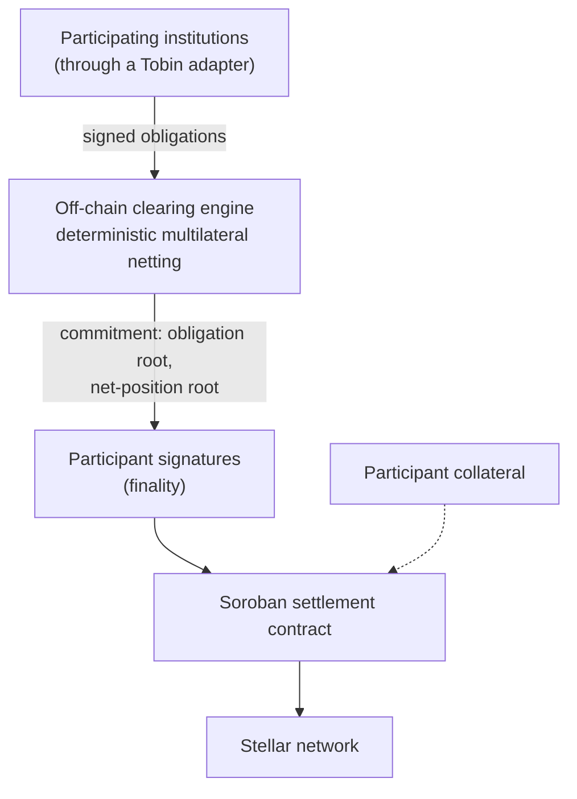

# Tobin Clearing Protocol

An open, non-custodial clearing protocol for financial institutions on Stellar.

> [!IMPORTANT]
> **Status: initial specification and validation stage. The protocol has not been built.**
> This repository currently contains no protocol code, SDK, CLI or smart contracts. Nothing is deployed and no packages are published. Nothing here describes a live network, completed settlement, institutional adoption or measured netting savings. The economic thesis described below is a hypothesis that has not yet been tested.

## The problem

Stellar settles payments quickly and cheaply, but fast settlement does not remove the need for **clearing**. When institutions have recurring obligations to several counterparties, those obligations can run in many directions, and settling each one on its own can move substantially more gross value than the final net positions require.

Standards such as SEP-31 give two anchors a common way to carry out a cross-border payment. They do not define an open, network-level way to aggregate obligations from many institutions, compute multilateral net positions, make the result final, manage settlement exposure, or handle a participant that fails to settle. Tobin is proposed to fill that coordination gap, above the existing standards and not in place of them.

## The proposed approach

Tobin is an open, Stellar-native clearing protocol that allows financial institutions to aggregate bilateral payment obligations, deterministically net them across a clearing network, and settle only the resulting net positions on Stellar.

1. Participating institutions submit payment obligations, and counterparties authenticate and accept them.
2. Accepted obligations are grouped into discrete **clearing sessions**.
3. A clearing engine deterministically calculates each participant's **net position**. It is a calculator, not an authority: independent implementations given the same accepted obligations, rules and algorithm version must produce identical results.
4. The result is committed cryptographically and becomes final only when the participants with non-zero net positions have signed it.
5. Only the net positions are settled, through a Soroban settlement contract on Stellar.

An illustrative example (arithmetic only, not data):

| Obligation | Amount |
| --- | ---: |
| A owes B | $100 |
| B owes C | $80 |
| C owes A | $70 |

Settled one by one, these move $250. Cleared first, the net positions are **A pays $30, B receives $20, C receives $10**, so only $30 is settled. Net positions always sum to zero; a session that breaks that rule must not finalize.

## Core concepts

- **Participants**: institutions authorised to take part in a clearing network.
- **Obligations**: payment liabilities between two participants, in integer base units (no floating point).
- **Acceptance**: counterparties accept an obligation before it can be cleared.
- **Clearing sessions**: discrete rounds with a submission window, a cutoff, a clearing step, finality and settlement.
- **Net positions**: each participant's credits minus debits; positive receives, negative pays.
- **Participant-signed finality**: no clearing engine can finalize a session alone.
- **Commitments, not an on-chain obligation book**: detailed obligations stay off-chain; the chain holds cryptographic commitments (such as Merkle roots) and settlement state.
- **Collateral**: participant-owned collateral limits the exposure that can enter a session, so Tobin extends no unsecured credit. It is not lending.
- **Narrow first version**: one settlement asset, with no multicurrency clearing.

## Intended architecture

This is the planned shape, not something that exists today, and it is subject to the specification.

## What Tobin is not

Tobin is not an anchor, a custodian, a payment processor, a DEX or liquidity pool, an FX provider, a lender or insurer, or a bank. It does not replace SEP-31, SEP-24 or SEP-38. It has no protocol token. It does not decide customer KYC or regulatory eligibility, and it does not guarantee participants' obligations. Each institution remains responsible for its own legal and regulatory requirements.

## Development status

| | |
| --- | --- |
| **Exists today** | This repository (licence and this README) and a separate public repository for the project's landing page. |
| **Not built** | Smart contracts, clearing engine, SDK, CLI, institutional adapter, testnet deployment, conformance suite. |
| **Not yet validated** | Whether real Stellar institutional payment flows are interconnected enough for multilateral clearing to reduce gross settlement. The first planned validation step uses historical Stellar ledger data and ends in an explicit go, modify or stop decision. That analysis has not been done. |
| **Not yet published here** | The product requirements and the draft protocol specification. They are still under review. |

The project is designed so that it can stop: if the data does not show meaningful value from multilateral clearing, the plan is to narrow or end the production design rather than assume a favourable result.

## Planned milestones

Planned, none complete, no dates set.

| Milestone | Focus |
| --- | --- |
| M0 | Protocol specification |
| M1 | Ledger and economic validation, with a go / modify / stop decision |
| M2 | Soroban MVP on Stellar testnet |
| M3 | SDK and reference implementation |
| M4 | Public testnet |
| M5 | Conformance suite and independent security review |
| M6 | Institutional pilot |
| M7 | Mainnet, only after the technical, network and operational criteria are met |
| M8 | Network growth |

Planned package names are `@tobin-protocol/types`, `@tobin-protocol/crypto`, `@tobin-protocol/sdk` and `@tobin-protocol/cli` (command `tobin`). None exists or is published yet.

## Licence

The code in this repository is licensed under the [Apache License 2.0](LICENSE). Licences for the protocol specification, other documentation, and the Tobin name, logo and brand assets have not been decided and are not covered by this statement.

Contribution guidelines and a security policy have not been added yet.

## Links

- Project site: <https://tobinprotocol.xyz>
- Landing page source: <https://github.com/tobin-protocol/tobin-landing>
