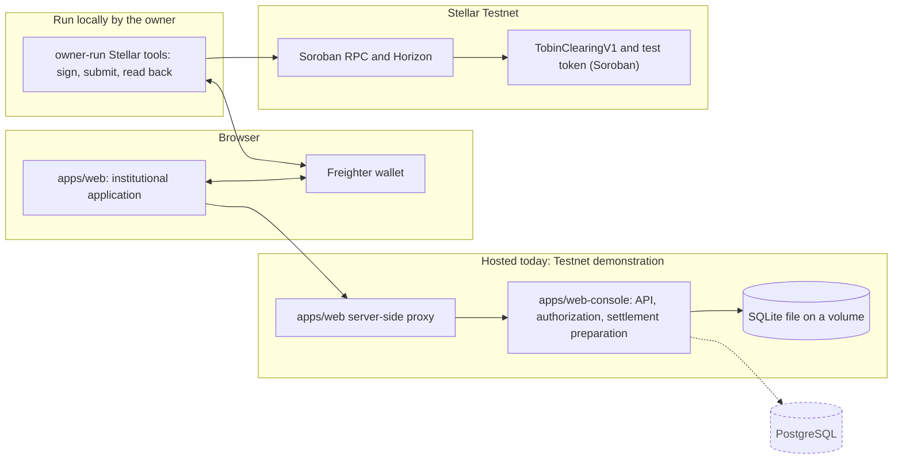

<div align="center">

<picture>
  
</picture>

<br><br>


<br>

# Tobin

**Institutional clearing and settlement infrastructure on Stellar.**

[Website](https://tobinprotocol.xyz) ·
[Documentation](https://docs.tobinprotocol.xyz) ·
[GitHub](https://github.com/tobin-protocol/tobin) ·
[Submission documents](docs/scf/README.md) ·
[Security](SECURITY.md)

</div>

Tobin is open-source software that helps financial institutions coordinate the payment obligations they owe each other on Stellar. Institutions record obligations; a deterministic engine computes each participant's net position; a reviewer approves the exact result; settlement instructions are prepared for the net amounts only; and a Soroban contract validates and executes a plan that every participant has approved and every debtor has authorized.

> [!IMPORTANT]
> **Status: Stellar Testnet only, specification and validation stage.** The core clearing and settlement preparation workflow is implemented and tested. One owner-run Testnet settlement (eight transactions, one base unit of a test token) has been executed and read back. The evidence is from the implementing author only; **no independent security review has taken place**; the hosted web application stops at settlement preparation and does not sign or submit transactions; the hosted deployment is a Testnet demonstration, not an institutional pilot. Mainnet and real-value use are not authorized. See [Status](#status).

## The problem

When institutions have recurring obligations to several counterparties, the obligations cross and largely offset, yet each is usually tracked and settled on its own:

- **Fragmented obligations.** Amounts owed between the same institutions live in separate systems and are settled one by one.
- **Manual reconciliation.** Teams reconcile spreadsheets and statements by hand to agree who owes whom.
- **Coordination and settlement preparation.** Settling gross amounts moves far more value than the net exposure requires, and every counterparty must agree on what to settle.
- **Approval and authorization.** The person who records or changes an obligation can often also release the payment.
- **Settlement visibility.** A submitted transaction is not a confirmed one, and a confirmed one still has to be matched against what was approved.

A worked example (arithmetic only): A owes B 100, B owes C 80, C owes A 70. Settled one by one that moves 250. Cleared first, A pays 30, B receives 20 and C receives 10, so 30 is settled. Net positions always sum to zero. Whether real Stellar payment flows are interconnected enough for netting to help has **not been measured**; that is an open hypothesis, not a result.

## What Tobin does

| Stage | What happens | State today |
|---|---|---|
| 1. Participants | an institution (organization), its members, roles and a separate reviewer grant | implemented |
| 2. Clearing session | participants and one asset for a clearing run | implemented |
| 3. Obligations | debtor, creditor and an integer amount, recorded by an administrator | implemented |
| 4. Netting | deterministic net positions saved as an immutable snapshot; any change makes it stale | implemented |
| 5. Review and authorization | a reviewer approves or rejects that exact calculation; a decision is bound to it and invalidated if inputs change | implemented (a database decision, not a signature) |
| 6. Settlement preparation | an immutable batch of generated instructions, reviewed; participants need verified Stellar accounts | implemented; the hosted application stops here |
| 7. Stellar settlement | the clearing contract validates the plan and executes the debtor-authorized transfers | contracts deployed on Testnet; executed by owner-run tools, one scenario |
| 8. Verification and reconciliation | the transaction is read back from the network by hash and compared with the approved plan | in the owner-run tool, on request; results are not written back to application records |

This is **not** one automated end-to-end production workflow. Stages 1 to 6 run in the application; stages 7 and 8 run in separate, owner-run Testnet tools. A prepared batch is not a transaction, a signed transaction is not a submitted one, a submitted one is not a confirmed one, and a confirmed one counts as settled only after it is read back and reconciled against the approved batch.

## How it works



Dashed means planned and not built. The pieces:

- **Application layer (`apps/web`).** The canonical user-facing application. It has no database and reaches the backend only through a server-side proxy.
- **Backend and API (`apps/web-console`).** Authentication, organizations, sessions, obligations, calculations, institutional approvals, settlement preparation and a read-only public Discover API, over SQLite with immutable history tables enforced by triggers. It also hosts the owner-run Stellar tools and a local sandbox.
- **Clearing and netting (`packages/mvp1-sdk`).** The netting engine, digests and prepared contract calls. The engine generates a default plan; it is a calculator, not an authority.
- **Soroban contracts (`contracts/`).** The clearing contract (session lifecycle Open, Committed, Approved, Settled) and a capped test token.
- **Wallet signing.** Freighter signs in the browser; no Tobin server holds a Stellar private key.
- **Audit records.** Decisions, batches, execution records and authentication events are immutable or append-only.

**What the contract does and does not enforce.** It accepts any plan that satisfies its own rules: every party admitted, every amount positive, each participant's payments and receipts equal to its net, instructions in strict order, checked arithmetic. It does **not** require the plan to equal the engine's output or to be minimal, and it has no time limit, abort, default or administrator override. The 10-ledger authorization-entry lifetime is a policy value in the owner-run tool, not something the contract enforces. Details: [technical specification](docs/scf/technical/technical-specification.md).

## Why Stellar

Stellar is the settlement layer of the design, not a place where all institutional records live. What is implemented against it: Soroban contracts that validate and execute a settlement plan (the clearing contract writes its Settled state and result record in the same invocation as the token transfers, and a failing transfer reverts it); Soroban authorization, so each debtor authorizes its own transfer; wallet signing through Freighter, including multisig signer sets that are checked against the network; Testnet execution of one session; and read-back of the contract state and the transaction by hash. Obligations, calculations, reviews and approvals are **off-chain application state**; only the settlement outcome is on-chain. Tobin sits above Stellar's existing standards and defines no protocol token. See [Stellar integration](docs/scf/technical/stellar-integration.md).

## Status

Terms follow the [maturity guide](docs/COMMUNICATION-AND-MATURITY-TERMINOLOGY.md).

| Level | Today |
|---|---|
| Implemented | MVP-1.2 to MVP-1.5 and wallet-first authentication, each complete with stated limitations |
| Tested | automated suites, contract tests and browser journeys; same-author |
| Testnet-verified | the settlement path, narrowly: one owner-run execution with multisig co-signing, read back from the network |
| Independently reviewed | **no** |
| Pilot-ready | **no** |
| Production-approved | **no** |

| Capability | Description | Status |
|---|---|---|
| Institutional onboarding | wallet-first sign-in, invitations, create or join an organization | implemented; tested with a protocol-compatible stand-in and by the owner with a real Freighter on Testnet, with no cross-browser or screen-reader pass; account recovery not built; registration is open on the hosted demonstration |
| Organizations and membership | admin or member, active or suspended, reviewer grant | implemented; application-level only, never a Stellar authority |
| Clearing sessions and obligations | integer base units, canonical asset identity, provenance labels | implemented |
| Netting | deterministic, immutable snapshots, stale detection | implemented; the economic benefit is unproven |
| Institutional authorization | decisions bound to the calculation, separation of duties, automatic invalidation | implemented; a reviewer who prepared a batch cannot approve it, but a different reviewer from the calculation's approver is **not** required yet (planned) |
| Settlement preparation | immutable batches, batch review, closure | implemented; moves no funds |
| Stellar Testnet integration | deployed contracts, Freighter signing, multisig, owner-run execution | implemented as local tools; one run, one base unit; the plan used in that run was fixed in the tool, not derived from a database batch |
| Transaction verification | read-back by hash and comparison with the plan | in the owner-run tool only; not stored |
| Public Discover API | read-only list of organizations that chose public visibility | implemented; settlements and statistics are empty or null because no read-back outcome is recorded |
| Operations and reconciliation | reconciliation and exception handling in the application | planned (MVP-1.6) |
| Security and infrastructure | hosted guards, CSP, CSRF checks at the proxy, structured logs, tenant-isolation and store-conformance suites | implemented; PostgreSQL, backups, independent review and monitoring planned (MVP-1.7) |

### Current scope and remaining engineering work

These are the validation and engineering gaps between the implemented Testnet integration and a pilot. Each is true today and tracked.

1. Evidence is same-author, from one environment and one browser engine; no independent penetration test, fuzzing or security review has been done.
2. Wallet and multisig verification is incomplete (no second-wallet or hardware-wallet validation); no cross-browser or screen-reader pass.
3. The Testnet settlement was one run of one base unit. Maximum-size sessions, fee breakdown and measured resources have not been validated, and the plan used was fixed in the owner-run tool rather than derived from a database batch.
4. Confirmed on-chain outcomes are not written back to application records; no route can mark a session `chain-confirmed`.
5. Account recovery is deferred: a wallet-only user must keep access to at least one verified wallet.
6. Migration 8 was tested on fresh databases and a populated version-7 test database, not on a real operator database.
7. The hosted demonstration runs one SQLite instance with open registration and no backup or restore test; PostgreSQL, invitation-controlled registration, email verification and the different-reviewer rule are planned.

Evidence: [implementation status](docs/scf/implementation/implementation-status.md), [evidence register](docs/scf/implementation/evidence-register.md), the recorded Testnet files in [`docs/product/architecture/mvp-1.5/evidence/`](docs/product/architecture/mvp-1.5/evidence/) and the contract manifest [`contracts/deployments/testnet.json`](contracts/deployments/testnet.json).

## Repository

```text
apps/web/          canonical user-facing application (Next.js 16, React 19)
apps/web-console/  backend and API host: institutional API, public Discover API, SQLite persistence,
                   owner-run Stellar tools, local sandbox, an older institutional UI that overlaps apps/web
apps/docs/         documentation site (docs.tobinprotocol.xyz)
apps/landing/      project website (tobinprotocol.xyz)
packages/          mvp1-sdk (netting engine, digests, SDK), ui-tokens (shared design tokens)
contracts/         Rust and Soroban: clearing, token, deployments (Testnet manifest)
scripts/           CI, release-gate, multisig and signer tooling
ci/  release/      dependency baseline and Wasm hash records; release controls and gates
accounts/          public metadata of Testnet accounts (no secrets)
docs/              documentation: SCF package, milestone records, governance, reference
```

`apps/web` is the canonical application. `apps/web-console` stays as the backend and the only host of the owner-run tools; its older UI overlaps `apps/web` and has a retirement plan in [ui-and-console](docs/scf/technical/ui-and-console.md). Nothing is removed yet.

## Documentation map

The public site is [docs.tobinprotocol.xyz](https://docs.tobinprotocol.xyz). The submission package below lives in this repository and is **not yet published on the docs site**.

| Document | Purpose |
|---|---|
| [SCF documentation index](docs/scf/README.md) | main reviewer entry point |
| [Technical overview](TECHNICAL.md) | one-page summary |
| [Product requirements](docs/scf/product/prd.md) | scope and requirements |
| [Roadmap](docs/scf/product/roadmap.md) | milestones and the SCF tranche mapping |
| [Architecture](docs/scf/technical/architecture.md) | components, trust boundaries, current and planned topology |
| [Technical specification](docs/scf/technical/technical-specification.md) | behaviour with code references |
| [Stellar integration](docs/scf/technical/stellar-integration.md) | Soroban, signing, submission, read-back |
| [Security overview](docs/scf/security/security-overview.md), [threat model](docs/scf/security/threat-model.md) | controls, limitations, review status |
| [API reference](docs/scf/technical/api-reference.md) | institutional HTTP API |
| [Implementation status](docs/scf/implementation/implementation-status.md) | what exists today |
| [Testing and validation](docs/scf/implementation/testing-and-validation.md) | verification evidence and gates |
| [Deployment and operations](docs/scf/implementation/deployment-and-operations.md) | local and hosted deployment |
| [Evidence register](docs/scf/implementation/evidence-register.md) | claims mapped to evidence |
| [AI disclosure](docs/scf/product/ai-disclosure.md) | AI-assisted development |

Older milestone records and decisions are under `docs/product/architecture/`; [`AGENTS.md`](AGENTS.md) is the guide for contributors and coding agents.

## Getting started

Prerequisites: Node.js 24 or later (CI uses 24.14.0; Node 24 runs `.ts` directly and provides `node:sqlite`), the npm bundled with it, and Chrome or Edge for browser checks. Contract work needs Rust 1.96.0 with `rustfmt`, `clippy` and the `wasm32v1-none` target, and the Stellar CLI 28.0.0 only to build Wasm. No database server is needed. Freighter is needed only to try wallet flows by hand, on **Testnet**.

**Local development**

```bash
git clone https://github.com/tobin-protocol/tobin.git && cd tobin
npm ci
npm run dev --workspace tobin-web-console     # backend and API, http://127.0.0.1:8787
npm run dev --workspace tobin-web             # user-facing app, http://127.0.0.1:3000 (needs the console running)
```

Locally the console accepts only loopback Host names by design. Settlement preparation needs a configured asset; see [`apps/web/README.md`](apps/web/README.md) for the full local setup, environment variables and asset command. No `.env` file is required and none is committed.

### Environment and database

No `.env` file is required and none is committed (`.env*` files are git-ignored). Never commit credentials. Optional variables:

| Variable | Purpose |
|---|---|
| `TOBIN_DB_PATH` | SQLite file. **Required when `NODE_ENV=production`**; otherwise defaults to `.data/tobin-dev.sqlite` in the app directory (git-ignored) |
| `PORT` | must match the port the server is started with (default 8787) |
| `TOBIN_BRIDGE_EXE` | path to the Rust bridge executable (sandbox console and bridge-backed tests) |
| `TOBIN_STELLAR_CLEARING_CONTRACT` | public id of the deployed clearing contract used by the execution-plan adapter |
| `TOBIN_SECOND_ACCOUNT`, `TOBIN_ADMIN_ACCOUNT_RECORD`, `TOBIN_DEPLOYMENT_RECORD`, `TOBIN_BATCH_ID` | inputs of the owner-run tools; see `apps/web-console/lib/stellar/` |
| `TOBIN_DEMO_PASSWORD` | password for `db:seed-demo` demonstration users (refused in production) |

Migrations apply when the server starts. By hand, from the repository root: `npm run db:migrate --workspace tobin-web-console` (idempotent), `npm run db:status --workspace tobin-web-console` (exits 2 while migrations are pending). The hosted-mode variables (Host allow-list, proxy secret, public origin) are in [`HOSTING-CONFIGURATION.md`](docs/backend-implementation/HOSTING-CONFIGURATION.md).

**Tests**

```bash
npm run typecheck                                 # all workspaces
npm test --workspace tobin-web-console            # backend, security, persistence, isolation tests
npm test --workspace tobin-mvp1-sdk               # engine and SDK
npm test --workspace tobin-web                    # web application unit tests
npm run lint --workspace tobin-web
node --test scripts/release/scan.test.mjs         # release-scan rule tests
```

**Contracts**

```bash
cd contracts
cargo test --locked --workspace                   # native contract tests
cargo build --locked -p tobin-clearing-v1 --example bridge   # development bridge used by some TypeScript tests
stellar contract build                            # Wasm
```

Set `TOBIN_BRIDGE_EXE` to the bridge executable to run the bridge-backed tests; without it they are skipped and reported. More commands (database, browser journeys, builds) are in [`AGENTS.md`](AGENTS.md) section 9 and [`apps/web/README.md`](apps/web/README.md). There is no one-command deployment; hosted deployment is described in [deployment and operations](docs/scf/implementation/deployment-and-operations.md).

## Testing and evidence

- **Automated suites:** unit and integration tests for the engine, the registry, authentication and authorization; a registry store-conformance suite and a tenant-isolation suite over every organization-scoped route; Rust contract tests; real-browser journeys; web unit tests.
- **CI:** pull requests run formatting, Rust tests, type checks, production builds, the backend and SDK suites, the web application's lint, tests, build and hosted-mode checks, dependency-baseline and link checks, the release-scan tests and the W0 browser journey. The contract-Wasm job and one console browser journey run from a separate workflow on `main`, weekly and on demand, not on pull requests; the other browser journeys are run locally and are not part of CI. Workflow definitions: [`.github/workflows/`](.github/workflows/).
- **Testnet evidence:** one owner-run settlement and the validation records in [`docs/product/architecture/mvp-1.5/evidence/`](docs/product/architecture/mvp-1.5/evidence/); same-author, single run.
- **Skips and gaps:** bridge-backed tests are skipped without the Rust bridge (CI allows one explicit skip); maximum-size sessions, fee breakdown, resource measurements, fuzzing and independent review have not been done. Release gates for a versioned or production release remain blocked in [`release/RELEASE-GATES.json`](release/RELEASE-GATES.json).

Test counts are recorded with their date and commit in [testing and validation](docs/scf/implementation/testing-and-validation.md), not here.

## Security

Report suspected vulnerabilities privately through GitHub private vulnerability reporting (the Security tab of this repository); see [`SECURITY.md`](SECURITY.md) for the process and the secondary contact. Do not open a public issue for a vulnerability and do not include real credentials or keys in a report. The security work so far is the author's own; **no independent audit or penetration test has been performed**. Controls and limitations: [security overview](docs/scf/security/security-overview.md).

## Project status and roadmap

| Milestone | Description | Status |
|---|---|---|
| MVP-1.2 | Clearing Operations Foundation | Completed |
| MVP-1.3 | Institutional Clearing Authorization | Completed |
| MVP-1.4 | Settlement Preparation Engine | Completed |
| MVP-1.5 | Stellar Settlement Integration | Completed with limitations |
| MVP-1.6 | Institutional Operations and Reconciliation | Planned |
| MVP-1.7 | Security, Governance and Infrastructure Hardening | Planned; hosting hardening and test-foundation work has begun |
| MVP-1.8 | Controlled Institutional Pilot | Planned |

Wallet-first authentication was delivered after MVP-1.5 as separate work (complete with limitations). Completing a milestone does not mean production readiness. Scope, deliverables and the SCF tranche mapping are in the [roadmap](docs/scf/product/roadmap.md).

## Contributing

[`CONTRIBUTING.md`](CONTRIBUTING.md) · [`CODE_OF_CONDUCT.md`](CODE_OF_CONDUCT.md) · [`SECURITY.md`](SECURITY.md) · [Issues](https://github.com/tobin-protocol/tobin/issues). Pull requests use the [template](.github/pull_request_template.md).

## Licence

The code, documentation and specification the project owns are licensed under the [Apache License 2.0](LICENSE). Third-party dependencies keep their own licences. The Tobin name, logo and brand assets are not licensed under Apache-2.0; see [`apps/landing/NOTICE`](apps/landing/NOTICE).
