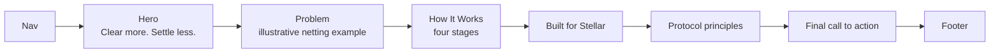
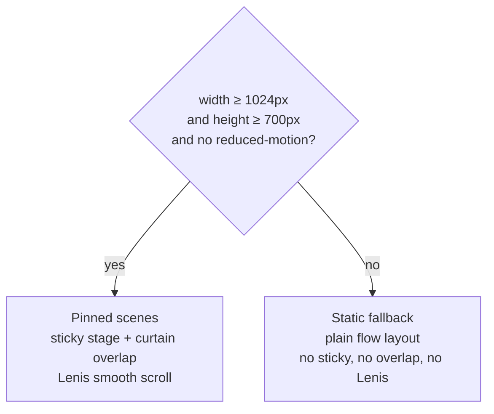

# Tobin landing page

The website for **Tobin Clearing Protocol**: an open clearing protocol that helps financial institutions net payment obligations and settle the resulting balances on Stellar.

This repository contains **only the landing page**. The protocol itself (specification, contracts, SDK, CLI) is not in this repository.

Built with Next.js (App Router), React, TypeScript, Tailwind CSS v4, [`motion`](https://motion.dev) and [`lenis`](https://lenis.darkroom.engineering) for smooth scroll.

**Contents:** [Getting started](#getting-started) · [What's on the page](#whats-on-the-page) · [Project structure](#project-structure) · [Design tokens](#design-tokens) · [Motion and layout](#motion-and-layout-architecture) · [Before you deploy](#before-you-deploy) · [Contributing](#contributing)

---

## Getting started

You need Node.js 20 or newer (developed on Node 24).

```bash
git clone https://github.com/tobin-protocol/tobin-landing.git
cd tobin-landing
npm install
npm run dev      # http://localhost:3000
```

| Command | What it does |
| --- | --- |
| `npm run dev` | Local development server |
| `npm run lint` | ESLint |
| `npm run build` | Type-checks and prerenders the page statically |
| `npm run start` | Serves the production build |

> [!IMPORTANT]
> This repo uses a recent Next.js with breaking changes from older versions. Before changing framework-level code, read the guides in `node_modules/next/dist/docs/` (see [AGENTS.md](AGENTS.md)).

## What's on the page

A single static page, in this order:



The numbers in the example (gross vs. net settlement) are illustrative and labelled as such on the page. They are **computed from** [src/lib/clearing.ts](src/lib/clearing.ts), not hard-coded, so the arithmetic and the visuals cannot drift apart.

## Project structure

```text
src/
  app/            App Router entry: layout, page, global styles, icons, social images
  components/     Page sections (Hero, Problem, HowItWorks/HowScene, Stellar, Principles,
                  FinalCta, Footer), Nav, Logo, ClearingVisual, motion helpers
  lib/            clearing.ts (netting arithmetic), site.ts (links, nav), stage.ts, how.ts, lenis.ts
public/           Static assets, brand copies, web manifest
brand-pack/       Source logo and colour assets
scripts/          build-logo-art.mjs (regenerates src/components/logo-art.ts from brand-pack/svg)
```

## Design tokens

All in [src/app/globals.css](src/app/globals.css). The palette was sampled from reference designs. Surfaces are `paper` (default), `navy` (dark sections), `accent` (violet `#6935f1`) and `signal` (gold `#d5a857`, used with ink text only). `ink` is text and the nav pills. `sky` is the third institution colour. `accent-ink` is violet for text on light, and `accent-bright` is lavender for text and graphics on dark surfaces.

The page has no glows, gradients or shadows, and cards are square. Surfaces announce themselves with `data-surface="dark|accent|signal"`, which drives body-copy colour, eyebrow colour and focus-ring colour.

## Motion and layout architecture

Wide, tall screens get pinned scroll scenes; everything else gets a plain flow layout.



- **Pinned scenes** are a tall outer wrapper with a `sticky` inner. The next block rides up over it with a negative margin (a "curtain"). The same media query lives in two places and must stay in sync: `PIN_QUERY` in [src/lib/stage.ts](src/lib/stage.ts) and the `@media` blocks marked "Keep in sync" in `globals.css`.
- **Static fallback.** `HowItWorks` renders both a static list and the pinned scene; CSS (`.pin-hide` / `.pin-only`) shows one so the other leaves the accessibility tree.
- **Scenes:** hero (`HeroStage`), How It Works (`HowScene`), Stellar curtain with wave (`Curtain`).
- **Nav tone.** The fixed nav samples which `[data-nav-tone]` element is under it and switches between light, dark and signal, so text and CTA are never ink-on-ink.
- **Pace.** Motion values follow the design spec except where this brand is calmer: Lenis 1.6s / wheel ×0.8 (spec 2.5s / ×0.6), hero pull-back scale .9 / rotate 1deg / opacity .2 (spec .8 / 2deg / .1), scene blur 3px (spec 4px).

## Before you deploy

- **Links:** set `github` and `docs` in [src/lib/site.ts](src/lib/site.ts). Both are `null` because no documentation URL exists yet. Until set, the nav and footer omit those links and the final call to action shows clearly marked "Link pending" placeholders.
- **Site URL:** set `NEXT_PUBLIC_SITE_URL` (for example `https://tobin.example`) so Open Graph and Twitter images resolve to absolute URLs.
- **Display font licence:** the headline face is Aalto Display, supplied with a **"Personal Use Only"** licence. A public site is not personal use, so get a web/commercial licence (or swap the face) before deploying. The font file is **not in this repository** (`public/fonts` is gitignored, so the licensed file is never redistributed). Put your licensed copy at `public/fonts/aalto-display-personal-use.otf`, or change the `@font-face` to point at yours. Without it, the `--font-display` stack falls back to Arial Narrow / Roboto Condensed and the layout still holds. To swap the face, change the `@font-face` and `--font-display` in [src/app/globals.css](src/app/globals.css); nothing else references the font by name.

## Contributing

Fixes and improvements to the landing page are welcome: accessibility, performance, responsiveness, motion, and copy clarity.

1. Open an issue first for anything beyond a small fix.
2. Fork, then branch from `master` (for example `fix/nav-focus-ring`).
3. Keep pull requests small and focused, with the reason in the description. Include before/after screenshots for visual changes.
4. Before pushing, run:

   ```bash
   npm run lint
   npm run build
   ```

5. Write imperative commit messages ("Fix nav focus ring").

### Ground rules

**Honest copy.** Do not add invented partners, logos, testimonials, statistics, institutions, customers or URLs. Example figures stay labelled as illustrative. Do not imply audits, mainnet readiness, funding or institutional commitments that do not exist.

**Design system.**
- Use the theme tokens in `globals.css`; do not hard-code hex values in components.
- No glows, gradients or drop shadows. Cards and panels are square; institution tiles use a subtle radius; pills are for buttons and nav.
- No italics and no grid lines.
- New colours need a source and a contrast check.

**Accessibility and robustness.**
- Text contrast meets WCAG AA; interactive targets are at least 44px.
- Respect `prefers-reduced-motion`, and keep the static fallback working.
- Check the page at phone width and do not introduce horizontal scrolling.

**Licensed assets.** Do not commit fonts, images or logos you do not have the right to redistribute. The Aalto Display file is deliberately kept out of the repository.

Please be respectful and assume good faith.

## Licence

No licence file has been added to this repository yet, so until one is, all rights are reserved by default.

## Links

- GitHub organisation: <https://github.com/tobin-protocol>
- Documentation: pending (no URL exists yet)
