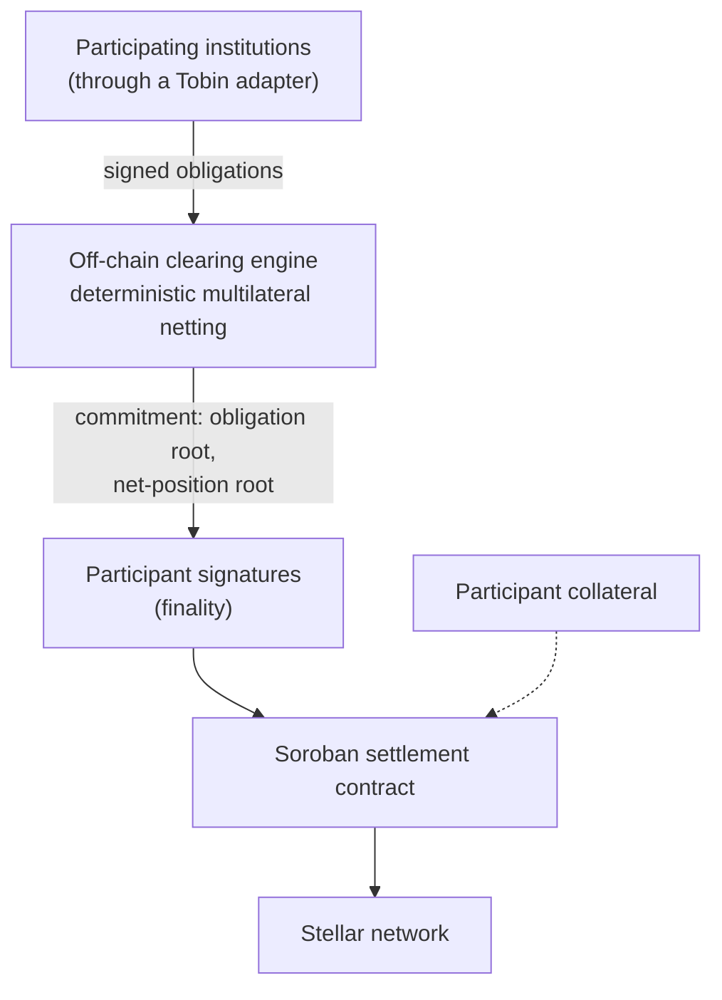

# Tobin Clearing Protocol

An open, non-custodial clearing protocol for financial institutions on Stellar.

> [!IMPORTANT]
> **Status: specification and validation stage. MVP-1, the experimental validation milestone, is complete; the broader protocol and production-ready capabilities are future work.**
> MVP-1 put Tobin's core clearing design into working Soroban contracts and supporting software and tested it, within a defined and limited scope, on the Stellar public testnet with disposable accounts and test assets (see [Experimental MVP-1](#experimental-mvp-1)). The full protocol, its production capabilities and any real-value use do not exist: nothing is deployed to production, no packages are published, and MVP-1 is not production-ready or independently audited. MVP-1 does not represent a production deployment, institutional adoption or measured netting savings. The economic thesis described below is a hypothesis that has not yet been tested.

## The problem

Stellar settles payments quickly and cheaply, but fast settlement does not remove the need for **clearing**. When institutions have recurring obligations to several counterparties, those obligations can run in many directions, and settling each one on its own can move substantially more gross value than the final net positions require.

Standards such as SEP-31 give two anchors a common way to carry out a cross-border payment. They do not define an open, network-level way to aggregate obligations from many institutions, compute multilateral net positions, make the result final, manage settlement exposure, or handle a participant that fails to settle. Tobin is proposed to fill that coordination gap, above the existing standards and not in place of them.

## The proposed approach

Tobin is an open, Stellar-native clearing protocol that allows financial institutions to aggregate bilateral payment obligations, deterministically net them across a clearing network, and settle only the resulting net positions on Stellar.

1. Participating institutions submit payment obligations, and counterparties authenticate and accept them.
2. Accepted obligations are grouped into discrete **clearing sessions**.
3. A clearing engine deterministically calculates each participant's **net position**. It is a calculator, not an authority: independent implementations given the same accepted obligations, rules and algorithm version must produce identical results.
4. The result is committed cryptographically and becomes final only when the participants with non-zero net positions have signed it.
5. Only the net positions are settled, through a Soroban settlement contract on Stellar.

An illustrative example (arithmetic only, not data):

| Obligation | Amount |
| --- | ---: |
| A owes B | $100 |
| B owes C | $80 |
| C owes A | $70 |

Settled one by one, these move $250. Cleared first, the net positions are **A pays $30, B receives $20, C receives $10**, so only $30 is settled. Net positions always sum to zero; a session that breaks that rule must not finalize.

## Who it is for

The target users are institutions that already have, or expect to have, recurring payment obligations with several counterparties on Stellar:

- **Stellar anchors**: financial institutions already operating Stellar-based payment infrastructure.
- **Payment institutions** that maintain recurring payment relationships with multiple counterparties.
- **Cross-border payment providers** that process obligations across several geographic corridors.
- **Institutional Stellar applications** that generate recurring institutional payment obligations.

Multilateral clearing helps only where several institutions have recurring obligations between one another. Whether that is true of real Stellar payment flows has not been measured yet (see [Development status](#development-status)).

## Core concepts

*These are the concepts of the proposed broader protocol. The experimental MVP-1 implements only part of them and differs in places: for example, every admitted participant approves a settlement proposal in MVP-1, and it has no collateral, Merkle commitments, submission window or cutoff (see [Experimental MVP-1](#experimental-mvp-1)).*

- **Participants**: institutions authorised to take part in a clearing network.
- **Obligations**: payment liabilities between two participants, in integer base units (no floating point).
- **Acceptance**: counterparties accept an obligation before it can be cleared.
- **Clearing sessions**: discrete rounds with a submission window, a cutoff, a clearing step, finality and settlement.
- **Net positions**: each participant's credits minus debits; positive receives, negative pays.
- **Participant-signed finality**: no clearing engine can finalize a session alone.
- **Commitments, not an on-chain obligation book**: detailed obligations stay off-chain; the chain holds cryptographic commitments (such as Merkle roots) and settlement state.
- **Collateral**: participant-owned collateral limits the exposure that can enter a session, so Tobin extends no unsecured credit. It is not lending.
- **Narrow first version**: one settlement asset, with no multicurrency clearing.

## Intended architecture

This is the planned shape, not something that exists today, and it is subject to the specification.

## What Tobin is not

Tobin is not an anchor, a custodian, a payment processor, a DEX or liquidity pool, an FX provider, a lender or insurer, or a bank. It does not replace SEP-31, SEP-24 or SEP-38. It has no protocol token. It does not decide customer KYC or regulatory eligibility, and it does not guarantee participants' obligations. Each institution remains responsible for its own legal and regulatory requirements.

> [!NOTE]
> "Non-custodial" is used in a technical sense only: the design is that no Tobin operator or key can move funds, and that participant collateral is held by the settlement contract under the protocol's rules (not yet published). It is not a legal characterisation. Whether contract-held collateral amounts to custody is a legal question, and legal advice has not been obtained. The technical claim also depends on real-value controls (threshold authority, a governance timelock and review) that are decided but not built, so it describes the intended design and not a deployed system.

## Experimental MVP-1

MVP-1 was the milestone for putting Tobin's core clearing design into practice and testing whether the ideas work beyond theory. It is distinct from the broader protocol described above and from its draft specification, and it makes no claim of conformance to that specification.

- **What was built:** the core clearing lifecycle (sessions, obligations, net settlement proposals, approvals and atomic settlement) as Soroban contracts written in Rust, a clearing contract and a capped-supply test token, in [core](core/README.md); and, in [ts](ts/README.md), a TypeScript netting engine and SDK, a local sandbox Console, and a local tool for signing authorization entries with disposable test keys.
- **How it was tested:** (1) automated tests in the Soroban test host and a local sandbox Console journey, which can be re-run from this repository with the setup described in [core/README.md](core/README.md) and [ts/README.md](ts/README.md); (2) a stage on a disposable local network, documented in [docs/reports/MVP-1-MILESTONE-8-STAGE-B-REPORT.md](docs/reports/MVP-1-MILESTONE-8-STAGE-B-REPORT.md), whose driver scripts are not part of this repository; and (3) a vertical slice on the Stellar public testnet with disposable accounts and test assets, whose report and raw evidence are not published, so it cannot be independently checked from this repository.
- **Outcome:** within MVP-1's defined scope (small sessions and one test token), the lifecycle passed the documented MVP-1 test scenarios. Obligations were recorded, net positions were calculated, participants approved a settlement proposal, and the net amounts of the test token moved atomically in a single settlement. The local-network stage covered wrong-signer, tampered-argument, wrong-network, expired, missing-authorization and replayed-authorization cases, and verified that a failed settlement was rolled back; the public-testnet run demonstrated the settlement flow, including successful settlement and a failed settlement that left balances unchanged. This completed the intended experimental validation milestone, roadmap milestone M2 for the experimental scope. It tested the clearing mechanics; it did not prove the economic thesis or any real-world use case.
- **Limits:** MVP-1 is experimental and not production-ready; it has not been independently audited, and its evidence comes from the implementing author only; it is not the full protocol (it has no deadlines, abort, default or recovery handling, collateral or Merkle commitments); it is not intended for real-value settlement; and it does not show wallet or multisig compatibility, maximum-size capacity, maximum resource consumption or general fee behaviour. The Console is a local sandbox with simulated authorizations. The public-testnet results rest on an unpublished report and cannot be independently verified from this repository.

Developer notes are in [core/README.md](core/README.md) and [ts/README.md](ts/README.md); see [CONTRIBUTING.md](CONTRIBUTING.md) before changing it.

## Development status

| | |
| --- | --- |
| **Exists today** | This repository (licence, this README, [contribution guidelines](CONTRIBUTING.md) and the experimental [MVP-1](#experimental-mvp-1) source) and a separate public repository for the project's landing page. |
| **Validated by MVP-1** | The core clearing lifecycle, within MVP-1's scope of small sessions and one test token: automated tests in the Soroban test host and a Stellar public-testnet run with disposable accounts and test assets (its report and raw evidence are unpublished). This completes roadmap milestone M2 for the experimental scope only. Experimental; evidence from the implementing author only; no independent audit. |
| **Not built** | The rest of the broader protocol: deadlines, abort, default and recovery handling, collateral, Merkle commitments, an institutional adapter, SDK and CLI packages for the broader protocol (none has been published; only the experimental MVP-1 SDK source exists), wallet or multisig integration, production deployment and a conformance suite. |
| **Not yet validated** | Whether real Stellar institutional payment flows are interconnected enough for multilateral clearing to reduce gross settlement. The first planned validation step uses historical Stellar ledger data and ends in an explicit go, modify or stop decision. That analysis has not been done; MVP-1 tested the clearing mechanics, not this question. |
| **Not yet published here** | The product requirements, the draft protocol specification and its review material. They are still under review and are not published in this repository. |
| **Review status** | The protocol specification (milestone M0) exists as a draft. It has not been approved, and it has been written and tested only by its author: no independent review, audit or fuzzing has been done. |

The project is designed so that it can stop: if the data does not show meaningful value from multilateral clearing, the plan is to narrow or end the production design rather than assume a favourable result.

## Planned milestones

Planned, no dates set. M2 is complete for the experimental scope described in [Experimental MVP-1](#experimental-mvp-1); no other milestone is complete, and the rest of the protocol and its production capabilities remain future work.

| Milestone | Focus |
| --- | --- |
| M0 | Protocol specification |
| M1 | Ledger and economic validation, with a go / modify / stop decision (**not complete**; MVP-1 did not establish this) |
| M2 | Experimental Soroban MVP on Stellar testnet (**complete for the experimental scope**; see [Experimental MVP-1](#experimental-mvp-1)) |
| M3 | SDK and reference implementation of the broader protocol (not the experimental MVP-1 SDK) |
| M4 | Public testnet for the broader protocol, beyond MVP-1's limited experimental testnet validation |
| M5 | Conformance suite and independent security review |
| M6 | Institutional pilot |
| M7 | Mainnet, only after the technical, network and operational criteria are met |
| M8 | Network growth |

Planned broader-protocol package names are `@tobin-protocol/types`, `@tobin-protocol/crypto`, `@tobin-protocol/sdk` and `@tobin-protocol/cli` (command `tobin`). These packages have not been published; the experimental MVP-1 SDK source is separate.

## Documentation

| Where | What |
| --- | --- |
| This README | The single source for the concepts, scope, status and milestones above |
| [CONTRIBUTING.md](CONTRIBUTING.md) | How to give feedback or propose a change |
| [core/README.md](core/README.md) | MVP-1 Soroban contracts: layout, implemented behaviour and test commands |
| [ts/README.md](ts/README.md) | MVP-1 TypeScript engine, SDK and local Console: layout and commands |
| [LICENSE](LICENSE) | Apache License 2.0, for the code, documentation and specification the project owns or controls (see [Licence](#licence)) |
| <https://tobinprotocol.xyz> | The project site |
| <https://github.com/tobin-protocol/tobin-landing> | Source of the project site |

The product requirements, the draft protocol specification and the supporting review material are not published here yet (see [Development status](#development-status)). If they are published here, a documentation index should say which document governs which topic, and which documents are decisions, proposals or history.

## Licence

The code, documentation and specification in this repository are licensed under the [Apache License 2.0](LICENSE), to the extent the project owner owns or controls them (copyright notice: Copyright 2026 tobin-protocol; this is a designation, not a statement that a registered legal entity exists). Third-party dependencies are not covered and remain under their own licences. The Tobin name, logo and brand assets are not covered by this licence, and no excluded material (such as the unpublished test-network evidence) is licensed or published here.

Contribution guidelines are in [CONTRIBUTING.md](CONTRIBUTING.md). Security reports go through GitHub private vulnerability reporting; see [SECURITY.md](SECURITY.md).

## Links

- Project site: <https://tobinprotocol.xyz>
- Landing page source: <https://github.com/tobin-protocol/tobin-landing>
