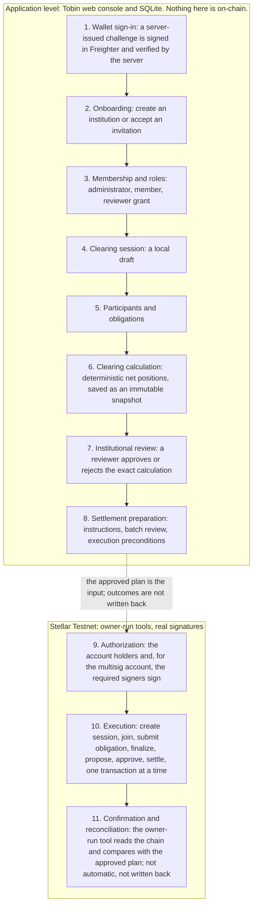
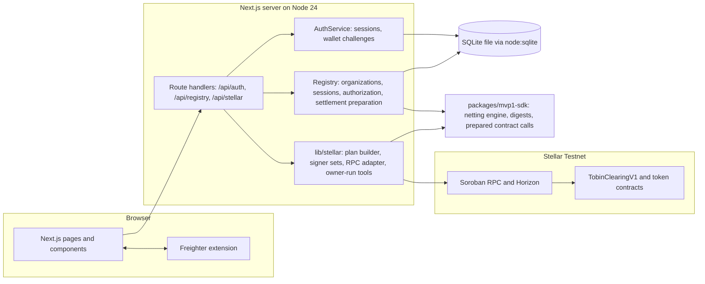

<div align="center">

<picture>
  
</picture>

<br><br>


<br>

**Institutional clearing and settlement infrastructure built on Stellar: record obligations, calculate net positions, apply authorization controls, prepare settlement instructions, and settle through Stellar. Testnet execution is currently performed by separate, owner-run tools.**

<br>

[Website](https://tobinprotocol.xyz) ·
[Documentation map](#documentation-map) ·
[Issues](https://github.com/tobin-protocol/tobin/issues) ·
[Contributing](CONTRIBUTING.md) ·
[Security](SECURITY.md) ·
[Licence](LICENSE)

</div>

> [!IMPORTANT]
> **Pre-production institutional infrastructure.** Tobin's core clearing and settlement workflows have been implemented and demonstrated through controlled Stellar Testnet execution. Production deployment and real-value use have not yet been approved.
> Milestones MVP-1.2 to MVP-1.5 and wallet-first authentication are implemented. The Testnet demonstration is real but narrow: one owner-run settlement of eight transactions with test assets. The evidence is from the implementing author only, no independent security review has been performed, and the release gates for a versioned or production release remain blocked. The institutional application persists clearing and settlement **preparation** records; actual Testnet execution is performed by **separate owner-run tools**, and confirmed outcomes are **not** written back into the application's records. See [Project status](#project-status-and-roadmap), [Current scope and remaining engineering work](#current-scope-and-remaining-engineering-work) and the [maturity terminology](docs/COMMUNICATION-AND-MATURITY-TERMINOLOGY.md).

## Table of contents

- [What is Tobin?](#what-is-tobin)
- [The problem](#the-problem)
- [What Tobin provides](#what-tobin-provides)
- [How Tobin works](#how-tobin-works)
- [Architecture](#architecture)
- [Security model](#security-model)
- [Current scope and remaining engineering work](#current-scope-and-remaining-engineering-work)
- [Project status and roadmap](#project-status-and-roadmap)
- [Repository layout](#repository-layout)
- [Getting started](#getting-started)
- [Testing](#testing)
- [Documentation map](#documentation-map)
- [Contributing and community](#contributing-and-community)
- [Licence](#licence)

## What is Tobin?

Tobin is institutional clearing and settlement infrastructure built on [Stellar](https://stellar.org), open source under Apache-2.0, for financial institutions that already move money on the network. Institutions record the payment obligations they owe each other. Tobin computes each participant's **net position** deterministically, requires a reviewer to approve the exact result, and prepares settlement instructions for only the net amounts. The application persists these clearing and settlement **preparation** records. Executing them on Stellar is a separate step: owner-run Testnet tools collect real signatures and submit the transactions to a Soroban smart contract one step at a time, each after the owner's typed confirmation. Nothing is submitted automatically, the application does not reconcile on-chain results automatically, and confirmed outcomes are not written back into its records. The contract applies its own validation to whatever plan it is given (see [Netting engine and contract validation](#netting-engine-and-contract-validation)).

**Why Stellar is central.** Stellar does four jobs in the design. *Settlement:* a Soroban contract validates the plan and moves the net amounts atomically, all or nothing. *Authorization:* each debtor authorizes its own transfer through Stellar account signing and Soroban authorization, with multisig signer sets verified against the network, so no operator key can move funds. *Execution:* transactions are signed by the required accounts and submitted one step at a time. *Verification:* outcomes are read back from the ledger by transaction hash and compared with the approved plan, never inferred from an API reply.

The repository holds three connected things:

1. **An institutional application** (`apps/web-console`): organizations and memberships, clearing sessions, obligations, calculations, reviewer approval, settlement preparation and wallet-first sign-in. State is persisted in SQLite.
2. **Soroban contracts and a TypeScript SDK** (`contracts/`, `packages/mvp1-sdk`): a clearing contract that settles a session atomically in a Soroban token contract, a capped-supply test token, and the netting engine and digest code that both the application and the tests use.
3. **Stellar Testnet tooling** (inside `apps/web-console`): owner-run tools that verify wallet control, check multisig signer sets, collect real Freighter signatures, submit the settlement transactions one step at a time after the owner's typed confirmation, and read the results back from the network. They keep their own run log and do not update the application's records.

**Intended users** are institutions with recurring payment obligations to several counterparties on Stellar: anchors, payment institutions, cross-border payment providers and institutional Stellar applications. Multilateral clearing only helps where several institutions owe each other. Whether real Stellar payment flows are interconnected enough to benefit has **not** been measured yet.

**Role in the Stellar ecosystem.** Tobin sits above Stellar's existing standards; it does not replace SEP-31, SEP-24 or SEP-38 and defines no protocol token. It is not an anchor, custodian, payment processor, DEX, lender or bank, and it does not decide any institution's KYC or regulatory obligations. "Non-custodial" is used in a technical sense only (no Tobin operator key can move funds under the design); it is not a legal characterisation, and the claim depends on real-value deployments that do not exist.

Tobin is **not** a universal clearing network and not a fully decentralized protocol: the application is a single-instance web app backed by one SQLite file, and the on-chain part is a settlement contract plus signatures.

## The problem

When institutions have recurring obligations to several counterparties, the obligations cross and mostly offset, yet each one is usually settled on its own. In practice this means:

- **Fragmented obligations.** Payments owed between the same institutions are tracked in separate places and settled one by one.
- **Manual reconciliation.** Teams reconcile spreadsheets and statements by hand to agree who owes whom.
- **Inefficient settlement coordination.** Gross settlement moves far more value than the net exposure requires.
- **No structured institutional approval.** The people who record or change an obligation can often also release the payment.
- **Operational and authorization risk.** A stale approval, a changed amount or a wrong signer can lead to settling something nobody approved.
- **Settlement and reconciliation uncertainty.** A submitted transaction is not a confirmed one, and a confirmed one still has to be matched against what was approved.

A worked example (arithmetic only, not data): A owes B 100, B owes C 80, C owes A 70. Settled one by one that moves 250. Cleared first, A pays 30, B receives 20 and C receives 10, so only 30 is settled. Net positions always sum to zero. (That is one valid way to settle those net positions; other plans can satisfy the same positions, and the contract accepts any plan that meets its own rules, described below.)

## What Tobin provides

Status labels: **Implemented** means the code and tests exist in this repository. **Testnet-verified** means it was exercised against the real Stellar Testnet. Production deployment has not yet been approved. The terms (implemented, tested, Testnet-verified, independently reviewed, pilot-ready, production-approved) are defined in the [maturity terminology guide](docs/COMMUNICATION-AND-MATURITY-TERMINOLOGY.md) and are not interchangeable.

| Capability | Implemented | Testnet-verified | Notes |
|---|:--:|:--:|---|
| Institutional workspaces: organizations, memberships (admin or member, active or suspended), invitations bound to an email, a wallet, or open | Yes | n/a | Application-level only; never a Stellar authority |
| Wallet-first sign-in and onboarding: server-issued single-use challenges, verified wallets, sessions, create-or-join flow | Yes | No | The Freighter flow is tested with a protocol-compatible stand-in; a real-Freighter run in Edge is outstanding |
| Clearing sessions with participants and obligations (integer base units, canonical asset identity) | Yes | n/a | Sessions carry a provenance label (see [Architecture](#architecture)) |
| Clearing calculations (deterministic netting) with immutable snapshots | Yes | n/a | The engine generates a default plan. It is a calculator, not an authority: many valid plans can exist, and the contract neither requires a proposal to equal the engine's plan nor enforces a minimal or unique one |
| Institutional reviewer authorization, separation of duties, immutable decisions, automatic invalidation of stale approvals | Yes | n/a | An approval is a database record, not a signature |
| Settlement preparation: deterministic instructions, immutable batches, batch review, operational closure | Yes | n/a | Preparation moves no funds |
| Soroban contracts: clearing contract and a capped test token | Yes | Yes | Deployed on Testnet; see `contracts/deployments/testnet.json` |
| Wallet ownership verification and signer-set-aware co-signing (multisig) | Yes | Yes | Real Freighter and a real multisig account were used in the owner-run validation |
| Stellar Testnet settlement execution: eight transactions from session creation to `settle` | Yes (owner-run tool) | Yes | One run: a one-base-unit settlement of a governed test token |
| Independent chain read and reconciliation against the approved plan | Foundations | Yes (one run) | An owner-run tool reads RPC and Horizon on request and compares the result with the approved plan; there is no automatic application-level reconciliation (see the note below) |

> [!NOTE]
> **What is and is not connected.** The persisted application records stop at "execution preconditions": the Settlement tab itself says *Stellar execution (preconditions only)*, and the settlement and execution records never read from or submit to the network (the one registry route that touches the chain is the read-only recording of a signer set). Real on-chain execution is performed by separate, owner-run tools (`/wallet-check`, `/cosign-check`, `/settle-run`) that keep their own run log. Writing confirmed on-chain outcomes back into the persisted application records is **not implemented**.

**Not implemented:** account recovery for wallet-only users; deadlines, abort, default and recovery handling, collateral and Merkle commitments (the broader protocol design); hardware-wallet or second-wallet validation; any Mainnet capability; independent audit.

## How Tobin works

The implemented lifecycle, with the boundary between application operations and Stellar operations made explicit:



| Step | What happens | Where |
|---|---|---|
| 1-3 | A wallet proves control of a key; Tobin finds or creates the internal user; the user creates or joins an institution. Authentication grants no role | Application |
| 4-5 | Participants and obligations are recorded. An obligation is a debtor, a creditor and an integer amount in one asset | Application |
| 6 | The netting engine produces net positions (`outgoing - incoming`; positive means the participant pays). Any change to participants or obligations makes the earlier result stale | Application |
| 7 | A reviewer approves or rejects **that exact calculation**. Nobody can decide on a result they recorded, changed or calculated | Application |
| 8 | An approved calculation becomes an immutable batch of generated settlement instructions; a second review approves the batch; every participant needs a verified Stellar account on the right network before execution is allowed | Application |
| 9-10 | Each required account authorizes its own step; the clearing contract moves its own session through Open, Committed, Approved and Settled, and `settle` executes the contract's approved plan atomically (the plan must satisfy the contract's own validation rules) | Stellar |
| 11 | A transaction is only trusted after it is read back from the network by hash and matched against the approved plan. The owner-run tool does this on request; it is not automatic and the result is not written back into the application's records | Owner-run tool |

A prepared batch is not a submitted transaction, a signed transaction is not a submitted one, a submitted one is not a confirmed one, and a confirmed one is not settled until it is reconciled.

### Netting engine and contract validation

These are two different things and are kept separate:

- **The netting engine** (`packages/mvp1-sdk/src/engine`) computes each participant's net position and generates a *default* set of settlement instructions. The application stores that result in an immutable batch for review. It is a calculator and an advisory check, never an authority.
- **The Soroban contract** enforces its own rules on whatever plan it is proposed, using the net positions it derives from the obligations recorded in the session: every party is an admitted participant; every amount is positive; for each participant the amount paid equals the net debit and the amount received equals the net credit, so no value is omitted, duplicated or introduced; instructions are in strictly ascending (payer, payee) order; and arithmetic is checked. The empty plan is valid only when every net is zero.

The contract does **not** compare a proposal with the engine's output and does **not** require the plan to be minimal or unique: it accepts any plan that meets those rules. Tobin's owner-run execution tool proposes the approved batch's instructions, re-ordered only into the contract's required order, and refuses locally if the mapped plan differs from the approved batch. That is an application-side check; the contract's own validation is the authority.

## Architecture



| Layer | What it is | Where |
|---|---|---|
| Frontend | Next.js 16 (App Router) with React 19; pages under `app/(institution)`; client components in `components/` | `apps/web-console` |
| Backend and API | Route handlers on the Node runtime: `/api/auth/*`, `/api/registry/*`, `/api/stellar/*`; a `proxy.ts` that enforces local-only Host/Origin guards and a per-request CSP | `apps/web-console/app/api`, `proxy.ts` |
| Persistence | SQLite through `node:sqlite` (no database server, one application instance); numbered, atomic migrations 1 to 8; immutable and append-only tables enforced by triggers | `apps/web-console/lib/db` |
| Authentication and authorization | Opaque HttpOnly session cookie (hash stored); wallet challenges; membership and role checks on the server in `Registry` | `lib/auth`, `lib/registry` |
| Stellar integration | `@stellar/stellar-sdk` 17.4.0 and `@stellar/freighter-api` 6.0.1; execution plan, signer-set verifier, RPC adapter, owner-run tools | `lib/stellar` |
| Contracts and SDK | Rust 1.96.0 and Soroban SDK 29.0.0; the TypeScript engine, digest and SDK are shared by the application and tests | `contracts/`, `packages/mvp1-sdk` |
| Tests and CI | `node:test` suites, real-browser journeys over the Chrome DevTools Protocol, GitHub Actions workflows | `test/`, `.github/workflows/` |

### Four kinds of state, kept apart

| State | What it is | Examples |
|---|---|---|
| **Application state** | Rows in SQLite. Not on-chain | organizations, sessions, obligations, users, wallets |
| **Clearing and settlement preparation state** | Application records that define what was approved | calculation snapshots; reviewer decisions (`active`, `superseded`, `invalidated`); batches (`awaiting-review`, `approved`, `rejected`, `invalidated`, `superseded`) |
| **Stellar transaction state** | What happened to a transaction Tobin built | `awaiting-signer`, `signing`, `signed`, `submission-pending`, `submitted`, `confirmed`, `reconciled`, `failed`, `expired`, `unknown-outcome`, `reconciliation-required` (defined in `lib/registry/settlement-state.ts`) |
| **Independently verified on-chain state** | What the network says when read back, never inferred from an API reply | the session, obligations, proposal, approvals and settlement record in the contract, token balances, a transaction read by hash |

A session record also carries a **provenance** label: `fixture` (demonstration data, never on-chain), `local-draft` (created in the application, nothing submitted), `chain-read` (a read-only RPC observation exists, not tied to a verified transaction) and `chain-confirmed` (a read matched the id and the creating transaction was confirmed successful).

## Security model

- **Wallet ownership is not institutional authority.** Signing in proves control of a key. Memberships, roles, reviewer grants and settlement authority are separate records, each checked by the server on every request.
- **Wallet ownership verification.** Challenges are server-issued, bound to site, network, key and purpose, single-use, and expire in five minutes; the signed text is rebuilt on the server and the signature is verified there.
- **Institutional roles are not Stellar signing authority.** An application administrator is not a multisig signer and not a reviewer. The owner-run Testnet tools additionally require a verified wallet that is a configured signer, the administrative account or the second account.
- **Reviewer separation of duties.** A reviewer cannot decide on a calculation they recorded, changed or calculated; an administrator is not automatically a reviewer.
- **Approvals are bound to what they approve.** A decision is bound to the exact calculation snapshot and a batch approval to the instruction hash; any later change invalidates them rather than silently carrying over.
- **Immutable records.** Decisions, batches, execution attempts, signer-set snapshots and authentication events are immutable or append-only, enforced by database triggers as well as by code.
- **Secure sessions.** HttpOnly, SameSite=Strict cookies (Secure in production), hash-only storage, rotation on sign-in, an absolute limit (and an idle limit for wallet sessions), revocation, a request-header CSRF guard and persisted rate limiting.
- **Testnet restrictions.** Wallet sign-in, the ownership proof and signer-set recording accept Stellar Testnet only. No Mainnet transaction, RPC, signer or settlement path exists. (The operator command `node scripts/db.ts asset-add public ...`, run from `apps/web-console`, can still register a `public` asset identity as configuration; it cannot execute anything.)

The detailed reviews are in the [documentation map](#documentation-map). They are the author's own reviews, not independent audits.

## Current scope and remaining engineering work

These are the validation and engineering requirements that stand between the implemented Testnet integration and a pilot. They are retained because they are true and because each one is planned or tracked, not because the work is hypothetical.

1. A real-Freighter validation of the wallet-first flow in Microsoft Edge is outstanding; automated browser tests use a protocol-compatible stand-in.
2. Evidence is same-author, from one environment and one browser engine; no independent penetration test or fuzzing has been done.
3. Migration 8 was tested on fresh databases and a populated version-7 test database, not on a real operator database.
4. Account recovery is deferred: a user must keep access to at least one verified wallet. There is no administrator or support override.
5. Confirmed on-chain outcomes are not written back to the persisted application records.
6. The settlement on Testnet was a single run of a one-base-unit settlement; maximum-size sessions, fee breakdown and measured resources have not been validated.
7. A repository ruleset on `main` requires a pull request with one approving review and blocks force pushes and deletion, but it requires **no specific CI check** and repository and organization admins can bypass it. That CI check must pass is project policy in [CONTRIBUTING.md](CONTRIBUTING.md), not something GitHub enforces.

## Project status and roadmap

**Maturity at a glance** (definitions in the [terminology guide](docs/COMMUNICATION-AND-MATURITY-TERMINOLOGY.md)):

| Level | Status |
|---|---|
| Implemented | Yes: MVP-1.2 to MVP-1.5 and wallet-first authentication |
| Tested | Yes: automated suites, contract tests and browser journeys (same-author) |
| Testnet-verified | The settlement path, narrowly: one owner-run execution of eight transactions with multisig co-signing, read back from the network |
| Independently reviewed | No |
| Pilot-ready | No: depends on MVP-1.6 to MVP-1.8 and an independent security review |
| Production-approved | No |

| Milestone | Description | Status |
|---|---|---|
| MVP-1.2 | Clearing Operations Foundation | Completed |
| MVP-1.3 | Institutional Clearing Authorization | Completed |
| MVP-1.4 | Settlement Preparation Engine | Completed |
| MVP-1.5 | Stellar Settlement Integration | Completed with limitations |
| MVP-1.6 | Institutional Operations and Reconciliation | Planned |
| MVP-1.7 | Security, Governance and Infrastructure Hardening | Planned |
| MVP-1.8 | Controlled Institutional Pilot | Planned |

Wallet-first authentication and institutional onboarding were delivered after MVP-1.5 as a separate piece of work (**complete with limitations**); it does not rename or reorder the milestones above.

**Completing MVP-1.5 does not mean production readiness.** It means the Testnet integration was built and validated within a narrow, stated scope. The versioned-release and production gates in [`release/RELEASE-GATES.json`](release/RELEASE-GATES.json) remain blocked, and real-value use is out of scope until the later milestones and an independent security review are done.

<details>
<summary>The earlier protocol-level milestones (M0 to M8), unchanged</summary>

The repository's earlier README tracked the broader protocol on a separate list. Its content is preserved here, not renamed or reordered: M0 protocol specification (draft); M1 ledger and economic validation with a go, modify or stop decision (not complete); M2 experimental Soroban MVP on Stellar Testnet (complete for the experimental scope only); M3 SDK and reference implementation of the broader protocol; M4 public testnet for the broader protocol; M5 conformance suite and independent security review; M6 institutional pilot; M7 Mainnet, only after the technical, network and operational criteria are met; M8 network growth. The product requirements and the draft protocol specification are not published in this repository.

</details>

## Repository layout

```text
tobin/
├── apps/
│   ├── web-console/        Next.js application: institutional app, owner-run Testnet tools,
│   │   ├── app/            local sandbox Console and the W0 console; pages and route handlers
│   │   ├── components/     client components
│   │   ├── lib/            auth, db (migrations), registry, stellar, server guards, console, w0
│   │   ├── scripts/        database operator commands and Testnet read-only scripts
│   │   └── test/           unit and integration tests; browser journeys in test/browser/
│   └── landing/            the project website (Next.js, has its own AGENTS.md)
├── packages/
│   └── mvp1-sdk/           TypeScript netting engine, digests, SDK and local bridge client
├── contracts/              Rust and Soroban: clearing/, token/, deployments/ (Testnet manifest)
├── docs/                   architecture and milestone documents, governance, reference, reports,
│                           spec, assets
├── scripts/                CI, release-gate, multisig and signer tooling
├── ci/                     dependency baseline, Wasm hash records, CI notes
├── release/                release controls, gate definitions, process-deviation log
├── accounts/               public metadata of Testnet accounts (no secrets, ever)
└── .github/                workflows, issue forms and the pull request template
```

## Getting started

### Prerequisites

| Tool | Version | Needed for |
|---|---|---|
| Node.js | 24 or later (CI uses 24.14.0) | everything TypeScript; Node 24 runs `.ts` files directly and provides `node:sqlite` |
| npm | the version bundled with Node 24 (11.19.0 was used locally) | workspaces, `npm ci` |
| Rust | 1.96.0 with `rustfmt`, `clippy` and the `wasm32v1-none` target (CI pin) | contracts and the Rust development bridge |
| Stellar CLI | 28.0.0 | building contract Wasm only |
| Chrome or Edge | any recent version | browser journeys (set `TOBIN_BROWSER` if it is not detected) |

No database server is needed. Freighter is needed only to try the wallet flows by hand, on **Testnet**.

### Install and run

```bash
git clone https://github.com/tobin-protocol/tobin.git
cd tobin
npm ci                                              # CI uses: npm ci --ignore-scripts
npm run typecheck                                   # all workspaces
npm run dev --workspace tobin-web-console           # http://127.0.0.1:8787
```

Open <http://127.0.0.1:8787/sign-in>. The server is bound to the loopback interface and refuses other Host names by design. The page at `/` is the MVP-1 local sandbox Console and needs the Rust bridge (below); the institutional pages do not.

### Environment and database

No `.env` file is required, and none exists in the repository. Never commit credentials; `.env*` files are git-ignored. Optional variables:

| Variable | Purpose |
|---|---|
| `TOBIN_DB_PATH` | database file. **Required when `NODE_ENV=production`**; otherwise defaults to `.data/tobin-dev.sqlite` (relative to the app directory, git-ignored) |
| `PORT` | must match the `--port` the server is started with (default 8787) |
| `TOBIN_BRIDGE_EXE` | path to the Rust bridge executable (sandbox Console and bridge-backed tests) |
| `TOBIN_STELLAR_CLEARING_CONTRACT` | public id of the deployed clearing contract used by the execution-plan adapter |
| `TOBIN_SECOND_ACCOUNT` | public key of the second participant account for the owner-run settlement tool |
| `TOBIN_ADMIN_ACCOUNT_RECORD`, `TOBIN_DEPLOYMENT_RECORD`, `TOBIN_BATCH_ID`, `TOBIN_VALIDATION_CREATOR`, `TOBIN_REPO_ROOT` | owner-run tool inputs; see `apps/web-console/lib/stellar/` |
| `TOBIN_DEMO_PASSWORD` | password for `db:seed-demo` demonstration users (refused in production) |
| `TOBIN_BROWSER`, `TOBIN_WIDTH` | browser path and viewport width for the journeys |

Migrations apply automatically when the server starts. To run them by hand (from the repository root):

```bash
npm run db:migrate --workspace tobin-web-console     # idempotent
npm run db:status  --workspace tobin-web-console     # prints the version; exits 2 while migrations are pending
npm run db:seed-demo --workspace tobin-web-console   # fixture demo data; needs TOBIN_DEMO_PASSWORD
```

### Rust contracts and the bridge

```bash
cd contracts
cargo test --locked --workspace                                  # contract tests (native)
cargo build --locked -p tobin-clearing-v1 --example bridge       # the development bridge used by TS tests
stellar contract build                                           # Wasm (needs the Stellar CLI)
```

Point `TOBIN_BRIDGE_EXE` at `contracts/target/debug/examples/bridge` (`bridge.exe` on Windows). Without it, the bridge-backed tests are skipped and the skips are reported.

### Build

```bash
npm run build:console                  # production build of the web console
npm run build --workspace tobin-landing
```

### Windows and PowerShell notes

- Use PowerShell syntax for variables: `$env:TOBIN_BRIDGE_EXE = "C:\path\to\tobin\contracts\target\debug\examples\bridge.exe"`; `export` is for Bash.
- Run the database and tool commands through `npm run ... --workspace tobin-web-console` so the working directory is the app directory; several tools resolve paths from it.
- Stop a server by process, not by killing every `node` process on the machine.
- Browser journeys find Chrome or Edge in their usual install paths; otherwise set `TOBIN_BROWSER`.

## Testing

| Layer | Command | Notes |
|---|---|---|
| TypeScript type check | `npm run typecheck` | all workspaces |
| SDK tests | `npm test --workspace tobin-mvp1-sdk` | `node:test`; use the bridge to avoid skips |
| Console unit, integration, security and persistence tests | `npm test --workspace tobin-web-console` | real SQLite; bridge-backed tests are skipped without `TOBIN_BRIDGE_EXE` |
| Contract tests | `cd contracts && cargo test --locked --workspace` | also run against Wasm in the integration workflow |
| Release-scan rule tests | `node --test scripts/release/scan.test.mjs` | the source-tree scan behind gate G09 |
| Browser journeys | from `apps/web-console`: `TOBIN_WIDTH=1200 node test/browser/<journey>.mjs <output dir>` | `journey`, `w0-journey`, `sessions-journey`, `settlement-journey`, `authorization-journey`, `clearing-journey`, `backend-journey`, `wallet-auth-journey`; needs a production build; run at 1200 and 420 |

**Local validation is not hosted CI.** On pull requests, hosted CI runs formatting, Rust tests, the type check, both production builds, the SDK and console suites with the bridge, the dependency-baseline and link checks, the scan tests, and the W0 browser journey. The other browser journeys are not run on pull requests, so a PR that could affect them needs the local results in its description. One TypeScript test is allowed to skip (known-answer fixtures are not published); any other skip must be explained. See [`ci/README.md`](ci/README.md).

## Documentation map

| Need | Read | For |
|---|---|---|
| Product requirements | *Not published in this repository* | the protocol specification is a draft held outside the repository |
| Whole-system orientation | [`AGENTS.md`](AGENTS.md) | contributors and coding agents: domain model, trust boundaries, invariants, navigation |
| Persistence and operations | [`BACKEND_PERSISTENCE_ARCHITECTURE.md`](docs/product/architecture/mvp-1.2/BACKEND_PERSISTENCE_ARCHITECTURE.md), [`DATA_MODEL`](docs/product/architecture/mvp-1.2/BACKEND_PERSISTENCE_DATA_MODEL.md), [`OPERATIONS`](docs/product/architecture/mvp-1.2/BACKEND_PERSISTENCE_OPERATIONS.md) | anyone changing the database or running the app |
| Milestone records | `docs/product/architecture/mvp-1.2` to `mvp-1.5` (acceptance, closure, implementation, security reports), e.g. [MVP-1.3 implementation](docs/product/architecture/mvp-1.3/MVP-1.3-IMPLEMENTATION.md), [MVP-1.4 implementation](docs/product/architecture/mvp-1.4/MVP-1.4-IMPLEMENTATION.md), [MVP-1.5 closure](docs/product/architecture/mvp-1.5/MVP-1.5-CLOSURE.md) | reviewers and anyone extending a subsystem |
| Authentication and security | [Wallet-first architecture](docs/product/architecture/wallet-first-auth/WALLET-FIRST-AUTH-ARCHITECTURE.md), [security review](docs/product/architecture/wallet-first-auth/WALLET-FIRST-AUTH-SECURITY-REVIEW.md), [MVP-1.3 authorization security](docs/product/architecture/mvp-1.3/MVP-1.3-AUTHORIZATION-SECURITY.md), [MVP-1.5 threat model](docs/product/architecture/mvp-1.5/MVP-1.5-THREAT-MODEL.md) | security-minded contributors |
| Stellar integration | [Wallet and signing](docs/product/architecture/mvp-1.5/MVP-1.5-WALLET-AND-SIGNING.md), [contract compatibility](docs/product/architecture/mvp-1.5/MVP-1.5-CONTRACT-COMPATIBILITY.md), [Testnet verification](docs/product/architecture/mvp-1.5/MVP-1.5-TESTNET-VERIFICATION.md), [ABI reference](docs/reference/MVP-1-ABI-AND-AUTHORIZATION-REFERENCE.md), [`contracts/README.md`](contracts/README.md) | Stellar and Soroban contributors |
| API | no single reference for the institutional API; the auth endpoints are tabulated in the wallet-first architecture document, the registry routes are in `apps/web-console/lib/registry/http.ts`. [`W1-API-REFERENCE.md`](docs/product/architecture/w1/W1-API-REFERENCE.md) covers only the mock `/api/w0/*` API | API contributors |
| Testing | [MVP-1 test plan](docs/reference/MVP-1-TEST-PLAN-AND-STAGE-B.md), [wallet-first validation record](docs/product/architecture/wallet-first-auth/WALLET-FIRST-AUTH-VALIDATION.md), [`ci/README.md`](ci/README.md) | anyone writing or reviewing tests |
| Deployment and governance | [`contracts/deployments/testnet.json`](contracts/deployments/testnet.json), [governance documents](docs/governance/testnet-administrative-multisig.md), [`accounts/README.md`](accounts/README.md), [`release/CHECKLIST.md`](release/CHECKLIST.md) | maintainers |
| Architecture decisions | there is no ADR directory; decisions are recorded inside the milestone documents and [`W1-DECISION-PAPERS.md`](docs/product/architecture/w1/W1-DECISION-PAPERS.md) | anyone proposing a design change |
| Older paths | [`docs/PATH-MAP.md`](docs/PATH-MAP.md) | readers of documents written before the monorepo move |

## Contributing and community

- [`CONTRIBUTING.md`](CONTRIBUTING.md): how to propose, build, test and submit a change.
- [`CODE_OF_CONDUCT.md`](CODE_OF_CONDUCT.md): expected behaviour.
- [`SECURITY.md`](SECURITY.md): report vulnerabilities privately, never in a public issue.
- [`AGENTS.md`](AGENTS.md): instructions for AI coding agents ([`CLAUDE.md`](CLAUDE.md) points to it).
- [Issues](https://github.com/tobin-protocol/tobin/issues): bug reports and feature proposals use the issue forms; GitHub Discussions are not enabled.
- Pull requests use the [pull request template](.github/pull_request_template.md).

## Licence

The code, documentation and specification the project owns or controls are licensed under the [Apache License 2.0](LICENSE). Third-party dependencies keep their own licences. The Tobin name, logo and brand assets are **not** licensed under Apache-2.0; see [`apps/landing/NOTICE`](apps/landing/NOTICE). The banner in this README is a rectangular crop of an existing brand image ([provenance](docs/assets/README.md)).
