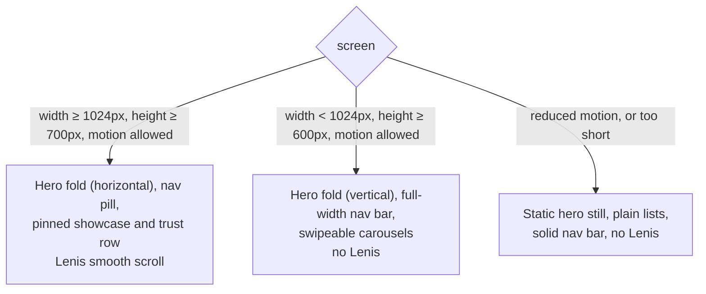

# Tobin landing page

The website for **Tobin Clearing Protocol**: an open clearing protocol that helps financial institutions net payment obligations and settle the resulting balances on Stellar.

This is the landing page of the [tobin-protocol/tobin](https://github.com/tobin-protocol/tobin) monorepo (`apps/landing`). The protocol work (contracts, the MVP-1 SDK, the Console) lives in the sibling directories; nothing here claims more than the repository README does.

Built with Next.js (App Router), React, TypeScript, Tailwind CSS v4, [`motion`](https://motion.dev) and [`lenis`](https://lenis.darkroom.engineering) for smooth scroll.

**Contents:** [Getting started](#getting-started) · [What's on the page](#whats-on-the-page) · [Project structure](#project-structure) · [Typography](#typography) · [Design tokens](#design-tokens) · [Motion and layout](#motion-and-layout-architecture) · [Before you deploy](#before-you-deploy) · [Contributing](#contributing)

---

## Getting started

You need Node.js 24 or newer (the monorepo's `engines` field; CI uses 24.14.0). The landing page is the `tobin-landing` workspace of the monorepo, so install from the repository root.

```bash
git clone https://github.com/tobin-protocol/tobin.git
cd tobin
npm ci --ignore-scripts          # installs every workspace from the lockfile, as CI does
npm run dev --workspace tobin-landing      # http://localhost:3000
```

Run the commands below from the repository root with `--workspace tobin-landing`, or from `apps/landing` without it.

| Command | What it does |
| --- | --- |
| `npm run dev` | Local development server |
| `npm run lint` | ESLint (CI runs this) |
| `npm run build` | Type-checks and prerenders the page statically (CI runs this) |
| `npm run start` | Serves the production build |

The landing page has no test suite and no `typecheck` script; `next build` type-checks it. `npx tsc --noEmit` also works from `apps/landing`.

> [!IMPORTANT]
> This repo uses a recent Next.js with breaking changes from older versions. Before changing framework-level code, read the guides in `node_modules/next/dist/docs/` (see [AGENTS.md](AGENTS.md)).

## What's on the page

A single static page, in this order. The design follows [Ondo Finance's site](https://ondo.finance) (its structure, greyscale palette, radii, type scale and motion timings), with Tobin's own content and no copied assets.

```mermaid
flowchart LR
  hero["Status bar, nav, hero fold<br/>Welcome to the Future of Institutional Clearing"] --> problem["Problem<br/>showcase: cards + charts<br/>(phones: card, then its charts)"]
  problem --> how["How it works<br/>five-step carousel"]
  how --> built["Intended versus built<br/>three charts, filter, grouped cards"]
  built --> stellar["Built for Stellar"]
  stellar --> manifesto["Tobin is<br/>rolling phrase + dot sphere"]
  manifesto --> trust["What it is, and is not<br/>trust cards (carousel on phones)"]
  trust --> arc["Netting arc"]
  arc --> ledger["Status"]
  ledger --> source["Read the source"]
  source --> cta["Closing card + footer"]
```



The numbers in the example (gross vs. net settlement) are illustrative and labelled as such on the page. They are **computed from** [src/lib/clearing.ts](src/lib/clearing.ts), not hard-coded, so the arithmetic and the visuals cannot drift apart.

Charts are [Recharts](https://recharts.org) wrapped in the manner of shadcn/ui's chart component (`src/components/chart.tsx`: a colour config published as CSS variables, plus a tooltip drawn as the page's value tag). The showcase charts load on the client only, once the section is near the viewport.

## Project structure

```text
src/
  app/            App Router entry: layout, page, global styles, icons, social images
  components/     Page sections (Hero, Problem, HowItWorks, BuiltStatus, Stellar, Manifesto, Trust,
                  NettingArc, StatusLedger, ReadTheSource, FinalCta, Footer), StatusBar, Nav,
                  BrandMark (the nav logo), StencilText and StencilWordmark (the letter breaks),
                  HeroMedia (video), ClearingShowcase, ShowcaseCharts, StatCharts, chart, Odometer,
                  DotGlobe, Reveal (reveals, mask reveal, parallax), SmoothScroll;
                  Logo and logo-art are the old brand-pack logo and are currently unused
  lib/            clearing.ts (netting arithmetic), site.ts (links, nav, source cards), stage.ts
                  (media-query stores), fold.ts (hero fold state), how.ts, lenis.ts
public/           Static assets: hero/ (video encodes and still), illustrations/how/, trust/, cta/,
                  brand/ (old brand pack copies), icons, web manifest
brand-pack/       Source logo and colour assets of the old logo
scripts/          build-logo-art.mjs (old logo), build-brand-icons.mjs (favicon set from the broken T)
assets-src/       Local source images (git-ignored, never committed; see below)
```

`assets-src/` holds the originals the optimised files in `public/` were made from. It is listed in the repository `.gitignore`.

## Typography

Four typefaces, all free (SIL Open Font License) and loaded through `next/font/google` in [src/app/layout.tsx](src/app/layout.tsx). `--font-mono` is the system monospace stack; JetBrains Mono, which the old brand-pack logo used, is no longer loaded because nothing renders in it.

| Face | Used for | Token |
| --- | --- | --- |
| **Urbanist** | Headlines (`h1` to `h6`, `.t-h2` to `.t-h5`), weight 500 | `--font-heading` |
| **Outfit** | The hero headline, the odometer numerals, the step numbers | `--font-display` |
| **Instrument Sans** | Body text, lead paragraphs, buttons and UI | `--font-sans` (`--font-serif` is an alias) |
| **Space Grotesk** | Labels, chart axes, tags, repository paths | `--font-label` |

Type classes (`.t-h1` to `.t-h5`, `.t-lead`, `.t-body`, `.t-ui`, `.t-label`, `.t-mono`, `.t-odo`) live in [src/app/globals.css](src/app/globals.css). Headings step at 600px, 900px and 1200px (h2 is 32, 44, 56px); tracking is -2%. The odometer numerals are 96px up to 150px with -4px tracking, one `1ch` column per digit. There are no italics and no pills: eyebrows, badges and value tags are plain text.

[src/components/StencilText.tsx](src/components/StencilText.tsx) puts the same breaks in the hero headline (CSS masks on each "o" and "n"; live text). [src/components/StencilWordmark.tsx](src/components/StencilWordmark.tsx) sets "Tobin Protocol" across the full width of the footer: live Urbanist text with a mask that cuts thin breaks through every o, b and n, placed from each letter's measured extent. The footer follows Ondo's arrangement (legal text, the big stencil name, then one row with the copyright and every link); there are no social links because the project has none. The footer parts reveal as they scroll into view, once: the legal paragraphs fade in and rise one after the other, the wordmark rises out of a mask (`MaskReveal` in `Reveal.tsx`), and the copyright and links fade in left to right; none of it moves under reduced motion. The nav logo is [src/components/BrandMark.tsx](src/components/BrandMark.tsx): a heavy T with a thin break cut through its stem, then "tobin" in the display face with the same stencil breaks. The favicon set (`src/app/icon.svg`, `favicon.ico`, `apple-icon.png`, `public/icon-*.png`) is the same T on black and is generated by `node scripts/build-brand-icons.mjs`. The older brand-pack logo files (`logo-art.ts`, `public/brand/`, the social images) are unchanged and no longer used by the nav.

## Icons

Icons are [Hugeicons](https://hugeicons.com) (the free stroke-rounded set, MIT): `@hugeicons/react` renders them and `@hugeicons/core-free-icons` holds the drawings. Import each icon by name (`import { File01Icon } from "@hugeicons/core-free-icons"`) so unused ones stay out of the bundle, and draw them through `<Icon icon={...} />` (24px, 1.5px stroke, in `ui.tsx`) or `<HugeiconsIcon>` directly for other sizes. The icon data lives next to the copy it illustrates (the cards in `BuiltStatus`, `Stellar` and `ClearingShowcase`). Brand marks of other networks come from [`@web3icons/react`](https://web3icons.io) (MIT): import the one you need by name (the Stellar network mark in the "Built for Stellar" section is `NetworkStellar`, in its mono variant so it follows the text colour). The logo, the stencil wordmark and the ring timer in the trust cards are drawn by hand and are not Hugeicons.

## Design tokens

All in [src/app/globals.css](src/app/globals.css), measured from Ondo. The page is **strictly greyscale**: colour appears only in data visualisation (the chart ramp, the showcase and stat charts), the manifesto phrases and the netting arc.

| Token | Value | Use |
| --- | --- | --- |
| `ink` / `ink-soft` / `paper` | #000 / #1D1D1D / #FFF | Dark sections, dark buttons and tiles / base of every translucent overlay / page and cards |
| `grey-850` | #313131 | Body text on light cards |
| `grey-600` | #626262 | Secondary text (6.1:1 on white) |
| `grey-500` | #818181 | Second phrase of two-tone headings, 24px and larger only (3.9:1) |
| `grey-400` | #B1B1B1 | Text on dark; never body text on a light surface |
| `grey-200` / `grey-100` | #DEDEDE / #F0F0F0 | Badges, dividers, inactive slides / light buttons, shells, inputs |
| `chart-1` to `chart-4`, `chart-ink` | #E0ECFF to #5A86CC, #1C3966 | Data visualisation only |
| `net`, `net-ink` | #00B27A, #007A52 | The one accent for a net or complete state: the How it works illustrations and the net-positions chart. `net-ink` is the text version (5.4:1 on white) |
| `purple`, `green-ink`, `purple-ink`, `arc-*` | see the file | The manifesto phrases and the arc, never text on buttons |

Radii: 8px (buttons, tabs), 12px (nav pill), 16px (carousel slides), 24px (cards), 32px (the segmented shell), 4px (chart tooltips and small tiles). Shadows: the floating nav pill (Ondo's three layers). Everything else is flat and uses tone steps and 1px hairlines. Glass (the trust cards, glass buttons) is 40% ink-soft with a 30px blur.

Where an Ondo value fails WCAG AA for small text it was darkened a step: the inactive segment text is `grey-600`, not #B1B1B1, and the transparent status bar and nav over the photo rely on a dark-to-clear band at the top of the hero (ink-soft at 60%) plus a 35% scrim, because the bright sky alone leaves white text near 3:1. Layout: content up to 94.5rem with 22px gutters on phones and 44px on desktop; section padding 80 to 120px.

## Motion and layout architecture

Three layouts share one page. Wide, tall screens get the pinned hero fold and Lenis smooth scroll. Phones and small tablets get a vertical version of the same fold. Reduced motion, or a very short window, gets a plain flow layout.



- **Queries.** `PIN_QUERY` and `COMPACT_QUERY` in [src/lib/stage.ts](src/lib/stage.ts) are repeated in the `@media` blocks of `globals.css` for `.hero` and `.nav-bar` (marked "Keep in sync"); change them together. `.pin-only` and `.pin-hide` still exist in `globals.css` but no component uses them now.
- **Hero fold** ([src/components/Hero.tsx](src/components/Hero.tsx)). At the top of the page the first wheel, swipe or key press (ArrowDown, PageDown, Space) waits 0.25s and runs one 0.9s tween (cubic-bezier(0.65, 0, 0.35, 1)) of a progress value while the page stays at scroll 0. The video folds into three concentric rounded squares (they copy the one playing video through a canvas), the headline lines move out of the way and the intro and buttons fade in. On wide screens the headline halves go to either side of the squares and a small 53px scroll follows; on phones the first half rises above the square and the second sinks below it, fitted to the hero's own measured size. Safeguards: the lock always ends (a 2.6s failsafe); anything that moves the page off the top (anchor link, `scrollTo`, a restored scroll position) settles the fold at once; scrolling up at the top reverses it; "Scroll to explore" runs it for keyboard users and Tab moves past the hero; nothing runs under reduced motion.
- **Nav.** Wide screens: a transparent bar over the hero, 12px below the equally transparent status bar, that turns black, rises to 12px and narrows to the 792px pill as the fold runs (`src/lib/fold.ts` shares the progress). Phones and tablets: transparent at first, then a full-width, square-cornered black bar stuck to the top, showing only the T. There is no per-section tone sampling: the bar is always black or over the scrimmed hero, so its text is always white on dark.
- **Carousels** (How it works, the trust cards, the manifesto phrase) autoplay and never pause (there are no pause buttons anywhere on the page). How it works and the trust cards are carousels at every width (infinite, swipeable on phones), and only become plain lists or card grids under reduced motion.
- **Entrances.** Every section animates in as it scrolls into view, once: `Reveal` rises, slides in from the left or right, or grows from 94% (`from`), `LineReveal` and `MaskReveal` lift text out of a mask, and `Parallax` drifts the Trust and closing-card photographs against the scroll. Rows and tiles alternate sides or stagger. Nothing moves under reduced motion.
- **Pace.** One choreographed intro (the fold); reveals play once and rise at most 56px; nothing bounces; loops take 6 to 20s. Lenis runs at 1.6s with a wheel multiplier of 0.8, only where the pin query matches, and is loaded on demand. Under `prefers-reduced-motion` the fold, odometer roll, reveals, carousels and the arc animation are removed.

## Hero image and media

The hero is a landscape 16:9 video that covers the whole hero (`object-cover`). It always autoplays and loops; there is no pause button (see "Accessibility and motion" below). There are two silent H.264 encodes in `public/hero/`: `hero-1080.mp4` (1920 x 1080, 2.8 MB) for screens at least 1280px wide and `hero-720.mp4` (1280 x 720, under 1 MB) below that. The source clip is a 3.2s dusk-to-night timelapse (3840 x 2160, 25fps), slowed to 70% speed (frames blended up to 30fps so it stays smooth), and each file plays it forward and then in reverse (about 8.9s) to loop without a jump. **Seven rooftop signs in the clip are blurred in the encode** so that no real-world brand name is readable. Its first frame, `public/hero/hero-still.jpg` (1920 wide, about 120 KB), is the video's poster, is server-rendered and preloaded, and is all that shows under reduced motion (the video element is not even mounted then, so no video is downloaded); the folded squares show the same single video through a canvas that copies its frames (one video is decoded, so all three squares stay in sync, and the copying pauses while the hero is off screen).

To replace the video keep the file names and the 16:9 shape, and re-encode the same way (`ffmpeg -an -vf "setpts=PTS/0.7,minterpolate=fps=30:mi_mode=blend,scale=1920:1080" -c:v libx264 -crf 28 -movflags +faststart`, and 1280:720 at crf 31; change 0.7 to change the speed). Check every frame for readable brand names, signs, people or plates and blur or crop what shows.

The trust section's backdrop is `public/trust/trust-skyline.jpg` (2000px wide, about 105 KB) under a black tint (70% at the top to 90% at the bottom, so the list under the cards stays readable), and the closing card uses `public/cta/cta-street.jpg` (2000px wide, with two licence plates and a car emblem blurred).

**Provenance.** [ASSET-CREDITS.md](ASSET-CREDITS.md) records where every shipped media file came from and what is unverified; the source, creator and licence of the video, the two photographs and the five illustrations are **not** verified. Do not commit new media without adding it there. The source files are never committed (`assets-src/` is git-ignored).

## How it works illustrations

`public/illustrations/how/cut-*.webp` are the five step illustrations (788 x 317, 2.49:1, transparent background so they sit directly on the black panel; the PNG sources are in `assets-src/how/`). The alt text lives with the step in `src/lib/how.ts`. They show only on the active carousel slide (the panel fades in and rises 12px on activation) and on every card of the static list. Replace a picture by keeping its name and its 2.49:1 shape; to change the shape, update `IMG_W` and `IMG_H` in `HowItWorks.tsx` and the static list's `aspect-[...]`.

## Deploying

This repository does not record how or where the page is hosted: there is no hosting configuration in it, and `ci.yml` only lints and builds the landing page (`npm run lint` and `npm run build` with `--workspace tobin-landing`, after `npm ci --ignore-scripts`). Anything that deploys the page therefore needs the following, set by whoever owns the deployment:

| Setting | Why |
| --- | --- |
| Node 24 (the monorepo's `engines`; CI uses 24.14.0) | Same runtime as CI |
| Build command `npm run build --workspace tobin-landing` from the repository root, output `apps/landing/.next` | Next.js App Router, statically prerendered (`/` is `○ Static`) |
| Network access during the build | `next/font` downloads the four Google Fonts at build time; no font files are stored here |
| `NEXT_PUBLIC_SITE_URL` = the production origin, for example `https://example.org` (no path) | Open Graph and Twitter image URLs are made absolute from it. **There is no default and none is invented here.** Without it Next.js falls back to `http://localhost:3000` and warns during the build. On Vercel, `VERCEL_PROJECT_PRODUCTION_URL` and `VERCEL_URL` are used as a fallback. |
| `TOBIN_REQUIRE_SITE_URL=1` (optional, recommended for the production environment) | Makes the build fail when no site URL is available, instead of shipping localhost share images. Do not set it in CI, which builds without a URL. |

After a deployment, view the page source and confirm `og:image` and `twitter:image` start with your production origin and not `localhost`, then check the share previews with the platforms' own debuggers.

**Release gates.** Merging this branch is not a release. `release/RELEASE-GATES.json` defines the gates; at the time of writing the read-only check (`node scripts/release/check-gates.mjs --target <target>`) passes for `private-remote-backup` and `public-source-release` and is blocked for `versioned-release` and `production` (G04 dependency review, G10 artifact provenance, E01 to E05 hosted-runner evidence, and for production P01 to P05). Those gates were recorded before this branch added media, fonts and dependencies and have not been re-reviewed for them. The page itself says Tobin MVP-1 is experimental, runs on the Stellar testnet, and is not production-ready or independently audited; do not describe a deployment of it as anything else.

## Before you deploy

- **Links:** `github` in [src/lib/site.ts](src/lib/site.ts) is the public protocol repository. `docs` is still `null` because no documentation site exists yet; the footer shows a marked "Link pending" placeholder for it and the nav and final call to action omit it. The "Read the source" cards link to files that exist in the repository: re-check the paths if files move.
- **Site URL:** see the table above.
- **Fonts:** nothing to configure. Urbanist, Outfit, Instrument Sans and Space Grotesk are free (SIL Open Font License) and are fetched from Google Fonts by `next/font` at build time, so the build needs network access. No font files are stored in the repository.
- **Notices and credits:** [NOTICE](NOTICE), [THIRD-PARTY-NOTICES.md](THIRD-PARTY-NOTICES.md) and [ASSET-CREDITS.md](ASSET-CREDITS.md) describe the fonts, libraries and media, and what is unverified. Review them before a public release.

## Accessibility and motion

- **No pause or stop controls.** The hero video, the carousels, the rolling manifesto phrase, the dot globe and the netting arc all start on their own and loop without a way to stop them. This is an explicit product decision. It does not meet WCAG 2.2.2 (Pause, Stop, Hide, Level A) for moving content that lasts more than five seconds, so the page must not be described as conforming to WCAG 2.2.
- **Reduced motion is honoured.** With `prefers-reduced-motion: reduce` the hero fold, reveals, carousels and animations are removed, the carousels become a plain list and a card grid, and the hero shows its still image: the video element is not mounted and no video file is requested.
- **What was checked automatically** (axe-core 4.14.0 in a production build, after scrolling the whole page): zero violations on desktop and phone, with and without reduced motion. Colour contrast of text over photographs and video cannot be decided automatically and needs a manual review. Keyboard use was checked by sending real key events: visible focus rings, arrow keys on both carousels, no focusable element inside a hidden region.
- **Not checked:** a screen reader, real devices, or any browser other than Chrome.

## Contributing

Fixes and improvements to the landing page are welcome: accessibility, performance, responsiveness, motion, and copy clarity.

1. Open an issue first for anything beyond a small fix.
2. Fork, then branch from `main` (for example `fix/nav-focus-ring`).
3. Keep pull requests small and focused, with the reason in the description. Include before/after screenshots for visual changes.
4. Before pushing, run:

   ```bash
   npm run lint --workspace tobin-landing
   npm run build --workspace tobin-landing
   ```

5. Write imperative commit messages ("Fix nav focus ring").

### Ground rules

**Honest copy.** Do not add invented partners, logos, testimonials, statistics, institutions, customers or URLs. Example figures stay labelled as illustrative. Do not imply audits, mainnet readiness, funding or institutional commitments that do not exist.

**Design system.**
- Use the theme tokens in `globals.css`; do not hard-code hex values in components.
- The page is greyscale: colour only in data visualisation, the manifesto phrases and the arc.
- Flat surfaces: tone steps and 1px hairlines; the nav pill is the only shadow; glass is for the trust cards and glass buttons.
- Radii come from the token list (8, 12, 16, 24, 32px; no pills); nothing else.
- No italics and no grid lines.
- New colours need a source and a contrast check.

**Accessibility and robustness.**
- Text contrast meets WCAG AA; interactive targets are at least 44px.
- Respect `prefers-reduced-motion`, and keep the static fallback working.
- Check the page at phone width and do not introduce horizontal scrolling.

**Licensed assets.** Do not commit fonts, images or logos you do not have the right to redistribute. Fonts come from `next/font`, not from files in the repo.

By submitting a pull request, you agree that your contribution is licensed under the Apache License 2.0, the same licence as the rest of the code.

Please be respectful and assume good faith.

## Licence

The source code is licensed under the [Apache License 2.0](LICENSE). See [NOTICE](NOTICE) for the copyright line.

The Apache licence does **not** cover the Tobin name, logo or brand assets (`brand-pack/`, `public/brand/`, the icons and social images). NOTICE lists the exact files. If you fork this repository for anything you present to others, replace them with your own branding. The fonts (Urbanist, Outfit, Instrument Sans, Space Grotesk) are loaded from Google Fonts under the SIL Open Font License and are not part of this repository.

## Links

- GitHub organisation: <https://github.com/tobin-protocol>
- Protocol repository: <https://github.com/tobin-protocol/tobin>
- Documentation: pending (no URL exists yet)
