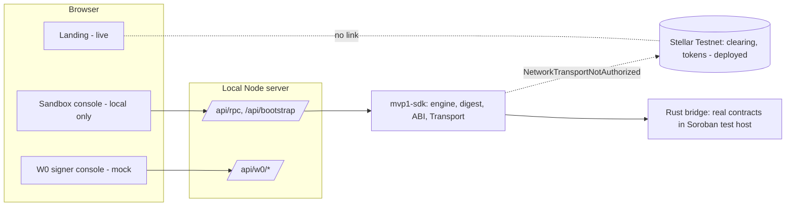
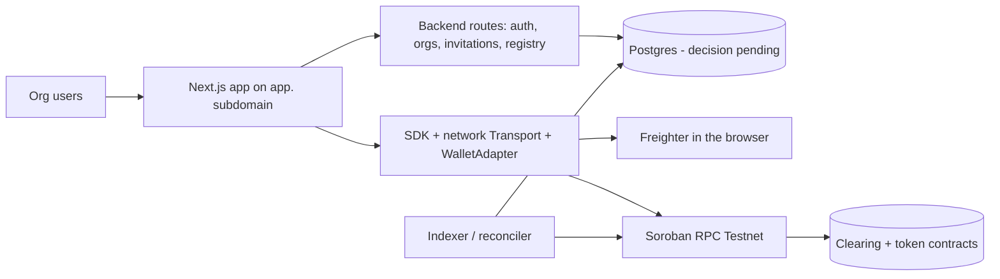

# B. Repository architecture report

Evidence: tracked tree at `f2abbbe`; `package.json` workspaces `apps/*`, `packages/*`; Node ≥24; TypeScript 5.9.3; Next.js 16.4.3; React 19.3.0; Rust workspace with soroban-sdk 29.0.0; Tailwind 4 (landing only).

## 1. Components

| Component | Location | Responsibility | Dependencies | Maturity | Integration points |
|---|---|---|---|---|---|
| Clearing contract `TobinClearingV1` | `contracts/clearing` | sessions, membership, obligations, proposals, approvals, atomic settlement | soroban-sdk | complete for MVP-1 scope; deployed; 1,124 lines | token `transfer`; no admin |
| Token `TobinTestToken` | `contracts/token` | capped test token, single minter | soroban-sdk | complete; deployed twice (legacy, governed) | called by the clearing contract |
| Deployment manifest | `contracts/deployments/testnet.json` (+ schema) | recorded Testnet addresses, Wasm hashes, tx hashes | none | VERIFIED against Testnet | scanned by release gate G09 |
| Netting engine / digest | `packages/mvp1-sdk/src/engine`, `digest.ts` | net positions, default proposal, validator, digests | none (own strkey and SHA-256) | complete, tested | mirrors the contract's rules |
| SDK | `packages/mvp1-sdk/src/sdk` | typed ABI, prepared calls, authorization intents, error tables, `Transport` | engine | complete for local; no network transport | `NetworkTransportNotAuthorized` placeholder |
| Local bridge | `packages/mvp1-sdk/src/local`, `contracts/clearing/examples/bridge.rs` | runs real contracts in the Soroban test host | Rust binary | dev only | sandbox console |
| Sandbox console | `apps/web-console` (`/`, `/api/bootstrap`, `/api/rpc`) | local lifecycle UI | SDK, bridge | functional but simulated, memory only | none to Stellar |
| W0/W1 signer console | `apps/web-console` (`/w0`, `/api/w0/*`, `lib/w0`) | non-executing signer request/approval/audit UI | none | mock adapter, development identity, in-memory | contract-tested adapter interface |
| TST signer | `scripts/tst-signer` | local CLI for the TST token (deploy, mint-C, mint-D) | pinned Stellar SDK 17.4.0 | built, integrity-gated; **execution not authorized**; B2 hazard open | none from the web |
| Integrity tooling | `scripts/tst-signer-verify`, `independent-verification` | B0/B1 verification | none | complete, 79+38 tests | CI |
| Governance tooling | `scripts/multisig`, `scripts/accounts`, `accounts/` | admin multisig setup, inspection, verification | Node | used on Testnet; evidence recorded | Horizon |
| Landing | `apps/landing` | public site | Next, Tailwind, motion, recharts | live, lint clean | deployed on Vercel at the apex domain |
| CI | `.github/workflows` (5) | build, test, scans, browser journeys | actions pinned by SHA | green | |
| Docs | `docs/**`, `README.md`, `contracts/README.md` | specs, reports, governance | | extensive, scattered | |

**Missing components:** application backend, database and migrations, authentication, organization/membership/invitation services, session registry and chain indexer, Soroban RPC client, wallet adapter(s), application shell using the landing tokens, monitoring.

## 2. Diagrams

Current architecture (what exists):

Target MVP architecture (proposed; needs owner decisions):

Trust boundaries: the server never holds keys or signs; chain state is authoritative; the browser signs authorization entries and submits; the registry is a cache plus organization metadata.

## 3. Duplication, inconsistency and abandoned material
- Large historical Phase 2C evidence (revision 5, 6, 6.1 to 6.3 archives, several copies of the same sources and zips) is retained by design but inflates the repository and is partly outside the active build; keep, but index and exclude from product navigation.
- Two web surfaces share one Next app (`/` sandbox and `/w0`); the sandbox must not ship publicly as is.
- Netting logic exists twice by design (Rust in the contract, TypeScript in the engine), reconciled by fixtures: keep.
- Console styles (33 lines, system fonts) are unrelated to the landing design system; no shared token package yet.
- README/roadmap statements about an unpublished Testnet report are inconsistent with the repository's own evidence standard.
- Untracked planning documents (`docs/product/architecture/*.md`, `docs/design-system/`) are not in version control; they hold the only screen inventory and domain model.

## 4. Recommended MVP data model (proposal; the database is an owner decision)
`users`, `organizations` (type, profile, status), `memberships` (user, organization, role: owner/admin/finance/viewer), `invitations` (token hash, email, role, expiry, status), `wallets` (user, organization, address, verified_at, challenge nonce), `sessions` (session_id = chain id, creator organization, token, cached state, last synced ledger), `session_participants` (session, organization, address, status), `obligations` (id, session, debtor/creditor organization, amount in base units, submit tx, ledger, status), `proposals` (digest, revision, instructions, proposer), `approvals` (participant, digest, tx), `settlements` (digest, tx hash, ledger, total moved), `chain_transactions` (hash, kind, status, submitted, confirmed), `activity_events` (append-only, per organization), `audit_events` (append-only, hash-chained). Rules: every row carries `organization_id` and is accessed through organization-scoped queries (enforced by row-level security or an equivalent single data-access layer); amounts as integer base units (never floats); the chain is authoritative and reconciliation records divergences instead of overwriting them; the registry never stores secrets or signatures beyond public authorization entries awaiting collection.
