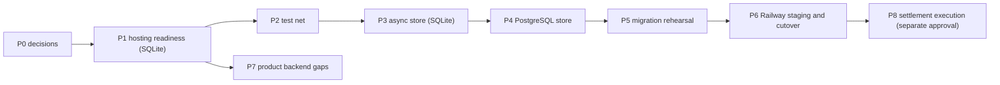

# Backend implementation roadmap

Status: **Recommendation**. Nothing here is started or approved. It is an ordering proposal derived from the other documents in this folder; every phase needs owner approval before work begins (`architecture-decisions.md` section 3). Stellar Testnet only. No Mainnet, token change, contract redeployment or change of signing authority appears in any phase.

Principles: each phase leaves `main` working and releasable; no phase deletes or overwrites the SQLite database; every phase ends with its exit criteria met and recorded; the order is chosen to put the cheapest, most reversible work first and the highest regression risk behind a stronger test net.

## P0. Decisions (no code)

Answer the blocking owner decisions in `architecture-decisions.md` section 3: PostgreSQL and the `pg` dependency; hosting scope and who may reach the console; whether any non-developer data must survive; whether owner Stellar tools run on the hosted console; the 10- versus 30-ledger authorization lifetime; batch-reviewer rule (SEC, authentication document A5).
**Exit:** each decision recorded in writing; the ADR list in `architecture-decisions.md` updated.

## P1. Hosting readiness on the current stack

Goal: a Testnet pilot could run on Railway with SQLite on one volume and one replica, with no database change.

| Item | Source finding | Notes |
|---|---|---|
| Configurable, fail-closed host and origin allow-lists; bind address from the platform; sandbox, W0 and `/api/rpc`, `/api/bootstrap` excluded from production builds | SEC-01, SEC-17 | do not simply widen the guard: those routes have no authentication of their own |
| Security headers on `web` (CSP, frame-ancestors, nosniff, referrer policy, HSTS) | SEC-02 | CSP must allow the Freighter flow and Next scripts: test in browser |
| Trusted client-IP hop, IP-aware rate limits on registration, login and wallet challenge; registration cost control | SEC-05, SEC-06 | the proxy must forward one trusted IP header the console accepts only from `web` |
| Structured stdout logging of authentication events, refusals and admin actions, redacted | SEC-08 | needed before real users |
| Readiness endpoint that checks the database; `/api/health` reachable by the platform | Railway document | health must work with the platform Host |
| Wallet sign-in challenge `domain` taken from configuration, not the internal Host | SEC-07 | |
| `apps/web` lint, unit tests, build and the access script added to CI | testing plan | today only the root typecheck covers it |
| UI and server limits aligned (password 12, organization name 80) | mapping document | |
| Correct the Wallets-tab behaviour or wording (sign-in flow versus linking) | README section 6 | an owner decision decides which |

**Exit:** a staging service pair passes `check-access.mjs` and the security-header checks from outside; guard tests cover the new configuration; CI runs the added jobs green.

## P2. Strengthen the test net before touching persistence

- Extract a registry store conformance suite from `backend-db.test.ts` and the `*-ops` tests so it can run against any `RegistryStore` (the existing conformance suite targets the W0 mocks).
- Extend the tenant-isolation test (S5 covers 9 endpoints) to every organization-scoped endpoint.
- Add a store round-trip test asserting key order of the stored position documents (the recalculation check compares `JSON.stringify`).
- Add idempotency and concurrency test scaffolding.
**Exit:** the suite passes on SQLite and is the acceptance gate for P3 and P4 (`testing-and-acceptance-plan.md`).

## P3. Asynchronous store, still on SQLite

The `RegistryStore` has 59 methods called 169 times in `registry/service.ts`, all synchronous, and `AuthService` issues SQL through `db.raw` directly (49 call sites). Make the interface asynchronous, route `AuthService` through a store, keep `node:sqlite` behind it, and keep behaviour identical. Keep `BEGIN IMMEDIATE` semantics as the explicit per-organization critical sections the PostgreSQL phase will implement with locks.
**Exit:** all existing tests and the new conformance suite pass unchanged; no schema change; no behaviour change in the browser scripts that ran before.

## P4. PostgreSQL store

- Schema from `postgresql-target-architecture.md` (proposal), created by migration tooling (single choice, no ORM); `json` for position documents, `numeric(39,0)` with range checks for amounts, text ids preserved, immutability by trigger plus `REVOKE`, two database roles.
- Per-organization lock (advisory lock or row lock; **Owner decision**) for last-administrator checks, invitation acceptance, calculate, decide, prepare and execution transitions.
- Pooling with a bounded pool sized to the Railway plan.
**Exit:** the conformance suite, tenant-isolation tests, concurrency tests (two writers racing each rule) and immutability tests pass on PostgreSQL; no SQLite path removed.

## P5. Migration utility and rehearsal

Build the read-only export and verified import described in `sqlite-postgresql-migration-plan.md`: backup first, idempotent, restartable, row counts and canonical hashes per table, invariant checks, `migration_runs` record. Rehearse on a copy of the real developer file and on fixture data.
**Exit:** two consecutive clean rehearsals; rollback rehearsed; the validation report format agreed.

## P6. Railway staging and cutover

Two services (`web` public, `console` private) plus PostgreSQL; pre-deploy migration step; health and readiness checks; backups and a restore test; domain and HTTPS; logs. Cutover per the migration plan: freeze writes, final copy, verify, switch, keep the SQLite file read-only and backed up through the soak period. Railway behaviour listed as Unknown must be confirmed against current Railway documentation during this phase.
**Exit:** staging soak completed with the agreed length; a restore test passed; rollback window defined; the owner signs the cutover.

## P7. Product backend gaps (parallel after P1, in value order)

From the mapping document (M01 to M24): organization summary, review queue and paged obligation and activity reads (removes the browser fan-out of about three requests per session across 10 sessions per page load, M01 to M07); single-session summary (M06, which also stops reading the whole organization activity log per session); per-entity history (M08); wallet linking client (M09, backend exists); idempotency keys on creates (M19); atomic create-session-with-participants (M18). Later and owner-gated: notifications (M12), directory and public explorer (M13, M14), password change and recovery (M15), session list (M16), invitation delivery (M17). Each is a new endpoint with its contract tests; none changes an existing contract.

## P8. Settlement execution (needs its own approval)

Only after the owner decides the model. Today the database execution and attempt tables are created up to `awaiting-signer` and no code advances them, while the real signing path is an owner tool with in-memory state and a JSONL log in the repository tree. Options and requirements are in `stellar-settlement-architecture.md`: unify the two so that attempts, transaction hashes and read-backs are persisted; make read-back and reconciliation repeatable; unknown outcomes are resolved by reading the original hash, never by resending. No server-side private keys at any point.

## Out of scope in every phase

Mainnet; token or contract changes; signing authority changes; real-value use; claims of audit or conformance.
