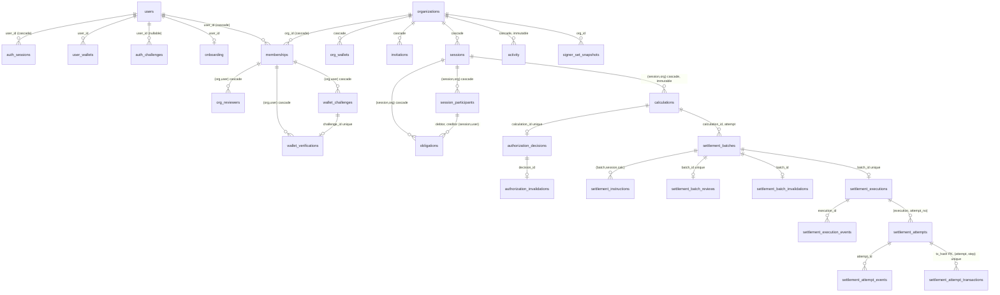

# SQLite database inventory

Scope: the persistent store behind `apps/web-console` as it exists in the working tree. This document describes what the code does. It proposes nothing; the PostgreSQL proposal is in `postgresql-target-architecture.md` and the migration procedure is in `sqlite-postgresql-migration-plan.md`.

Labels: **Verified** (read in code), **Inference**, **Unknown**, **Recommendation**, **Owner decision**. Paths are relative to the repository root. `database.ts` means `apps/web-console/lib/db/database.ts`.

## 1. Summary

- **Verified.** There is exactly one durable store: one SQLite file opened through Node's built-in `node:sqlite` (`database.ts:6`, `:671-678`). It holds authentication, organizations, the clearing registry, authorization decisions, settlement preparation and execution records, and two append-only histories.
- **Verified.** `apps/web` has no database. `lib/w0/stores.ts` (the mock W0 API) is in memory only, see section 12.
- **Verified.** 8 migrations (`database.ts:10-620`) create 32 application tables plus `schema_migrations` (33 in total), after migrations 2 and 5 drop and rebuild some tables. 15 tables are fully append-only or immutable by trigger and one more (`user_wallets`) is revoke-only.
- **Verified.** All business timestamps are ISO-8601 UTC strings in `TEXT` columns. All amounts are decimal digit strings in `TEXT` columns. Identifiers are application-generated text with prefixes, or 64-hex values.
- **Verified.** The store interface `RegistryStore` (`lib/registry/store.ts:7-76`) is fully synchronous. `AuthService` does not use that interface; it issues SQL directly through `db.raw` (`lib/auth/service.ts`).
- **Unknown.** Row counts of any existing database. See section 14.

## 2. Location, configuration, pragmas

| Item | Value | Source |
|---|---|---|
| Path variable | `TOBIN_DB_PATH` | `lib/server/backend.ts:20` |
| Default (non-production) | `.data/tobin-dev.sqlite`, relative to the process working directory | `backend.ts:26` |
| Production without the variable | `BackendUnavailable`; every request answers 503 | `backend.ts:22` |
| `:memory:` | rejected in production, allowed otherwise | `backend.ts:23, 25` |
| Directory creation | `mkdirSync(dirname(path), {recursive: true})` for file paths | `database.ts:672` |
| `PRAGMA foreign_keys = ON` | yes, per connection | `database.ts:674` |
| `PRAGMA busy_timeout = 5000` | yes | `database.ts:675` |
| `PRAGMA journal_mode = WAL` | yes for file databases (so `-wal` and `-shm` sidecar files exist) | `database.ts:676` |
| `synchronous`, `cache_size`, `mmap`, `auto_vacuum` | not set (SQLite defaults) | `database.ts:671-678` |
| Process model | one `Database` singleton per process, stored on `globalThis` under `Symbol.for('tobin.backend')` | `backend.ts:37-55` |
| Migrations on startup | `createBackend` calls `migrate(db)`; a failure closes the DB and the process serves nothing | `backend.ts:29-34` |
| Operator script | `node scripts/db.ts migrate | status | asset-add | asset-disable | asset-list | seed-demo` | `scripts/db.ts:1-62` |

**Verified, working-tree observation.** `apps/web-console/.data/` contains `tobin-dev.sqlite`, `-shm` and `-wal`. The directory is git-ignored (`.gitignore:70`, `git ls-files apps/web-console/.data` returns nothing). It is a local developer database, not repository content.

**Verified.** The single-writer model: `Database.tx` issues `BEGIN IMMEDIATE`, which takes the SQLite write lock at once (`database.ts:628-642`). Together with `busy_timeout = 5000`, a second process writing the same file waits up to 5 s, then fails. The persistence architecture document states the single-instance limit (`docs/product/architecture/mvp-1.2/BACKEND_PERSISTENCE_ARCHITECTURE.md`, section 11).

## 3. Migration mechanism

| Aspect | Behaviour | Source |
|---|---|---|
| Definition | `MIGRATIONS` array of `{version, name, sql}`, SQL embedded in the TypeScript file | `database.ts:8-10` |
| Version tracking | table `schema_migrations(version INTEGER PRIMARY KEY, name TEXT NOT NULL, applied_at TEXT NOT NULL)`, created with `CREATE TABLE IF NOT EXISTS` on every status check | `database.ts:649` |
| Applied set | rows in `schema_migrations`; pending = migrations whose version is absent | `database.ts:651-653` |
| Transaction | each migration plus its `schema_migrations` insert runs inside one `db.tx` (BEGIN IMMEDIATE ... COMMIT); failure rolls back that migration | `database.ts:660-666` |
| Repeatable | yes: already-applied versions are skipped | `database.ts:661` |
| Downgrade protection | database version greater than the code's latest throws | `database.ts:659` |
| Down migrations | none | `database.ts:10-620` |
| Gaps | not checked: pending is "not in set", so a missing middle version would be applied later | `database.ts:653` |
| Checksums of applied SQL | none; the stored `name` is the only record | `database.ts:664` |
| Foreign keys during table rebuilds | `foreign_keys` is ON while migrations 2 and 5 `DROP TABLE` tables that other tables may reference. **Unknown** whether these two migrations were exercised against populated data; `AGENTS.md` records that migration 8 was not tested on a real operator database. | `database.ts:133, 400-403` |

Migration history:

| # | Lines | Name (abridged) | Adds or changes |
|---|---|---|---|
| 1 | 12-111 | initial schema | `users`, `auth_sessions`, `rate_events`, `organizations`, `memberships`, `org_wallets`, `invitations`, `sessions`, `session_participants`, `activity` and the activity triggers |
| 2 | 112-175 | clearing operations | `sessions.workflow_state`; rebuilds `session_participants` (drops the membership FK, adds `status`, `removed_at`); adds `obligations`, `calculations` and calculation triggers |
| 3 | 176-214 | institutional authorization | `org_reviewers`, `authorization_decisions`, `authorization_invalidations` and triggers |
| 4 | 215-297 | settlement preparation | `supported_assets`, `settlement_batches`, `settlement_instructions`, `settlement_batch_reviews`, `settlement_batch_invalidations` and triggers |
| 5 | 298-471 | asset identity, attempts, challenges, execution | `obligations.asset_ref/asset_identity`, `calculations.asset_ref`; rebuilds `supported_assets` (adds `contract` kind); rebuilds all four settlement tables (adds `attempt`, instruction contract columns); adds `wallet_challenges`, `wallet_verifications`, `settlement_executions`, `settlement_execution_events` and triggers |
| 6 | 472-520 | execution attempts | `settlement_attempts`, `settlement_attempt_events`, `settlement_attempt_transactions` and triggers |
| 7 | 521-544 | signer-set snapshots | `signer_set_snapshots` and triggers |
| 8 | 545-619 | wallet-first authentication | `users.auth_method/updated_at`; `auth_sessions.last_seen_at/auth_method/wallet_id`; `user_wallets`, `auth_challenges`, `auth_audit`, `onboarding`; `organizations.institution_type/jurisdiction`; `memberships.status`; triggers on `user_wallets` and `auth_audit` |

**Documentation drift (Verified).** `docs/product/architecture/mvp-1.2/BACKEND_PERSISTENCE_DATA_MODEL.md` says it takes "migration 1" as source of truth and lists 11 tables. It does not describe migrations 2 to 8. It still states that `session_participants` has a foreign key to `memberships` with cascade; migration 2 (`database.ts:117-134`) removed that on purpose. `BACKEND_PERSISTENCE_ARCHITECTURE.md` states an "8 hour absolute lifetime" for sessions; the code applies `SESSION_TTL_MS = 8h` to password sessions and, for wallet sessions, an additional 24 h absolute cap and 2 h idle limit (`lib/auth/service.ts:37-39, 129-138, 155-157`). The code is treated as correct here.

## 4. Tables, columns and constraints

Column notation: `type`, `NN` = NOT NULL, `NULL` = nullable. SQLite has type affinity only; `CHECK` constraints carry the real validation. "Final" means the column set after all 8 migrations. All `TEXT` timestamps hold `Date.toISOString()` output (`YYYY-MM-DDTHH:mm:ss.sssZ`, Verified by the writers, for example `lib/auth/service.ts:132`, `lib/registry/service.ts:51`).

### 4.1 Authentication and identity

**`users`** (m1, extended m8)

| Column | Type | Null | Default | Constraint |
|---|---|---|---|---|
| id | TEXT | PK | | `usr_` + 18 hex (`auth/service.ts:100, 247`) |
| email | TEXT | NN | | UNIQUE; `email = lower(email)` and length 3..254 |
| display_name | TEXT | NN | | length 1..80 |
| password_hash | TEXT | NN | | scrypt string `scrypt$cost$8$1$salt$key`, or the literal `'wallet-only'` for wallet users |
| created_at | TEXT | NN | | |
| disabled | INTEGER | NN | 0 | in (0,1) |
| auth_method | TEXT | NN | `'password'` | in (`password`,`wallet`) (m8) |
| updated_at | TEXT | NULL | | (m8) |

Wallet-only users get a placeholder email `wallet.<userId>@wallet.tobin.invalid` (`auth/service.ts:249`), because `email` is NOT NULL and UNIQUE.

**`auth_sessions`** (m1, extended m8)

| Column | Type | Null | Default | Constraint |
|---|---|---|---|---|
| token_hash | TEXT | PK | | SHA-256 hex of the cookie token (`auth/service.ts:50, 135`) |
| user_id | TEXT | NN | | FK `users(id)` ON DELETE CASCADE |
| created_at | TEXT | NN | | |
| expires_at | TEXT | NN | | |
| revoked_at | TEXT | NULL | | |
| last_seen_at | TEXT | NULL | | (m8) |
| auth_method | TEXT | NN | `'password'` | in (`password`,`wallet`) (m8) |
| wallet_id | TEXT | NULL | | (m8) not a declared FK; references `user_wallets.id` logically |

Indexes: `auth_sessions_user(user_id)`, `auth_sessions_wallet(wallet_id)`.

**`rate_events`** (m1): `id INTEGER PK AUTOINCREMENT`, `key TEXT NN`, `at INTEGER NN` (epoch milliseconds, the only integer time column). Index `rate_events_key_at(key, at)`. Keys seen in code: `login:<email>`, `chal:<publicKey>`, `chal:*`, `wverify:<publicKey>` (`auth/service.ts:114, 196-197, 219`).

**`user_wallets`** (m8)

| Column | Type | Null | Constraint |
|---|---|---|---|
| id | TEXT | PK | `wal_` + 18 hex |
| user_id | TEXT | NN | FK `users(id)` |
| network | TEXT | NN | in (`testnet`) |
| public_key | TEXT | NN | length 56, GLOB `G*` |
| status | TEXT | NN | in (`active`,`revoked`) |
| verified_at | TEXT | NN | |
| created_at | TEXT | NN | |
| revoked_at | TEXT | NULL | `(status='revoked') = (revoked_at IS NOT NULL)` |
| revoked_reason | TEXT | NULL | |

Indexes: `user_wallets_active_key` UNIQUE on `(network, public_key) WHERE status='active'` (partial unique), `user_wallets_user(user_id, status)`. Triggers: `user_wallets_no_delete`, `user_wallets_identity_fixed` (blocks update of user_id, network, public_key, verified_at, created_at), `user_wallets_revoked_final` (blocks any update once revoked). So the only legal mutation is `active -> revoked`.

**`auth_challenges`** (m8): `id TEXT PK` (32 hex), `purpose` in (`sign-in`,`link-wallet`), `network` in (`testnet`), `public_key` (56, `G*`), `user_id TEXT NULL` FK `users(id)`, `domain` (1..100), `nonce` (32 hex), `issued_at`, `expires_at`, `consumed_at NULL`, `failures INTEGER NN DEFAULT 0`. CHECK `(purpose='link-wallet') = (user_id IS NOT NULL)`. Index `auth_challenges_expiry(expires_at)`. Single-use is enforced by one guarded `UPDATE ... WHERE consumed_at IS NULL AND expires_at > ?` (`auth/service.ts:226-227`).

**`auth_audit`** (m8): `seq INTEGER PK AUTOINCREMENT`, `at`, `user_id TEXT NULL` (no FK), `kind`, `subject`, `detail` (all TEXT NN except user_id). Index `auth_audit_user(user_id, seq)`. Triggers forbid UPDATE and DELETE. No signatures or tokens are recorded (`auth/service.ts:364` comment).

**`onboarding`** (m8): `user_id TEXT PK` FK `users(id)`, `profile_done INTEGER NN DEFAULT 0` in (0,1), `last_org_id TEXT NULL` FK `organizations(id)`, `updated_at TEXT NN`.

### 4.2 Organizations and membership

**`organizations`** (m1, extended m8): `id TEXT PK` (`org_` + 18 hex), `name` (2..80), `description NN DEFAULT ''` (<=500), `visibility` in (`private`,`public`), `created_at`, `created_by` FK `users(id)`, `institution_type TEXT NULL` in (`bank`,`payment-institution`,`broker-dealer`,`fintech`,`corporate-treasury`,`other`) or NULL, `jurisdiction TEXT NULL` (2 upper-case letters). The store upsert updates only `name, description, visibility` on conflict (`sqlite-store.ts:30`).

**`memberships`** (m1, extended m8): PK `(org_id, user_id)`, `org_id` FK `organizations(id)` CASCADE, `user_id` FK `users(id)` CASCADE, `role` in (`admin`,`member`), `since TEXT NN`, `status TEXT NN DEFAULT 'active'` in (`active`,`suspended`). Index `memberships_user(user_id)`. Upsert updates role and status only (`sqlite-store.ts:38`).

**`org_reviewers`** (m3): PK `(org_id, user_id)`, `granted_by` FK `users(id)`, `granted_at`, composite FK `(org_id, user_id) -> memberships` CASCADE. Mutable: granted and removed by `DELETE` (`sqlite-store.ts:154`). Reviewer capability is separate from the admin role (`registry/service.ts:512-532`).

**`org_wallets`** (m1): PK `(org_id, address)`, FK `organizations(id)` CASCADE, `address` (56, `G*`), `proof` in (`none`,`signature-verified`). The application only writes `none` (`registry/service.ts:209`); these are unproven claims.

**`invitations`** (m1): `id TEXT PK`, `org_id` FK CASCADE, `invitee TEXT NN` (an email, a Stellar address or free text, 3..120 chars by the application), `role`, `token_hash TEXT NN UNIQUE` (length 64), `status` in (`pending`,`accepted`,`revoked`), `expires_at`, `created_by` FK `users(id)`. Index `invitations_org(org_id)`. Mutable: upsert changes `status` only. Expiry is checked at acceptance (`registry/service.ts:185`); expired rows are never deleted.

**`onboarding`** and **`user_wallets`** are above.

### 4.3 Clearing registry

**`sessions`** (m1, extended m2): `session_id TEXT PK` (64 lowercase hex, CHECK), `org_id` FK `organizations` CASCADE, `label` (1..80), `provenance` in (`fixture`,`local-draft`,`chain-read`,`chain-confirmed`), `created_at`, `chain_json TEXT NULL`, `confirmed_tx_hash TEXT NULL`, `workflow_state TEXT NN DEFAULT 'configuring'` in (`configuring`,`ready`,`closed`). Constraints: `UNIQUE(session_id, org_id)` (target of composite FKs); `(provenance IN ('chain-read','chain-confirmed')) = (chain_json IS NOT NULL)`; `(provenance='chain-confirmed') = (confirmed_tx_hash IS NOT NULL)`; hash is 64 lowercase hex. Index `sessions_org(org_id, created_at)`. **Mutable**: the upsert rewrites provenance, chain_json, confirmed_tx_hash, workflow_state (`sqlite-store.ts:57-61`). The `session_id` is the on-chain `BytesN<32>` id, globally unique across all organizations.

**`session_participants`** (rebuilt in m2): PK `(session_id, user_id)`, `org_id`, `wallet_address TEXT NULL` (not constrained to `G*`), `added_by`, `added_at`, `status` in (`active`,`removed`) DEFAULT `'active'`, `removed_at NULL`, CHECK `(status='removed') = (removed_at IS NOT NULL)`, FK `(session_id, org_id) -> sessions` CASCADE. There is no FK to `memberships` or `users`: the migration comment says removing a member must not erase or block session history (`database.ts:117-118`). `added_by` has no FK.

**`obligations`** (m2, extended m5)

| Column | Type | Null | Constraint |
|---|---|---|---|
| id | TEXT | PK | 64 lowercase hex, `randomBytes(32)` (`registry/service.ts:360`) |
| session_id, org_id | TEXT | NN | composite FK `sessions(session_id, org_id)` CASCADE |
| debtor, creditor | TEXT | NN | each FK `(session_id, x) -> session_participants(session_id, user_id)`; `debtor <> creditor` |
| amount | TEXT | NN | length 1..39, digits only, no leading `0` (so strictly positive, no zero) |
| asset | TEXT | NN | length 1..12, `[A-Z0-9]` only (a code, not an identity) |
| reference | TEXT | NN DEFAULT '' | <= 200 |
| status | TEXT | NN | in (`active`,`voided`) |
| revision | INTEGER | NN | >= 1 |
| created_at, created_by, updated_at, updated_by | TEXT | NN | `*_by` has no FK |
| asset_ref | TEXT | NULL | (m5) canonical `tobin-asset/v1` string |
| asset_identity | TEXT | NN DEFAULT `'legacy-unresolved'` | in (`canonical`,`legacy-unresolved`); canonical requires `asset_ref` not null |

Index `obligations_session(session_id, created_at)`. **Mutable by design**: edits and voiding rewrite the row and bump `revision` (`sqlite-store.ts:78-82`); there is no history table of earlier revisions. Earlier revisions survive only inside `calculations.input_json`.

**`calculations`** (m2, `asset_ref` m5): `seq INTEGER PK AUTOINCREMENT`, `id TEXT NN UNIQUE` (`calc_` + 18 hex), `session_id`, `org_id` (composite FK `sessions` CASCADE), `asset TEXT NN`, `input_hash TEXT NN` (length 64), `input_json TEXT NN`, `positions_json TEXT NN`, `gross TEXT NN`, `created_at`, `created_by` (no FK), `asset_ref TEXT NULL`. Index `calculations_session(session_id, seq)`. Triggers forbid UPDATE and DELETE. "Latest" means highest `seq` (`sqlite-store.ts:90`).

`input_json` shape (`lib/registry/types.ts:137`): `{participants: string[], obligations: [{id, revision, debtor, creditor, amount}]}`. `positions_json`: `[{userId, net}]` where `net` is a signed decimal string (can be negative; `clearing.ts:58`). `inputHash` is `sha256(JSON.stringify({v:1, asset, ...input}))` (`clearing.ts:44`). The hash is over JSON text produced by JavaScript `JSON.stringify` with insertion-ordered keys; therefore the stored JSON text is part of the hash contract (see migration plan).

### 4.4 Authorization (calculation level)

**`authorization_decisions`** (m3): `seq INTEGER PK AUTOINCREMENT`, `id UNIQUE` (`dec_`...), `session_id`, `org_id` (composite FK `sessions`, no cascade), `calculation_id TEXT NN UNIQUE` FK `calculations(id)`, `decision` in (`approved`,`rejected`), `reason` (<=500; `(decision='rejected') = (length(trim(reason))>0)`), `decided_by` FK `users(id)`, `decided_at`. Index `authorization_decisions_session(session_id, seq)`. Immutable (triggers). UNIQUE on `calculation_id` is the database-level "one decision per snapshot" rule.

**`authorization_invalidations`** (m3): `decision_id TEXT PK` FK `authorization_decisions(id)`, `cause` (1..300), `at`, `by_actor`. Immutable. A decision stops authorizing when this row exists; the decision stays as history.

### 4.5 Settlement preparation and execution

**`supported_assets`** (rebuilt m5): `id TEXT PK` (`<network>:native`, `<network>:<code>:<issuer>` or `<network>:contract:<contract_id>`, enforced by CHECK), `network` in (`testnet`,`public`), `kind` in (`native`,`issued`,`contract`), `code` (1..12, `[A-Z0-9]`), `issuer NULL` (56, `G`, base32), `contract_id NULL` (56, `C`, base32), `status` in (`supported`,`disabled`), `source` DEFAULT `'operator-configured'` CHECK equals that literal, `added_at`. Kind/issuer/contract_id coupling is checked. Mutable (`status` is updated by upsert). Written only by the operator script (`scripts/db.ts`), not by the API (comment `store.ts:41`). Note `scripts/db.ts` `asset-add` cannot create `contract` kind assets; **Unknown** how contract assets are added to a real database (not via `db.ts`; a test or direct `putAsset` call).

**`settlement_batches`** (rebuilt m5): `seq PK AUTOINCREMENT`, `id UNIQUE` (`bat_`...), `session_id`, `org_id` (composite FK `sessions`), `calculation_id` FK `calculations(id)`, `attempt INTEGER NN DEFAULT 1` (>=1), `asset_id`, `asset_network`, `asset_kind`, `asset_code`, `asset_issuer NULL` (denormalized copy of the asset at preparation time, no FK to `supported_assets`), `instruction_count` (>=0), `total_amount` (digits, length 1..39, zero allowed), `instructions_hash` (length 64), `algorithm`, `validation_json`, `prepared_by` FK `users`, `prepared_at`. Constraints `UNIQUE(id, session_id, calculation_id)`, `UNIQUE(calculation_id, attempt)`. Index `settlement_batches_session(session_id, seq)`. Immutable.

**`settlement_instructions`** (rebuilt m5): `id TEXT PK` (`ins_` + 24 hex of a hash), `batch_id`, `session_id`, `org_id NULL`, `calculation_id`, `approval_decision_id NULL`, `network NULL`, `seq` (>=1), `payer`, `payee`, `source_account NULL`, `destination_account NULL`, `asset_id`, `amount` (positive digits), `fingerprint NULL`, `validation_status NN DEFAULT 'valid'` (CHECK = `'valid'`). Constraints: `payer <> payee`; `CHECK (source_account IS NULL AND destination_account IS NULL)` (those columns can never hold a value, **Verified**, `database.ts:375`); `UNIQUE(batch_id, seq)`, `UNIQUE(batch_id, payer, payee)`; composite FK `(batch_id, session_id, calculation_id) -> settlement_batches(id, session_id, calculation_id)`. `payer` and `payee` are user ids without FK. Immutable. `org_id`, `approval_decision_id`, `network`, `fingerprint` are nullable only because migrated legacy rows may lack them; migration 5 back-fills `approval_decision_id` and `network` for legacy rows (`database.ts:380-382`) but not `fingerprint`.

**`settlement_batch_reviews`** (rebuilt m5): `seq PK AUTOINCREMENT`, `id UNIQUE` (`brv_`...), `batch_id TEXT NN UNIQUE` FK `settlement_batches(id)`, `decision`, `reason` (same rule as decisions), `decided_by` FK `users`, `decided_at`. Immutable.

**`settlement_batch_invalidations`** (rebuilt m5): `batch_id TEXT PK` FK `settlement_batches(id)`, `cause`, `at`, `by_actor`. Immutable.

**`settlement_executions`** (m5): `id TEXT PK` (`exe_`...), `batch_id TEXT NN UNIQUE` FK `settlement_batches(id)`, `session_id`, `org_id` (no FK), `network` in (`testnet`,`public`), `accounts_json TEXT NN` (map userId -> verified G-address), `created_by` FK `users`, `created_at`. Immutable.

**`settlement_execution_events`** (m5): `seq PK AUTOINCREMENT`, `execution_id` FK `settlement_executions(id)`, `from_state NULL`, `to_state NN`, `actor`, `at`, `detail NN DEFAULT ''`, `evidence_json NULL`. Index `(execution_id, seq)`. Immutable. State is the last event; there is no state column.

**`settlement_attempts`** (m6): `id TEXT PK` (`att_`...), `execution_id` FK, `attempt_no` (>=1), `network`, `plan_fingerprint` (length 64), `plan_json TEXT NN` (written with a replacer that turns BigInt into strings, `sqlite-store.ts:141`), `initiator` (user id, no FK), `created_by` FK `users`, `created_at`, `UNIQUE(execution_id, attempt_no)`. Immutable.

**`settlement_attempt_events`** (m6): `seq PK AUTOINCREMENT`, `attempt_id` FK, `kind` in (`transition`,`note`), `from_state NULL`, `to_state NN`, `actor`, `at`, `detail`, `evidence_json NULL`, CHECK `kind='transition' OR from_state = to_state`. Index `(attempt_id, seq)`. Immutable. State is the last `transition` event (`registry/service.ts:845-849`).

**`settlement_attempt_transactions`** (m6): `tx_hash TEXT PK` (64 lowercase hex), `attempt_id` FK, `step_index` (>=1), `network`, `recorded_by`, `recorded_at`, `UNIQUE(attempt_id, step_index)`. Immutable. The PK on `tx_hash` is global across organizations.

**`signer_set_snapshots`** (m7): `seq PK AUTOINCREMENT`, `id UNIQUE` (`sgs_`...), `org_id` FK `organizations(id)` (no cascade), `network`, `account` (56, `G*`), `fingerprint` (64 lowercase hex), `thresholds_json`, `signers_json`, `source` CHECK = `'horizon+rpc-agreed'`, `recorded_by` FK `users`, `recorded_at`, `UNIQUE(org_id, network, account, fingerprint)`. Immutable.

### 4.6 Wallet verification (organization-scoped, older mechanism)

**`wallet_challenges`** (m5): `id TEXT PK` (`wch_`...), `org_id`, `user_id` (composite FK `memberships(org_id, user_id)` CASCADE), `network` in (`testnet`,`public`), `public_key` (56, `G*`), `nonce` (length 48), `message TEXT NN`, `issued_at`, `expires_at`, `used_at NULL`. Mutable (`used_at` set once).

**`wallet_verifications`** (m5): PK `(org_id, network, public_key)`, `user_id`, composite FK `(org_id, user_id) -> memberships` CASCADE, `scheme` in (`raw`,`sep-53`), `challenge_id TEXT NN UNIQUE` FK `wallet_challenges(id)`, `verified_at`. Not protected by triggers. The settlement execution step reads these to find "exactly one VERIFIED key per person" (`registry/service.ts:793-799`).

**Verified, important.** There are now two independent wallet-ownership mechanisms: `wallet_challenges/wallet_verifications` (organization-scoped, used by `Registry.verifyWalletChallenge`) and `auth_challenges/user_wallets` (user-scoped, used by `AuthService`). Settlement execution reads the first; sign-in reads the second. `wallet_verifications` rows disappear (cascade) when the membership row is deleted (`Registry.removeMember` deletes the membership, `sqlite-store.ts:40`).

### 4.7 Activity (organization audit trail)

**`activity`** (m1): `seq INTEGER PK AUTOINCREMENT`, `id TEXT NN UNIQUE` (`act_`...), `at`, `org_id` FK `organizations` CASCADE, `actor TEXT NN` (user id), `kind TEXT NN`, `subject TEXT NN`, `detail TEXT NN` (free text, not JSON). Index `activity_org(org_id, seq)`. Triggers forbid UPDATE and DELETE. `kind` is an unconstrained string (about 40 distinct values written by `registry/service.ts`). Separation-of-duties logic reads this table: `conflictedActors(calc, obligations, activityOfOrg(orgId))` (`registry/service.ts:559, 580`), so the activity table is **business-logic input**, not only an audit log. See `lib/registry/authorization.ts` for the rule.

### 4.8 Table count and classification overview

32 application tables + `schema_migrations`. Section 10 classifies each for migration.

## 5. Triggers

All triggers are `BEFORE UPDATE` or `BEFORE DELETE` with `SELECT RAISE(ABORT, '<message>')`.

| Table | Triggers | Effect |
|---|---|---|
| `activity` | `activity_no_update`, `activity_no_delete` | fully append-only (m1, `database.ts:108-109`) |
| `calculations` | `calculations_no_update/_no_delete` | snapshot immutable (m2) |
| `authorization_decisions` | `_no_update/_no_delete` | immutable (m3) |
| `authorization_invalidations` | `_no_update/_no_delete` | immutable (m3) |
| `settlement_batches`, `settlement_instructions`, `settlement_batch_reviews`, `settlement_batch_invalidations` | `_no_update/_no_delete` each | immutable; **re-created in m5** after the table rebuild (dropping a table drops its triggers, `database.ts:409-416`) |
| `settlement_executions`, `settlement_execution_events` | `_no_update/_no_delete` | immutable (m5) |
| `settlement_attempts`, `settlement_attempt_events`, `settlement_attempt_transactions` | `_no_update/_no_delete` | immutable (m6) |
| `signer_set_snapshots` | `_no_update/_no_delete` | immutable (m7) |
| `auth_audit` | `_no_update/_no_delete` | append-only (m8) |
| `user_wallets` | `_no_delete`; `_identity_fixed` (BEFORE UPDATE OF user_id, network, public_key, verified_at, created_at); `_revoked_final` (BEFORE UPDATE WHEN old.status='revoked') | revoke-only life cycle |

Consequences (Verified by reading the DDL, **Inference** for the operational effect):

1. A `DELETE` that would cascade into an immutable table aborts. Example: deleting an organization would cascade into `activity` (ON DELETE CASCADE) and the trigger would abort the whole delete. Deleting organizations or users is therefore not possible in SQLite as designed, consistent with "Deleting an organization or user is not an application operation" (`BACKEND_PERSISTENCE_DATA_MODEL.md`).
2. The triggers apply to every statement, including an operator's manual fix. The only way around them is dropping the trigger, which is what migrations themselves do implicitly when rebuilding tables.
3. Tables that are **not** protected, yet carry history-like rows: `obligations` (revisioned in place), `sessions` (provenance and workflow), `invitations`, `org_reviewers`, `wallet_challenges`, `wallet_verifications`, `supported_assets`, `org_wallets`, `memberships`, `auth_sessions`, `auth_challenges`, `onboarding`.

## 6. Relationships

Soft references that are **not** foreign keys (Verified; these are where integrity depends on application code): `auth_sessions.wallet_id`, `auth_audit.user_id`, `activity.actor`, `session_participants.added_by`, `obligations.created_by/updated_by`, `calculations.created_by`, `authorization_invalidations.by_actor`, `settlement_batch_invalidations.by_actor`, `settlement_instructions.payer/payee/approval_decision_id/org_id`, `settlement_executions.org_id/session_id`, `settlement_attempts.initiator`, `settlement_*_events.actor`, `settlement_attempt_transactions.recorded_by`, `org_wallets`/`session_participants.wallet_address`, and the JSON contents (`calculations.input_json` user ids, `settlement_executions.accounts_json`).

Tenant scoping (Verified): `org_id` is present on most private tables, and composite FKs `(session_id, org_id)` bind session children to the right organization. It is **not** present on `settlement_instructions` as NOT NULL (nullable), `settlement_executions` (present, no FK), `settlement_attempts*` (absent; reachable through execution), `authorization_invalidations` and `settlement_batch_*` (absent; reachable through parents).

## 7. Query patterns

All access is by primary or foreign key lookups; there is no ad-hoc search, pagination, or reporting query.

| Pattern | Statement shape | Used by | Index that serves it |
|---|---|---|---|
| Session token resolve | `auth_sessions JOIN users WHERE token_hash=?` | every authenticated request (`auth/service.ts:148-150`) | PK `token_hash` |
| Wallet active check | `user_wallets WHERE id=? AND status='active'` | wallet sessions (`:158`) | PK |
| Throttled last-seen update | `UPDATE auth_sessions SET last_seen_at` once per 60 s | wallet sessions (`:160`) | PK |
| Memberships of org / of user | `WHERE org_id=? ORDER BY since, user_id`; `WHERE user_id=? ORDER BY since, org_id` | **every** Registry call through `#role` (`registry/service.ts:55`) | PK / `memberships_user` |
| Sessions of org | `WHERE org_id=? ORDER BY created_at, session_id` | session list | `sessions_org` |
| Participants, obligations of session | `WHERE session_id=? ORDER BY ...` | netting, readiness, checks | PK prefix / `obligations_session` |
| Latest calculation | `WHERE session_id=? ORDER BY seq DESC LIMIT 1` | currency checks | `calculations_session` |
| Calculations / decisions / batches of session | `WHERE session_id=? ORDER BY seq` | review and preparation | `*_session` indexes |
| Join for reviews/invalidations | `settlement_batch_reviews r JOIN settlement_batches b ON b.id = r.batch_id WHERE b.session_id=?`; same for invalidations | batch status | FK columns |
| Activity of org | `WHERE org_id=? ORDER BY seq` (whole history) | activity view; separation-of-duties checks in `decide`, `authorization` (`:559, 580`) | `activity_org` |
| Invitation by hash | `WHERE token_hash=?` | acceptance | UNIQUE index |
| Wallet uniqueness | `WHERE network=? AND public_key=? AND status='active'` | sign-in, link | `user_wallets_active_key` |
| Rate window | `DELETE FROM rate_events WHERE at < now-24h` then `SELECT count(*) WHERE key=? AND at>?` | `rateCount` is called on login and challenge paths (`:370-374`) | `rate_events_key_at` (the DELETE scans by `at` alone; **Inference**: no index leading with `at`) |

**Inference.** Performance hotspots are application-level, not SQL-level: `Registry` reads whole collections (all memberships of an org, all activity of an org, all obligations of a session) and filters in memory, and several operations call `#evaluate`/`authorization`/`calculationView` repeatedly inside one transaction (`registry/service.ts:594-638, 697-704`). At testnet scale this is cheap; the activity history read grows with the age of the organization.

## 8. Transaction boundaries

| Mechanism | Behaviour | Source |
|---|---|---|
| `Database.tx(fn)` | `BEGIN IMMEDIATE`, run `fn`, `COMMIT`; any throw triggers `ROLLBACK` and rethrows; nested calls join the outer transaction via `#depth` (no savepoints) | `database.ts:628-642` |
| `RegistryStore.transaction` | delegates to `db.tx` (`sqlite-store.ts:27`) | |
| Registry mutations | each public mutating method wraps its work in `transaction`; activity is appended in the same transaction | `registry/service.ts` (about 33 call sites) |
| Two-phase patterns | `calculate` runs an authorization transaction first, then a second transaction for the write, then a third (activity `netting.failed`) only on `INVALID` failure so a refused request still leaves a trace (`:414-437`). `markReady` records a failed readiness evaluation the same way (`:468-481`) | |
| `AuthService` password paths | `register`, `login`, `logout`, `resolve`, rate-limit writes run as autocommit single statements, not in `tx` | `auth/service.ts:91-165, 370-375` |
| Wallet sign-in and link | explicit `BEGIN IMMEDIATE ... COMMIT` written by hand (not `db.tx`), with a deliberate `COMMIT` of failure bookkeeping (challenge `failures`, rate events) before rethrowing the error | `auth/service.ts:235-262, 273-290` |
| Wallet removal, renew, set display name | `db.tx` | `auth/service.ts:294, 313, 329` |
| Reads | outside any transaction (autocommit) unless called from within a mutation | |

**Verified.** Because every write transaction is `BEGIN IMMEDIATE` and the process has one connection, all write transactions are serialized. Read-check-write sequences in `Registry` (count admins then change role, check unique then insert) are therefore race-free in SQLite without explicit locking. This is an implicit guarantee that disappears with a multi-connection database (see PostgreSQL document, section on isolation).

**Verified.** The `tx` re-entrancy flag `#depth` is process-wide per `Database` object; with a synchronous driver and one thread there is no interleaving. The hand-written `BEGIN IMMEDIATE` in `verifySignIn` does not set `#depth`; a nested `db.tx` inside it would try `BEGIN IMMEDIATE` again and fail. Current code does not do that (`#newSession` and `#audit` use `db.raw` directly).

## 9. Retention and expiry behaviour

| Data | Expiry field | Cleanup in code | Source |
|---|---|---|---|
| `auth_sessions` | `expires_at`, `revoked_at` | **none**. Expired and revoked rows accumulate; only validity is checked at read. | `auth/service.ts:148-153` |
| `auth_challenges` | `expires_at` (5 min TTL) | `DELETE ... WHERE expires_at < now-24h` on each challenge issue | `auth/service.ts:199-200` |
| `rate_events` | `at` | `DELETE ... WHERE at < now-24h` on each `rateCount` call; `DELETE WHERE key=?` after a successful login | `auth/service.ts:123, 372` |
| `wallet_challenges` | `expires_at` | none | |
| `invitations` | `expires_at` (7 days) | none; status stays `pending` after expiry | `registry/service.ts:30, 185` |
| `activity`, `auth_audit`, decisions, snapshots, batches, executions, attempts, signer sets | none | none by design; immutable by trigger. A retention policy "does not exist yet" (`BACKEND_PERSISTENCE_OPERATIONS.md`) | |
| `user_wallets` | none | revoked rows are kept | |

## 10. Identifier, timestamp, amount, JSON and hash conventions

**IDs (Verified).** All application-generated, in code, not by the database:

| Entity | Format | Generator |
|---|---|---|
| users | `usr_` + 18 hex | `randomBytes(9)` (`auth/service.ts:100`) |
| user_wallets | `wal_` + 18 hex | `auth/service.ts:247` |
| organizations, invitations, activity, calculations, decisions, batches, batch reviews, wallet challenges, executions, attempts, signer sets | `org_`, `inv_`, `act_`, `calc_`, `dec_`, `bat_`, `brv_`, `wch_`, `exe_`, `att_`, `sgs_` + 18 hex | `id(prefix)` (`registry/service.ts:34`) |
| sessions | 64 lowercase hex (the on-chain `BytesN<32>` id), generated by `randomSessionId()` (`registry/http.ts:307`) or supplied | |
| obligations | 64 lowercase hex, `randomBytes(32)` | `registry/service.ts:360` |
| settlement instructions | `ins_` + first 24 hex of `sha256(calculationId|attempt|seq|payer|payee|amount)` (deterministic) | `settlement.ts:53` |
| auth_challenges | 32 lowercase hex | `auth/service.ts:201` |
| auth_sessions | primary key is SHA-256 hex of the token | |
| tx_hash, input_hash, instructions_hash, plan_fingerprint, fingerprint | 64 lowercase hex SHA-256 or Stellar transaction hash | |
| Stellar addresses | `G` + 55 base32 chars (accounts), `C` + 55 (contracts), length-checked | |

Note: `settlement_batches.id` is `bat_` + 18 hex, while `#short(b.id.slice(4))` in log text shows the part after the prefix. Instruction ids embed a hash but `batch_id` is stored separately.

**Timestamps (Verified).** `TEXT`, ISO-8601 UTC with milliseconds and a `Z` suffix, from `Date.toISOString()`. Comparisons in SQL (`expires_at < ?`, `ORDER BY created_at`) rely on lexicographic order, which is correct for this fixed-width format. The one exception is `rate_events.at`, an integer in epoch milliseconds. **Inference.** A row written by a test with a different clock still has this format because every writer uses `clock.now().toISOString()`.

**Money (Verified).** Amounts are `TEXT` containing a base-10 integer, "whole number of base units" (`clearing.ts:17-22`), 1 to 39 digits, strictly positive for obligations and instructions, capped at `I128_MAX = 2^127 - 1` by the application (`clearing.ts:12, 20`). The database `CHECK` enforces digits and length only, not the i128 cap. `gross`, `total_amount` use the same text form; `positions_json[].net` is a signed decimal text. **Unknown:** the number of decimal places implied by "base units" (7 for Stellar classic assets and many Soroban tokens). The registry code never scales; scaling, if any, is outside the database.

**JSON columns (Verified), all `TEXT`:** `sessions.chain_json`, `calculations.input_json` / `positions_json`, `settlement_batches.validation_json`, `settlement_executions.accounts_json`, `settlement_execution_events.evidence_json`, `settlement_attempts.plan_json`, `settlement_attempt_events.evidence_json`, `signer_set_snapshots.thresholds_json` / `signers_json`. They are written with `JSON.stringify` and read with `JSON.parse`; SQLite never queries inside them (no `json_extract` anywhere in `lib/`). `activity.detail` and `auth_audit.detail` are plain text, not JSON.

**Hashes stored.** `users.password_hash` (scrypt, parameters inside the string), `auth_sessions.token_hash`, `invitations.token_hash`, `calculations.input_hash`, `settlement_batches.instructions_hash`, `settlement_instructions.fingerprint`, `settlement_attempts.plan_fingerprint`, `signer_set_snapshots.fingerprint`, `settlement_attempt_transactions.tx_hash`, `sessions.confirmed_tx_hash`. Several hashes are recomputed from stored content during validation (`#batchValidation`, `#fingerprintCheck`, `currencyOf`), so the stored text of the JSON/amount columns is hash-relevant and must round-trip byte-exactly in any migration.

## 11. `RegistryStore` interface versus SQL behaviour

- **Verified.** Upsert semantics are not uniform. `putOrganization`, `putMembership`, `putSession`, `putParticipant`, `putObligation`, `putInvitation`, `putWallet`, `putAsset` are `INSERT ... ON CONFLICT DO UPDATE` on selected columns. The immutable tables use plain `INSERT` and rely on UNIQUE/PK errors; several service methods recognize failures by matching the SQLite message with `/UNIQUE/i` (`registry/service.ts:584, 670, 749, 878, 911`). A PostgreSQL implementation must map `23505` to the same condition.
- **Verified.** `InMemoryRegistryStore` emulates the same UNIQUE rules with hand-written errors (`store.ts:115-139`) and exists for unit tests; the conformance suite is `test/w1-store-conformance.*` (name suggests the W1 mock store, **Unknown** whether it also covers `SqliteRegistryStore`).
- **Verified.** `membershipsOfOrg` and similar reads return rows ordered by `since, user_id`; `ORDER BY created_at, id` on obligations. Application behaviour (for example "last element is the latest" in `calculationsOfSession`) depends on ordering by `seq`.

## 12. Other storage in the repository

| Component | Storage | Verdict |
|---|---|---|
| `lib/w0/stores.ts` | `InMemoryAuditStore`, `InMemoryIntentStore`, `InMemoryPreviewStore`: JavaScript maps, capacity 10,000 audit events, lost on restart; header says "EXPLICITLY NON-PRODUCTION" (`stores.ts:1-3`) | No SQLite. Mock API under `/api/w0`; not part of the production data model. **Recommendation:** exclude from migration. |
| `lib/registry/store.ts` `InMemoryRegistryStore` | in memory, tests only | Not a data source. |
| `lib/registry/demo-seed.ts` | creates one fixture organization, one fixture session (`f1` x 32), one other organization, only through the Registry rules; refused when `NODE_ENV=production` (`scripts/db.ts:45`) | Fixture data; its session has provenance `fixture`. |
| `apps/web` | none | |
| Contracts, `contracts/deployments/testnet.json` | on-chain / file | outside the database |

## 13. Classification of tables for migration

Criteria: whether losing the table breaks identity, institutional evidence, or referential integrity; whether it can be rebuilt; whether it is transient. This is a **Recommendation**; the owner decision is in the migration plan, section on production data.

| Table | Class | Reason |
|---|---|---|
| `schema_migrations` | special: do not copy | PostgreSQL has its own migration ledger; record the SQLite source version in the migration report instead. |
| `users` | must migrate | identity root; ids are referenced everywhere as text. `password_hash` is **special treatment**: scrypt strings are portable; copy verbatim or force reset (owner decision). `disabled`, `auth_method` must survive. |
| `auth_sessions` | disposable (recommended) | bearer-session state; token hashes are valid only for 8 to 24 h; invalidating forces re-login only. May migrate if a no-logout cutover is wanted, but then token hashes are session credentials in a second system. |
| `rate_events` | disposable | 24 h window counter. |
| `auth_challenges` | disposable | 5 min single-use challenges. Unconsumed ones are useless after cutover. |
| `user_wallets` | must migrate | wallet-first identity; revoked rows are history; partial unique index must be rebuilt. |
| `auth_audit` | must migrate, special | append-only security history; migrate verbatim with `seq`, then keep append-only. |
| `onboarding` | may migrate | a preference; losing it resets the onboarding screen only (re-derivable: `accountView` falls back by auth method, `auth/service.ts:346`). |
| `organizations`, `memberships` | must migrate | |
| `org_reviewers` | must migrate | reviewer capability gates approvals. |
| `org_wallets` | may migrate | unproven claims (`proof=none`); referenced by participant `wallet_address` text. |
| `invitations` | may migrate | pending invitations remain valid for up to 7 days; accepted/revoked rows are history of how membership arose. Only `token_hash` is stored, so a migration cannot re-issue tokens. |
| `sessions`, `session_participants`, `obligations` | must migrate | the working clearing data. `obligations` is mutable: it holds the current revision only. |
| `calculations` | must migrate, special | immutable snapshots; hash-bound; copy JSON text byte-exactly. |
| `authorization_decisions`, `authorization_invalidations` | must migrate, special | immutable institutional approval evidence. |
| `supported_assets` | must migrate (or re-seed) | operator configuration, small; batches copy asset fields by value so they do not depend on it at read time, but obligations validation does. |
| `settlement_batches`, `settlement_instructions`, `settlement_batch_reviews`, `settlement_batch_invalidations` | must migrate, special | immutable; include the fingerprints verified at read time. |
| `settlement_executions`, `settlement_execution_events` | must migrate, special | immutable state logs. |
| `settlement_attempts`, `settlement_attempt_events`, `settlement_attempt_transactions` | must migrate, special | evidence of submitted Testnet transactions; the tx-hash uniqueness protects against duplicate submission. |
| `signer_set_snapshots` | must migrate, special | immutable chain observations. |
| `wallet_challenges` | may migrate (only used rows) | `wallet_verifications.challenge_id` is a NOT NULL FK to it, so every challenge referenced by a verification must be copied; unused/expired ones are disposable. |
| `wallet_verifications` | must migrate | evidence used to resolve payer/payee accounts for execution. |
| `activity` | must migrate, special | append-only and also input to separation-of-duties checks. |

Fixture data (`provenance='fixture'`, names containing "(fixture data)") is disposable if present.

## 14. Existing data volumes

- **Unknown.** No row counts are available. The only database file in the working tree is `apps/web-console/.data/tobin-dev.sqlite` with its `-wal` and `-shm`. It is a live local development database (git-ignored) with WAL modified recently. It was not opened, in line with the read-only rule; opening a WAL-mode database can create or checkpoint sidecar files. File sizes only (read by directory listing): main file 4,096 bytes, `-wal` about 2.4 MB, `-shm` 32,768 bytes. **Inference:** the main file has not been checkpointed, so the content is mostly in the WAL; nothing can be concluded about row counts or whether the rows are test data.
- **Verified (evidence on production data).** `AGENTS.md` states the product is Stellar Testnet only, pre-production, production deployment not approved; `BACKEND_PERSISTENCE_OPERATIONS.md` and the architecture document describe one instance and "no backup automation". `AGENTS.md` also records that migration 8 "was not tested on a real operator database". **Unknown** whether any non-developer instance has ever run with a persistent `TOBIN_DB_PATH`. No deployment configuration for `TOBIN_DB_PATH` was found in tracked JSON, YAML, TOML or Dockerfile files.
- **Owner decision needed:** confirm whether any shared or operator-run database holds data that must be preserved.

## 15. Findings that affect later work

1. **Verified.** 15 immutable tables (plus the revoke-only `user_wallets`) rely on triggers; PostgreSQL needs equivalent triggers or privileges.
2. **Verified.** Business invariants enforced only by application code (not by the schema): at most one admin remaining; single asset per session; "current calculation" is the latest `seq`; `payer`/`payee` membership; the authorization rule that approver is not the preparer. Wallet uniqueness is enforced by schema (partial unique index, composite PK).
3. **Verified.** Two ID-reference styles coexist: strict composite FKs for session children, soft text references for audit-style columns.
4. **Verified.** `settlement_instructions.source_account` / `destination_account` are permanently NULL by CHECK; `validation_status` is always `'valid'`. They are dead columns kept for a contract.
5. **Verified.** `obligations` stores no revision history; `memberships` are deleted on removal (`removeMembership`), with CASCADE to reviewers and wallet verifications, so removed members' wallet verification evidence is deleted, while the activity trail keeps the user id.
6. **Verified.** The stale data-model document (section 3) should not be used as a schema reference.
