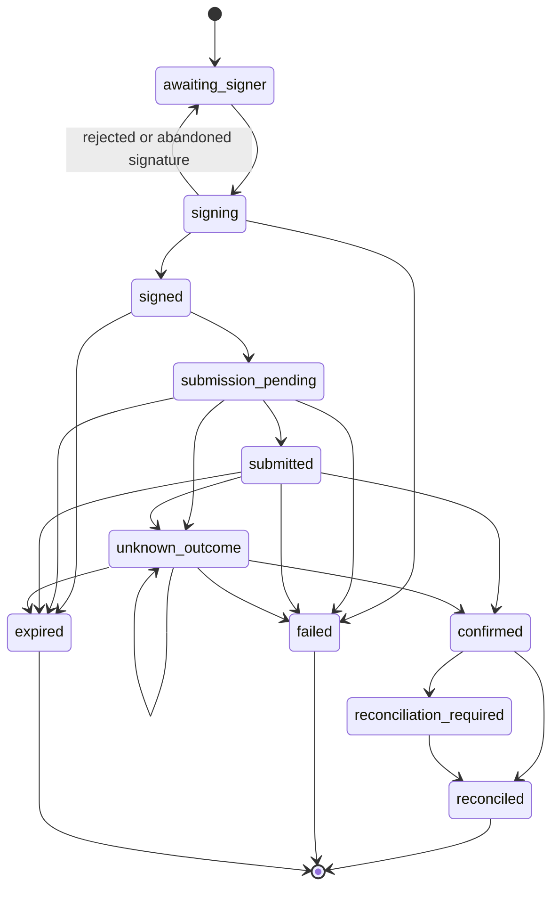

# Stellar settlement architecture: as implemented and as required

Scope: Stellar Testnet only. No Mainnet, no token change, no contract redeploy, no change of signing authority. Nothing in this document is an implementation; SQL and API shapes are proposals and are labelled as such. The evidence is same-author, no independent security review or penetration test has taken place, and the settlement path has been demonstrated on Testnet in one owner-run execution (`docs/product/architecture/mvp-1.5/MVP-1.5-CLOSURE.md`, closure statement).

Labels used throughout: **Verified** (read in code), **Recommendation**, **Inference**, **Unknown**, **Owner decision**. Paths are relative to the repository root. Line numbers were checked by reading the files.

## 1. Headline findings

1. **Verified.** The repository holds two settlement-execution records that are not connected. (a) The database records (`settlement_executions`, `settlement_execution_events`, `settlement_attempts`, `settlement_attempt_events`, `settlement_attempt_transactions`, migrations 5 and 6) are created over HTTP only as far as `awaiting-signer` (`apps/web-console/lib/registry/http.ts:257-262`). Nothing in `app/`, `components/` or `lib/stellar/` calls `advanceExecutionAttempt` or `advanceSettlementExecution` (a repository-wide grep finds them only in `service.ts` and in tests). (b) The code that actually signs-and-submits, `apps/web-console/lib/stellar/run.ts`, keeps its state in two in-process `Map`s (`ATTEMPTS`, line 58, and `PREPARED`, line 60) and appends to a JSONL file inside the repository tree (line 62). A restart loses every in-flight attempt, including an `UNKNOWN` one.
2. **Verified.** `run.ts` is an owner-run tool for one hard-coded one-unit settlement between two configured accounts (`MAX_UNITS = 1n`, line 20; `buildRunPlan`, lines 32-38; plan built from constants, not from a database batch). It is not a general settlement executor for approved batches.
3. **Verified.** `apps/web` cannot reach `/api/stellar/*`. The proxy allow-list is `/^\/api\/(auth|registry)(\/|$)/` (`apps/web/lib/proxy-policy.ts:7`); anything else returns 404 (line 17). The proxy comment (lines 5-6) states this is deliberate. The owner-run pages (`/settle-run`, `/wallet-check`, `/cosign-check`) live in `apps/web-console/app/(institution)/` and are served by the console on its own origin.
4. **Verified.** `verifyChainOutcome` and the `ChainReader` interface (`apps/web-console/lib/registry/settlement-state.ts:43,57`) are not called from any production code path. The transfer-multiset check they describe has no producer: no code reads contract events or extracts transfers from a transaction (grep for `getEvents` finds nothing). What the code does verify on chain is the contract's own state (`compareWithPlan` over `get_session`, `get_obligations`, `get_proposal`, `get_approvals`, `get_settlement`) plus the transaction status by hash.
5. **Verified.** No private key is held server-side. The only key-related imports in `lib/` are `Keypair.fromPublicKey` (`lib/stellar/freighter.ts:39`, `live.ts:16`, `signer-set.ts:101,103`). Signing happens in the owner's browser through Freighter (`components/settle-run.tsx:62`). A repository-wide search for `fromSecret`, `secretKey`, `privateKey` in `lib/`, `app/`, `components/`, `scripts/` finds nothing relevant.
6. **Verified, discrepancy.** Authorization-entry lifetime: the accepted policy and the threat model say 10 ledgers (`MVP-1.5-THREAT-MODEL.md`, row 4; the offline signer policy), but the interactive tool uses 30 (`run.ts:18-19`, `ENTRY_LIFETIME_LEDGERS = 30`, commented as an engineering choice flagged to the owner). See section 9.
7. **Verified.** The Testnet RPC URL and the Horizon URL are compile-time constants (`lib/stellar/rpc.ts:12`, `lib/stellar/live.ts:7`); there is no environment override. Pointing the backend at another RPC provider needs a code change.
8. **Verified.** The contract does not know about Tobin organizations, batches, calculations or application approvals. It enforces its own participant approvals, debtor authorizations and atomic transfers, and nothing else (section 8).
9. **Inference.** Testnet RPC retains roughly 120,960 ledgers (`MVP-1.5-CONTRACT-COMPATIBILITY.md`, "Network and protocol": older transactions read back as `NOT_FOUND`). A `NOT_FOUND` for an old hash is therefore ambiguous and a backend must record the ledger window at submission (section 7.3).

## 2. Lifecycle at a glance

"Reachable from apps/web" means reachable through the server-side proxy, i.e. `/api/auth/*` and `/api/registry/*` only (**Verified**, `apps/web/lib/proxy-policy.ts:7`). The web app's client calls the execution read endpoints and nothing that writes beyond `execution/start`-style registry routes (**Verified**: `apps/web/lib/tobin/client.ts:176-177` reads `execution` and `attempts`).

| # | Stage | Exists in code | Reachable from apps/web | Persisted | Missing |
|---|---|---|---|---|---|
| 1 | Obligation recording | `Registry.createObligation/updateObligation/voidObligation` (`service.ts:345,366,393`); amount rules `clearing.ts` `parseObligationAmount` | yes (registry routes) | `obligations` (revisioned), `activity` | none for the application level; nothing on chain |
| 2 | Netting calculation | `Registry.calculate` (`service.ts:414`) -> `runNetting` -> `computeNets` from `packages/mvp1-sdk` (`clearing.ts:104`); input hash `inputHash` (`clearing.ts:101`) | yes | `calculations` (immutable snapshot, trigger) | none |
| 3 | Institutional approval | `Registry.decide` (`service.ts:566`), pure rules in `authorization.ts` (`conflictedActors`, `decisionStatus`, `authState`) | yes | `authorization_decisions`, `authorization_invalidations` (immutable) | none |
| 4 | Settlement preparation | `prepareSettlementBatch` (`service.ts:646`), `decideSettlementBatch` (`service.ts:732`), `settlement.ts` (`buildInstructions`, `integrityChecks`, `instructionsHash`) | yes | `settlement_batches`, `settlement_instructions`, `settlement_batch_reviews`, `settlement_batch_invalidations` (immutable) | none |
| 5 | Execution preconditions | `startSettlementExecution` (`service.ts:800`) needs verified accounts for every payer and payee; `beginExecutionAttempt` (`service.ts:855`) builds an `ExecutionPlan` | yes: `POST .../execution/start`, `.../execution/attempts/begin` (`http.ts:257-262`) | `settlement_executions`, `settlement_execution_events`, `settlement_attempts`, `settlement_attempt_events` | state never leaves `awaiting-signer` in production |
| 6 | Transaction construction | `buildAndSimulate` (`rpc.ts:63`) | **no** (only via `/api/stellar/run`) | `PREPARED` map in memory (`run.ts:60`) | no persisted unsigned transaction or its hash |
| 7 | Signing | Freighter in the browser (`components/settle-run.tsx`); envelope check `verifyEnvelope` (`signer-set.ts`) | **no** | nothing | no record that a signature was requested, given or rejected |
| 8 | Submission | `submitSigned` (`rpc.ts:138`), `submitStep` (`run.ts:137`) | **no** | `ATTEMPTS` map and the JSONL file (`run.ts:58,62`) | no database record; the DB check "hash recorded before sending" (`service.ts` `advanceExecutionAttempt`, `to === 'submission-pending'`) is not wired to the real submit |
| 9 | Network confirmation | `readTransaction`, `pollTransaction` (`rpc.ts:120,150`), 20 polls x 2000 ms (`run.ts:159`) | **no** | in memory only | no background confirmation; a poll that ends `NOT_FOUND` is `UNKNOWN` in memory |
| 10 | Independent read-back | `readObservedChain` (`rpc.ts:84`) calls five getters through simulation | **no** | nothing | no persistence of the observation; `Registry.attachChainRead` exists (`service.ts:238`) but no production path feeds it |
| 11 | Reconciliation | `compareWithPlan` (`compare.ts:26`) | **no** | nothing | result not stored; `verifyChainOutcome` unused |
| 12 | Provenance `chain-confirmed` | `Registry.confirmSession` (`service.ts:251`): needs an earlier `chain-read` and `txStatus === 'SUCCESS'` with a 64-hex hash | no HTTP route can set provenance (`http.ts` header comment, lines 1-3) | `sessions.provenance`, `sessions.confirmed_tx_hash`, DB CHECKs (`database.ts:70-84`) | no caller in production |

## 3. Stage detail

### 3.1 Obligation recording (Verified)
Amounts are canonical positive digit strings within i128 (`clearing.ts` `parseObligationAmount`); the asset is a code of 1-12 upper-case letters or digits (`ASSET_CODE`). Obligations are mutable only while the session workflow is `configuring` (`#editable`, `service.ts:271`) and are revisioned; the calculation input records each obligation's revision. An application obligation is not an on-chain obligation. The on-chain `submit_obligation` is a separate act, authorized by the debtor.

### 3.2 Netting calculation (Verified)
`calculate` builds a canonical input (active obligations sorted by id, participants sorted: `canonicalInput`, `clearing.ts:94`), runs the real engine on deterministic per-session handles (`partyHandle`, `clearing.ts:89`), refuses if nets do not sum to zero (`clearing.ts:113`), and stores an immutable `calculations` row with `inputHash = sha256(JSON.stringify({v:1, asset, ...input}))` (`clearing.ts:101`). The hash decides staleness (`currencyOf`, `clearing.ts:124`). The handle is a bookkeeping key and not a Stellar account. This hash is an application digest; it is not the on-chain obligation commitment (DB-09 version 2 digests come from `packages/mvp1-sdk/src/digest.ts` and are computed in `execution-plan.ts`).

### 3.3 Approval (Verified)
`decide` requires the reviewer grant, a non-closed session, the latest and current calculation, no earlier decision on it, and separation of duties (anyone who ran the calculation or touched an input obligation is excluded: `conflictedActors`). An approval is an application record bound to one calculation id. It is not a signature, not a debit authorization and not an on-chain fact (comment, `authorization.ts` line 1-3 of that file). The batch review (`decideSettlementBatch`) is a second approval bound to the batch's `instructionsHash` and also needs a different person from the preparer.

### 3.4 Settlement preparation (Verified)
`#evaluate` (`service.ts`, the function returning `checks`) re-checks from stored data: session not closed, calculation exists, is the latest and current, has an active approval, participants and obligations still valid, positions recompute exactly, the asset resolves to exactly one supported registry entry (an operator-configured list, "no on-chain check"), the engine accepts the plan, and the independent `integrityChecks` pass. The batch, its instructions and its review are immutable by trigger (migrations 4 and 5). The default allocation is the greedy plan from `proposalFromNets` (`ALGORITHM`, `settlement.ts`); the contract accepts any valid plan, so this is one valid plan, not the only one. A prepared batch is not a transaction.

### 3.5 Execution preconditions and attempts (Verified)
- `startSettlementExecution` requires an `approved`, still eligible batch, a clean validation, at least one instruction, no existing execution (`settlement_executions.batch_id UNIQUE`), and exactly one VERIFIED Stellar account per payer and payee on the batch network. The accounts are snapshotted in `accounts_json`.
- `beginExecutionAttempt` rebuilds the plan server-side from the approved calculation, the approved batch and the snapshotted accounts, never from client input (`service.ts:855-880`). It requires `TOBIN_STELLAR_CLEARING_CONTRACT` to be a valid contract id (`backend.ts:33`, regex `^C[A-Z2-7]{55}$`), applies the retry policy (`retry-policy.ts` `mayStartAttempt`), and stores an immutable attempt with `plan_json` and `plan_fingerprint`.
- `advanceExecutionAttempt` (`service.ts:894`) enforces `canTransition`, makes a repeat of the current state a no-op, records the transaction hash before `submission-pending`, and demands evidence: `confirmed` needs `evidence.networkRead` reporting `SUCCESS` for a hash recorded for that attempt; `failed` after signing needs a `FAILED` read or `rejectedBeforeInclusion`; `expired` out of `unknown-outcome` needs a `NOT_FOUND` read and `validityPassed === true`; `reconciled` needs `evidence.comparison.ok === true`. It has no HTTP route and no production caller. **Verified.**
- The evidence is trusted as supplied by the caller: the method checks the shape and that the hash was recorded, it does not itself call the network. A future server-side verifier must obtain the evidence from its own network read (section 6).

### 3.6 Transaction construction (Verified)
`buildAndSimulate` loads the source account sequence from the RPC, builds a one-operation `InvokeHostFunction` transaction with base fee 100 and a 300 s timeout, simulates it, and returns an assembled unsigned transaction only if the simulation succeeded (`rpc.ts:63-71`). `prepareStep` (`run.ts:101`) additionally re-reads the whole chain state, requires every gate (`network`, `amount`, `chain-consistent`, `supply`, `funds`, `admin-signers`: `run.ts:88-95`), requires the step to be the next undone step, and refuses a step whose earlier attempt is unresolved (`run.ts:105`).

### 3.7 Signing (Verified)
- Authorization entries (`address`/`address_v2` credentials) are signed in the browser by Freighter `signAuthEntry`; `attachEntry` (`run.ts:121`) replaces the entry only if its root invocation equals the prepared one and re-simulates so the network validates the signature.
- Envelope signatures: for the multisig administrative account the envelope must carry Founder and Security signatures meeting the medium threshold, checked against the live signer set (Horizon and RPC must agree) by `verifyEnvelope` (`submitStep`, `run.ts:145-149`).
- Who may drive the tools: `ownerToolsAllowed` (`owner-access.ts`) requires an active verified wallet equal to the admin account, one of its signers, or `TOBIN_SECOND_ACCOUNT`. This is an access gate for tooling and not an institutional role.
- Wallet connection is not Tobin authentication is not membership is not reviewer authority is not Stellar signing authority (`AGENTS.md` section 6; `MVP-1.5-WALLET-AND-SIGNING.md`).

### 3.8 Submission (Verified)
`submitStep` requires the exact typed confirmation `I CONFIRM SUBMIT STEP <n>` (`run.ts:138`), a transaction hash that matches a prepared entry, no unresolved prior attempt for the step, all gates, correct step order, sufficient envelope signatures, and a fresh simulation of the final signed transaction (`run.ts:151`). It writes `SUBMITTING` before sending (`run.ts:153`) and computes the hash locally first (`rpc.ts:137` comment). `submitSigned` maps the RPC answer: `PENDING` to accepted, `DUPLICATE` to duplicate, `ERROR` to rejected, `TRY_AGAIN_LATER` and transport errors to unknown (`rpc.ts:138-147`). There is no automatic retry.

### 3.9 Network confirmation and read-back (Verified)
After an accepted submission, `pollTransaction` reads the original hash up to 20 times at 2 s intervals (about 40 s); `SUCCESS` or `FAILED` end it, anything else is `UNKNOWN` (`run.ts:159-162`). `readTransaction` maps `NOT_FOUND` and transport errors to `NOT_FOUND`/`UNAVAILABLE` (never failure, never success: `rpc.ts:120-127`). After each step `runStatus` re-reads the contract state through simulated getters (`readObservedChain`, `rpc.ts:84-99`): a missing item reads as null or empty, and a getter error other than "not found" (`Error(Contract, #1)`) throws.

### 3.10 Reconciliation (Verified)
`compareWithPlan` (`compare.ts:26`) compares creator, token, capacities, participants, obligations (id, debtor, creditor, amount), the obligation commitment, net positions recomputed with the engine from the on-chain obligations, the proposal (revision, instruction order and content, digest, proposer), approvals, and the settlement result (digest, total moved, instruction count, session state). Any difference means stop. It does not compare token balances or transfer events; the owner tool reads balances separately for its gates (`run.ts:84-85`). A real settled session was compared once with no mismatch (`MVP-1.5-ACCEPTANCE.md`, final criterion 4). The shapes of non-empty getters were "not yet confirmed against a live non-empty session" before that run (`MVP-1.5-CONTRACT-COMPATIBILITY.md`) and were exercised by it.

## 4. Distinctions a backend must preserve

| Distinction | Where it is enforced today |
|---|---|
| Application record is not an on-chain record | `sessions.provenance` CHECKs (`database.ts:70-84`); `attachChainRead` refuses fixtures (`service.ts:238`) |
| Prepared batch is not a transaction | batch has no hash; transactions exist only in `run.ts` memory |
| Signed is not submitted | `signing` -> `signed` -> `submission-pending` are separate states (`settlement-state.ts:11-22`); not exercised by the real tool |
| Submitted is not confirmed | `submitted` -> `confirmed` needs a network read (`service.ts` evidence rule) |
| API success, DB persistence or simulation is not proof of settlement | `submitStep` returns `outcome` only after a hash read; simulation is a precondition, never a result |
| Chain-confirmed needs independently verified successful chain execution | `confirmSession` needs `txStatus === 'SUCCESS'` and a prior chain read |
| Application records stay distinguishable from on-chain records | provenance values `fixture`, `local-draft`, `chain-read`, `chain-confirmed` |

**Recommendation:** keep the provenance and state vocabulary exactly as is. A Postgres backend must keep the CHECK that `chain-confirmed` implies a stored 64-hex hash, and must add (section 9) a stored verification record so that "confirmed" can be re-derived, not merely asserted.

## 5. State machines

### 5.1 Execution/attempt states (exact, from `settlement-state.ts:8-23`)

State names in code use hyphens (`awaiting-signer`, `submission-pending`, `unknown-outcome`, `reconciliation-required`); underscores above are a Mermaid constraint. Terminal states: `reconciled`, `failed`, `expired` (`TERMINAL`, line 23). There is no transition from `unknown-outcome` back to `submission-pending`: this is the code's expression of "never resend". **Verified.**

Retry between attempts (`retry-policy.ts:20-32`): a new attempt is allowed only after `expired`, or after `failed` with `reviewedFailure === true`; refused while an attempt is live, after `unknown-outcome`, `confirmed`, `reconciled` or `reconciliation-required`.

**Verified, limitation.** One attempt covers a multi-step plan (up to 8 or more contract calls: create, join, submit obligation, finalize, propose, approve, settle), but the attempt has a single state and `settlement_attempt_transactions` holds one hash per `(attempt, step_index)`. The state machine does not say which step a given state refers to. A backend that runs steps through this model must either keep one attempt per step or add a step dimension (section 9).

### 5.2 On-chain session lifecycle (contract, `contracts/clearing/src/lib.rs:7`)

```mermaid
stateDiagram-v2
    [*] --> Open: create_session (creator authorizes; token and capacities fixed)
    Open --> Open: join_session (joiner AND creator authorize), submit_obligation (debtor authorizes)
    Open --> Committed: finalize_obligations (any admitted participant)
    Committed --> Committed: propose_settlement (any participant; replacement clears approvals), approve_settlement (until all approved)
    Committed --> Approved: last participant approves the current digest
    Approved --> Committed: propose_settlement replaces the proposal and clears all approvals
    Approved --> Settled: settle (any caller; every debtor authorizes own total)
    Settled --> [*]
```

A proposal is data, not a state. There is no timeout, abort, default, recovery or administrator (`lib.rs:18`). **Verified** against the module documentation and the `settle` body (`lib.rs:555-668`); the transition `Committed -> Approved` happens inside `approve_settlement` when every participant has approved the current digest (`lib.rs:540-548`); a repeat of an identical approval returns without change (`lib.rs:523-526`).

### 5.3 Mapping
`progress` in `compare.ts` (`not-started`, `created`, `obligations-recorded`, `finalized`, `proposed`, `approved`, `settled`) is a derived view of the chain; it is not an execution state. A backend should store both: the application execution state (5.1) and the last observed on-chain state (5.2), and never derive one from the other without a stored read.

## 6. How a backend should verify chain results against the approved batch

**Recommendation** (the procedure reuses what exists; the new part is persistence and an independent trigger):

1. Input: attempt id, recorded `tx_hash`, recorded `ledger_window_start` (latest ledger when the hash was computed), the stored `plan_json` (immutable).
2. `getTransaction(hash)` on the RPC. Map as `readTransaction` does. `SUCCESS`: record ledger, `createdAt`, `applicationOrder`. `FAILED`: record and stop. `NOT_FOUND`/`UNAVAILABLE`: stay `unknown-outcome` (section 7.3).
3. On `SUCCESS`, run the five-getter observation (`readObservedChain`) at a ledger no earlier than the transaction's ledger. Store the raw observation with the ledger it was read at (`ChainObservation.readAtLedger` is already required by `attachChainRead`, `service.ts:238`).
4. Run `compareWithPlan(plan, observed)`. Persist the comparison result (ok, mismatches) in its own immutable row. `ok === true` is the only input to `reconciled`.
5. For the final step (`settle`), additionally verify value movement: the settlement result's `digest`, `total_moved`, `instruction_count` equal the plan's; and, **because the contract's `SettlementResult` does not list transfers**, confirm the token effects through an independent source: token `balance` reads before and after, or the `Settled` event and token `transfer` events for the ledger. Balance deltas require a stored "before" read taken before submission. **Gap (Verified):** neither balance snapshots nor event reading is implemented for general batches; the owner tool only reads balances as gates (`run.ts:84`).
6. A second source for the transaction status is desirable: Horizon `GET /transactions/{hash}` as used for signer sets in `live.ts`. **Inference** that Horizon serves transaction history beyond the RPC retention window; **Unknown** for how long on Testnet; verify before relying on it.
7. Promotion: `confirmed` only with the stored network read; `reconciled` only with a stored matching comparison; `chain-confirmed` provenance only through `confirmSession` with the same hash. Every promotion is performed by the verifier process, never by a request that supplies the evidence.

**Verified gap:** `advanceExecutionAttempt` accepts caller-supplied `evidence`. If an HTTP route were ever added for it, a client could fabricate `networkRead`. The route must not exist; the verifier must be a server-side job that fetches the evidence itself.

## 7. Failure, duplicate, partial, unknown and expired cases

### 7.1 Duplicate requests and idempotency
| Case | Current protection (Verified) | Recommendation |
|---|---|---|
| Repeated "start execution" | `settlement_executions.batch_id UNIQUE`; service returns `EXISTS` (`service.ts:800`) | idempotent success returning the existing execution, or keep `EXISTS` and document it |
| Repeated "begin attempt" | `UNIQUE (execution_id, attempt_no)`, `mayStartAttempt` refuses while one is live | add a client idempotency key per request (header `Idempotency-Key`), stored with the request hash |
| Same transaction recorded twice | `tx_hash PRIMARY KEY`, `UNIQUE (attempt_id, step_index)`: a duplicate is refused by the schema (`database.ts:504-511`) | keep; natural key is the 64-hex hash |
| State advance repeated | requesting the current state again is a no-op, no new event (`service.ts:894`, `cur === to`) | keep |
| Double submit of the same signed XDR | `submitSigned` computes the hash before sending; the network answers `DUPLICATE` and the code maps it to "accepted/duplicate: look it up, do not send again" (`rpc.ts:143`) | the verifier reads the hash; it never re-sends |
| Browser double-click on submit | `ATTEMPTS` entry set to `SUBMITTING` before the send (`run.ts:153`), but only in process memory | persist the `submission-pending` row with the hash in the same DB transaction before the network call |
| Sequence/replay | a Stellar transaction has a source-account sequence number; a replay of a consumed sequence fails with `tx_bad_seq`; `buildAndSimulate` reads the real sequence (`rpc.ts:64`). Soroban authorization entries carry a nonce and an expiry ledger | store the source account and sequence in the attempt transaction row |

Note **Verified:** the `PREPARED` map and `ATTEMPTS` map are per process. Two instances would not see each other's attempts. The tool is single-instance by construction.

### 7.2 Partial outcomes
A multi-step plan is a sequence of independent transactions, each atomic. The chain can therefore be validly partway through (session created, some joins done). `stepsDone` (`run.ts:41-54`) derives which steps are on chain from observed state only, and `compareWithPlan` accepts a "partial but consistent progress" (`compare.ts` comment). Within `settle`, the contract is atomic: the settlement record, the state change and every token transfer commit together or not at all (`lib.rs:641-655`). A failed `settle` leaves the session `Approved` and unchanged. **Verified.**

Recommendation: the backend stores `steps_done` as a derived, re-computable read and never as the truth; a restart recomputes it from the chain.

### 7.3 Unknown outcome (`NOT_FOUND`, timeouts, `TRY_AGAIN_LATER`)
Rule (**Verified** in `settlement-state.ts:17`, `retry-policy.ts:24`, `rpc.ts:149`): read the original hash, never resend.

Procedure (**Recommendation**):
1. Persist the hash and `submitted_at_ledger` before sending.
2. On a timeout or `NOT_FOUND` after the poll deadline, move to `unknown-outcome`.
3. A scheduled job re-reads the original hash with back-off until a terminal answer or until the transaction's validity window has passed: the time bound (`setTimeout(300)` in `buildAndSimulate`, i.e. `maxTime`) and the ledger bound. Only when the read says `NOT_FOUND` after validity has passed does the attempt become `expired` (`advanceExecutionAttempt` already requires `readOk('NOT_FOUND') && validityPassed === true`).
4. The RPC retains about 120,960 ledgers (**Inference** from the compatibility note; **Unknown** exact current value). If the job was down longer than that, `NOT_FOUND` no longer means "never included". Then the backend must not mark `expired`; it must consult Horizon or compare the on-chain state with the plan (`compareWithPlan`): if the chain already shows the step done, the step happened. If both are inconclusive, the attempt stays `unknown-outcome` and escalates to an operator.
5. A retry, if the attempt is `expired`, is a new attempt after revalidation; the on-chain session simply continues from its observed state (`MVP-1.5-CONTRACT-COMPATIBILITY.md`, "Handle failed execution").

### 7.4 Expired authorizations (the 10-ledger policy)
- Policy (**Verified** in `MVP-1.5-THREAT-MODEL.md` row 4 and the offline signer): authorization entries valid for at most 10 ledgers.
- Implementation in the interactive tool: `ENTRY_LIFETIME_LEDGERS = 30`, justified in the source comment as human signing time (`run.ts:18-19`). The `prepareStep` result reports `entryValidUntil = latestLedger + 30` (`run.ts:117`).
- **Owner decision:** keep 30 for interactive use (document it as an exception to the 10-ledger policy) or reduce. A server-side flow must read the current ledger from the RPC before each preparation and reject a signed entry whose `signatureExpirationLedger` is at or below the current ledger plus a safety margin.
- Soroban authorization nonces are consumed only by successful transactions; a failed transaction's signed entries stay reusable until they expire (recorded as EQ-20 and in the threat model, residual risk of row 4). Therefore after any failed or unknown submission the backend must discard the prepared transaction and require fresh signatures (**Recommendation**, consistent with the accepted "fresh authorization after every failed settlement").
- An expired entry is not a failure of the batch: the attempt becomes `expired` (from `signed`) and a new attempt may be started after revalidation (`retry-policy.ts:28`).

### 7.5 Reconciliation discrepancies
`compareWithPlan` returns a list of mismatches. Required handling:
1. Set the attempt to `reconciliation-required` (legal only from `confirmed`).
2. Stop all further steps and all new attempts (`retry-policy.ts:27`).
3. Store the observation, the comparison and the mismatches, immutable.
4. Alert an operator. Only a person with authority resolves it (existing rule); `reconciliation-required -> reconciled` requires a matching comparison (`service.ts` evidence rule), so the resolution path is "the data was wrong and a re-read now matches", never "an operator overrides". **Owner decision:** whether an authorized override with a recorded reason should exist. Today none does and none should be added without a decision (`AGENTS.md`, no admin overrides).
5. A mismatch is never fixed by editing the batch (immutable) or by resubmitting.

## 8. What the contract enforces and what it does not

Source: `contracts/clearing/src/lib.rs` (line numbers below).

| Topic | Enforced by the contract | NOT enforced by the contract |
|---|---|---|
| Session creation | creator authorizes (`:287`); session id must be new (`SessionExists`, `:274`); token and capacities fixed; token must be a contract address (`BadAddressKind`, `:278`); capacity within ceilings 4/16/16 (`BadCapacity`, `:285`) | that the token is a genuine SEP-41 token, is the Tobin asset, or matches the application batch asset (the application compares this off chain: `compare.ts`); who may choose a session id (first come, 32 arbitrary bytes) |
| Membership | joiner and creator both authorize (`:332-333`); Open only; no duplicates; capacity | any link to a Tobin organization, user or verified wallet |
| Obligations | debtor authorizes (`:384`); both parties admitted; amount positive; id unique; capacity; overflow-safe sums (`:357-374`) | that the creditor agreed (consent comes at approval); that the obligation corresponds to any application obligation, invoice or legal debt; that the debtor can pay |
| Freezing | any admitted participant may finalize (`:409`); at least the minimum participants (`TooFewParticipants`) and at least one obligation (`NoObligations`, `:416`); stores the commitment | agreement among participants to finalize |
| Proposal | any admitted participant (`:449,451`); plan validated against the frozen obligations: admitted parties, positive amounts, no self-pay, debit = max(0, net), credit = max(0, -net), strict (payer, payee) order, at most 16 instructions (`validate_plan`, `:928-992`) | that the plan equals the application batch or the engine's default plan (any valid plan is accepted); that it is economically "fair"; who proposes |
| Approval | each admitted participant must approve the current digest; a stale digest is rejected (`:513-520`); a replacement proposal clears all approvals (`:464`) | that an approval is a debit authorization (it is not); any approval by an organization or reviewer |
| Settlement | `settle` has no caller argument and no caller restriction; needs Approved, the current digest, all approvals, successful re-validation, and `require_auth_for_args(session, digest, own total)` from each distinct payer (`:555-640`); settlement record and state written before transfers, all reverted if any transfer fails (`:641-655`) | token balance sufficiency before the call (a failing `transfer` reverts everything); who submits; fees; that the transaction envelope or source account is appropriate |
| Atomicity | all-or-nothing within the `settle` invocation | atomicity across the separate transactions of the lifecycle; a session can stop at any step |
| Time | none | any deadline, timeout, abort, default or recovery (`lib.rs:18`); a session may stall forever (DB-06); transaction expiry and authorization expiry exist only at the Soroban/Stellar layer |
| Administration | none: no administrator, override, upgrade path | any emergency stop; the token's own governance is separate (minter is the administrative multisig) |
| Single settlement | `AlreadySettled` on a second `settle` (`:558`) | idempotence of the Tobin application's own bookkeeping |
| Records | emits events; stores `SettlementResult {digest, ledger_sequence, total_moved, instruction_count}` (`:641-655`) | a per-transfer ledger inside the contract; the individual transfers are only visible in the token's events or balances |
| Digest | DIGEST_VERSION 2, domain-separated SHA-256 (`:34,40-41`) | independent cryptographic review (same-author only, `AGENTS.md`) |

Do not claim: that settlement is "guaranteed", that the contract checks asset identity, KYC, institutional approval, or that it binds the application batch. It binds the on-chain proposal digest only; the application proves equality with the batch off chain (`compareWithPlan` proposal digest, instructions, revision).

## 9. What a PostgreSQL backend must persist for settlement (proposal)

All DDL below is a **proposal**. It extends, and does not replace, the existing tables listed in section 2. The existing immutability triggers (SQLite `RAISE(ABORT)`) must be reproduced as Postgres triggers or by revoking `UPDATE`/`DELETE` from the application role; the pattern is already tested in `apps/web-console/test/backend-db.test.ts`.

| Table (existing -> keep) | Immutable? | Notes |
|---|---|---|
| `calculations`, `authorization_decisions`, `authorization_invalidations` | yes | keep |
| `settlement_batches`, `settlement_instructions`, `settlement_batch_reviews`, `settlement_batch_invalidations` | yes | keep; `calculation_id UNIQUE` per batch (`database.ts:236-257`) |
| `settlement_executions` | yes | one per batch |
| `settlement_execution_events`, `settlement_attempts`, `settlement_attempt_events`, `settlement_attempt_transactions` | append-only | keep; add the columns below |
| `sessions` | mutable (provenance, chain_json, confirmed_tx_hash) | CHECKs keep provenance honest; add a row-version for optimistic concurrency |

Proposed additions:

```sql
-- PROPOSAL. One row per transaction actually built for an attempt step.
ALTER TABLE settlement_attempt_transactions
  ADD COLUMN source_account    text,        -- G... fee/sequence account
  ADD COLUMN source_sequence   numeric,     -- sequence consumed
  ADD COLUMN unsigned_xdr_hash char(64),    -- hash of the unsigned envelope (identity before signing)
  ADD COLUMN built_at_ledger   bigint,      -- latest ledger when built
  ADD COLUMN valid_until_time  timestamptz, -- envelope max time
  ADD COLUMN entry_expiry_ledger bigint,    -- min signatureExpirationLedger over entries
  ADD COLUMN submitted_at      timestamptz,
  ADD COLUMN submit_status     text CHECK (submit_status IN ('accepted','duplicate','rejected','unknown'));

-- PROPOSAL. Every network observation, immutable. The evidence for any promotion.
CREATE TABLE chain_observations (
  id           text PRIMARY KEY,
  attempt_id   text NOT NULL REFERENCES settlement_attempts(id),
  tx_hash      char(64),
  kind         text NOT NULL CHECK (kind IN ('transaction','contract-state','balance','signer-set')),
  source       text NOT NULL,              -- 'soroban-rpc' | 'horizon'
  read_at      timestamptz NOT NULL,
  read_at_ledger bigint NOT NULL,
  status       text,                       -- SUCCESS | FAILED | NOT_FOUND | UNAVAILABLE for kind='transaction'
  payload_json jsonb NOT NULL,
  payload_hash char(64) NOT NULL
);

-- PROPOSAL. One immutable comparison per observation.
CREATE TABLE reconciliations (
  id             text PRIMARY KEY,
  attempt_id     text NOT NULL REFERENCES settlement_attempts(id),
  observation_id text NOT NULL REFERENCES chain_observations(id),
  plan_fingerprint char(64) NOT NULL,
  ok             boolean NOT NULL,
  mismatches_json jsonb NOT NULL,
  compared_at    timestamptz NOT NULL
);

-- PROPOSAL. Idempotency for mutating requests.
CREATE TABLE idempotency_keys (
  user_id text NOT NULL, key text NOT NULL, request_hash char(64) NOT NULL,
  response_status int, response_json jsonb, created_at timestamptz NOT NULL,
  PRIMARY KEY (user_id, key)
);

-- PROPOSAL. Work queue for the verifier job (see section 11).
CREATE TABLE verification_jobs (
  attempt_id text PRIMARY KEY REFERENCES settlement_attempts(id),
  next_run_at timestamptz NOT NULL, tries int NOT NULL DEFAULT 0, locked_until timestamptz
);
```

Also persist, as part of each attempt: the pre-submission token balances of every payer and payee (kind `balance` observations) so balance deltas can be checked; and a `step_index` on `settlement_attempt_events` if the one-attempt-per-plan model is kept (section 5.1). **Owner decision:** one attempt per step versus a step dimension.

Immutability and integrity: hashes (`plan_fingerprint`, `instructions_hash`, `instruction_fingerprint`) are recomputed on read (`#batchValidation`, `#fingerprintCheck`, `service.ts`); a Postgres port must preserve the recomputation and the triggers. A synchronous-to-asynchronous port of `Registry` is required (`store.ts:7` interface methods are synchronous, `transaction<T>(fn: () => T)`; **Verified**; consequence for a pg driver is an **Inference**).

## 10. Stellar reads that must be repeatable and idempotent

| Read | Function | Why it is safe to repeat | Rule |
|---|---|---|---|
| Transaction by hash | `readTransaction` (`rpc.ts:120`) | read-only, keyed by the natural key | the only way to resolve unknown outcomes; no side effects |
| Contract state | `readObservedChain` -> `view` (`rpc.ts:74`) via `simulateTransaction` with a dummy account sequence 0 | simulation only, nothing signed or sent | record the ledger; two reads may differ if the chain moves, so compare against a ledger floor |
| Token balance, total supply | `tokenBalance`, `tokenTotalSupply` | same | take a "before" read before submission |
| Account sequence | `getAccount` inside `buildAndSimulate` | changes after every submission by that source | read fresh on every build, never reuse |
| Signer set | `fetchLiveSignerSet` (Horizon and RPC must agree) | read-only | fail closed if they disagree or either is unreachable (`live.ts`) |
| Latest ledger | `simulation.latestLedger` (`run.ts:110`) | monotonic | used for expiry computations |

Never repeatable: `sendTransaction`. It is called exactly once per attempt step (`submitSigned`), after the hash is persisted.

## 11. Worker and polling needs

**Verified:** no background job exists. The only waiting is the in-request 20 x 2 s poll (`run.ts:159`). Setting timers elsewhere is limited to request timeouts. Rate-limit state is persisted in the `rate_events` table, not in memory (`service.ts` `rateCount`), so it survives restart.

**Recommendation:** a single verifier loop (in the same Node process or a second Railway service sharing the database) that: selects `verification_jobs` due now using `FOR UPDATE SKIP LOCKED`; reads the recorded hash; writes a `chain_observations` row; advances state through the existing guarded methods using its own evidence; schedules the next read with back-off until terminal. It also expires `signed` attempts whose entries have passed their ledger, and runs the reconciliation. No second implementation of the state machine: it must call `advanceExecutionAttempt`.

## 12. Network, RPC, Horizon, secrets and keys

| Item | Today | Change needed |
|---|---|---|
| RPC URL | constant `https://soroban-testnet.stellar.org` (`rpc.ts:12`); also `rpc` in `contracts/deployments/testnet.json` read by `owner-validation.ts:14-17` | **Recommendation:** make the RPC and Horizon URLs configuration (default = current value), still Testnet only; refuse any passphrase other than Testnet (existing check: `readRunConfig`, `run.ts:26`) |
| Horizon URL | constant `https://horizon-testnet.stellar.org` (`live.ts:7`) | same |
| Network passphrase | constant (`rpc.ts:12`, `execution-plan.ts` `NETWORK_PASSPHRASE`) | none; Testnet only |
| Contract ids | `TOBIN_STELLAR_CLEARING_CONTRACT` env for attempts (`backend.ts:33`); `contracts/deployments/testnet.json` file for the owner tool (`run.ts:25`) | on a platform without the repository tree, either ship the file in the image (default path `resolve(cwd, '../../')`) or move to env with the same Testnet checks. The manifest says clearing `CCV3EF...` and governed token `CD5OK4...` (shortened in the docs by the release gate; full ids only in the manifest) |
| Admin account record | `accounts/testnet-admin.json` via `TOBIN_ADMIN_ACCOUNT_RECORD` or the default path (`cosign.ts:14-16`) | public metadata only (account id, signer public keys, thresholds); also needs to be present at runtime |
| Evidence log | appended to `docs/product/architecture/mvp-1.5/evidence/settlement-run-2026-11-07.jsonl` (`run.ts:62-63`); failures to write are swallowed | not appropriate on an ephemeral filesystem; replace with `chain_observations` rows |
| Private keys | none server-side. Public keys only (Verified, finding 5). Keys live in the owners' Freighter wallets (Founder, Technical, Security signers and the second participant). The administrative account's master key weight is 1 per the record and its secret is not in the repository (**Unknown** where it is kept) | none; the backend must keep holding no signing key. Do not add a "service signer" |
| Secrets the backend does hold | database credentials (SQLite path today), none for Stellar | Postgres URL only; no Stellar secret to store |
| Rate limiting toward the RPC | none (**Verified** by absence) | add a bounded concurrency/back-off in the verifier; the public Testnet RPC has its own limits (**Unknown**) |

## 13. Constraints restated

No Mainnet: `issueWalletChallenge` refuses any network but `testnet` (`service.ts`), `readRunConfig` refuses a non-Testnet passphrase (`run.ts:26`), `fetchLiveSignerSet` refuses `public` (`live.ts:10`). Note the known stale spot: `scripts/db.ts` `asset-add` still accepts `public` for asset configuration (`AGENTS.md` section 3); `execution-plan.ts` accepts only Testnet. No token change: the token is a session parameter fixed at `create_session` and the manifest records the governed token. No contract redeploy: the clearing contract is immutable without an upgrade path (manifest note). No change of signing authority: signers are the three Founder/Technical/Security keys and the second participant; the backend never signs.

## 14. Discrepancies between documents and code

1. `settlement-state.ts` header (lines 1-3) says no wallet, signing or submission exists in this build; it predates MVP-1.5 (`AGENTS.md` section 3 lists it).
2. `http.ts:249-250` (execution GET) still answers `unavailable: ['Wallet connection', 'Transaction construction', ...]` and "NOT implemented" for the execution endpoint, although the owner tool implements those capabilities outside this endpoint.
3. `MVP-1.5-ARCHITECTURE.md` describes the attempts and the state machine as the path for signer, submitter and verifier services; the implemented signer/submitter (`run.ts`) does not use them.
4. 10-ledger policy versus 30-ledger implementation (finding 6).
5. `MVP-1.5-ARCHITECTURE.md` says the plan limits are 4/16/16 and "limits are the deployed ceilings"; `execution-plan.ts` `DEPLOYED_CEILINGS` agrees; the actual on-chain `config()` was read in the preflight (Verified in the compatibility document, not re-read by this audit).

## 15. Not verified

- Behaviour of the live Testnet RPC and Horizon (retention, rate limits): not queried; no network used.
- Whether any process currently calls `advanceExecutionAttempt` outside the code searched (`apps/`, `lib/`, `scripts/`, `components/`); tests do.
- Full list of `execution-plan.ts` step mechanics beyond the header; read only partially.
- Where the administrative account master secret is kept.
