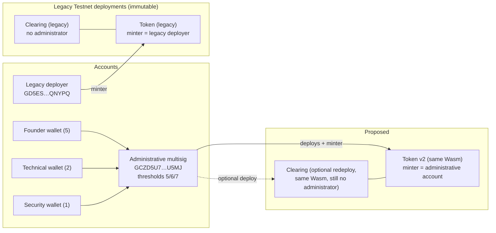
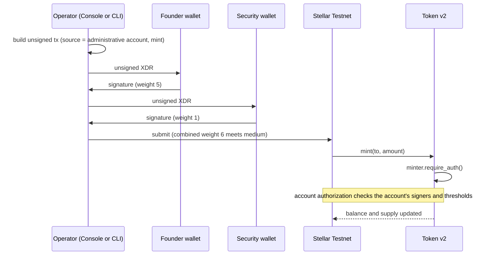

# Testnet contract governance audit (SCF deliverable 1, Phase 1.2)

> **Status update (2026-11-03).** The plan below was implemented for the token: a governed token instance was deployed with the administrative multisig as minter, its authorization was tested, and its TTL was extended. Results and evidence are in [governed-token-evidence.md](governed-token-evidence.md). The body of this document is the original audit and is not rewritten; the clearing contract decision (section 5, decision 1) was not changed: it remains immutable and admin-free.

Audit and plan only. Nothing was deployed, changed or submitted for this document; all on-chain facts come from read-only Testnet queries made on 2026-11-03 (Soroban RPC and Horizon, ledger about 5,529,319). Written for the founder and reviewers of the first SCF deliverable: "contracts deployed on Stellar Testnet and governed by the intended administrative addresses."

## 1. Contract inventory (MVP-1)

| Contract | Source | Role | Privileged operations |
|---|---|---|---|
| `TobinTestToken` | `contracts/token/src/lib.rs` (187 lines) | Capped test token (decimals, name, symbol, mint, transfer, reads). No burn, no allowance | `mint` only, authorized by the stored `Minter` address |
| `TobinClearingV1` | `contracts/clearing/src/lib.rs` (1,124 lines) | Sessions, membership, obligations, proposals, approvals, atomic settlement | None. Its own header: "No administrator, no override, no timeout, no abort, no default, no recovery, no upgrade" |

Not contracts: `contracts/clearing/examples/bridge.rs` (dev-only host for the local sandbox) and `examples/authsign.rs` (local signer). The Console (`apps/web-console`) and SDK (`packages/mvp1-sdk`) are client code. There are no other contracts, and no deployment script exists for contracts in the repository (deployment used the Stellar CLI directly; the result is recorded in `contracts/deployments/testnet.json`).

## 2. Testnet deployment inventory (verified on-chain)

| Item | Token | Clearing |
|---|---|---|
| Contract ID (full IDs only in `contracts/deployments/testnet.json`) | `CD7HOX…UC4O` | `CCV3EF…Y4DT` |
| Wasm hash (on-chain instance) | `ef483732…83241f` = local build | `80bea964…47e5e4` = local build |
| Deployed by (tx source) | legacy deployer `GD5ES…QNYPQ`, tx `050fe47b…` | same, tx `0b620e91…` |
| Initialized | constructor ran at deploy: minter = legacy deployer, cap 10000000000000, decimals 7, "Tobin Test Token", TTT; supply 1000000000 | no constructor; instance storage empty |
| Admin / owner | `Minter` = legacy deployer `GD5ES…QNYPQ` (read on-chain) | none |
| Upgradeable | no (source has no update-Wasm entry point; instance Wasm hash fixed) | no |
| Instance TTL | live until ledger 6494352 (about 56 days from the query) | live until ledger 6494355 (about 56 days) |
| Interface on-chain | cap, mint, name, minter, symbol, balance, decimals, transfer, total_supply, constructor | config, create_session, join_session, submit_obligation, finalize_obligations, propose_settlement, approve_settlement, settle and the getters |

Accounts: the legacy deployer has a single signer (itself, weight 1) and thresholds 0/0/0. The administrative multisig `GCZD5U7…U5MJ` has signers Founder 5, Technical 2, Security 1 and the master key at 1, thresholds 5/6/7 (verified; see the evidence file in `accounts/evidence/`).

## 3. Governance audit and gap analysis

| | Legacy token | Legacy clearing |
|---|---|---|
| Current administrator | Legacy deployer (the `Minter`) | None |
| Authorization model | `Minter.require_auth()` on `mint`; `from.require_auth()` on `transfer`; fixed at construction, no setter | Per-participant `require_auth()` only (creator, joiner and creator for joins, debtor, proposer, approver). `settle` has no authority of its own |
| Upgradeability | Immutable | Immutable |
| Can the administrative multisig control it? | **No.** The minter is a different address and cannot be changed | **No.** There is nothing to control |
| Intended governance requirement satisfied? | **No.** The admin is the legacy single-key deployer, not the intended administrative address | **Not applicable as written.** The contract has no governed function. Whether "governed by the administrative address" is meant to cover it depends on how the SCF requirement is read (decision 1 below) |
| Change required | A new token instance with the administrative account as minter. **No source change** | None to the existing instance. Do not give it authority its code cannot support. Redeploying the same Wasm from the administrative account is optional and only changes provenance |

What the multisig can and cannot do with a contract: an account's signers and thresholds decide whether a *signature* satisfies `require_auth()` for that account address. A contract that stores the administrative account as its admin is therefore governed by the multisig for the operations it guards. Nothing about the existing instances stores it.

## 4. Minimum viable architecture

Smallest design that satisfies "deployed on Testnet and governed by the intended administrative addresses" without new features:

1. **New token instance, same audited Wasm, administrative account as minter.** The token already has the needed shape: a stored admin, explicit `require_auth()`, a fixed cap, no hidden override. Deploy the existing Wasm hash (`ef483732…`, already uploaded) with constructor `minter = GCZD5U7…U5MJ`. No contract code changes. The deploy transaction should have the administrative account as its **source** and be signed by the multisig, so the on-chain record shows the administrative address as deployer and minter.
2. **Clearing contract stays immutable and admin-free.** Its safety rests on having no privileged role. Adding an admin or upgrade path now would be a new design with new risks and is not needed for deliverable 1. Optional: deploy a second instance of the same Wasm from the administrative account so the deployer matches the intended address. Same code, same hash.
3. **Admin rotation without contract support:** the minter address is the *account*, so rotating keys means changing the account's signers (a high-threshold operation), and the contract needs no transfer function. This is the only "ownership transfer" the MVP needs. A contract-level transfer is not added.
4. **No upgrade authority anywhere.** The MVP needs none.
5. **Keep alive:** a new instance starts with about 7 days of life. The token extends its own instance (to 60 days) only when less than 30 days remain, so an explicit Extend Footprint TTL operation was planned as part of deployment. (An earlier version of this line wrongly said the token never extends its own lifetime: `mint` and `transfer` do call an instance extension.)

Operational consequence to accept: mint calls then need the multisig. A Soroban call in which the administrative account is the transaction source is authorized by the transaction signatures, which must reach the **medium** threshold (6): Founder + Security, or Founder + Technical. While the master key is enabled, Founder + master also reaches 6. The earlier Stellar CLI limitation for non-source authorization entries is avoided by making the administrative account the transaction source.

## 5. Decisions needed before implementation

1. **Reading of the SCF requirement.** Is "governed by the intended administrative addresses" satisfied by (a) the token minter and the deployer being the administrative account, with the clearing contract documented as having no administrator by design (recommended), or (b) the clearing contract also needing an admin-controlled function (for example a pause)? Option (b) means a new contract version and a larger change.
2. **Provenance redeploy of clearing from the administrative account:** yes or no (optional, recommended for a clean story).
3. **Master key:** keep enabled during these tests, as currently approved, and decide separately when to disable it.
4. **Mint policy for the new token:** cap, decimals, name and symbol (reuse the current values unless you want a different "official" token).

## 6. Implementation sequence (not started)

1. Confirm the four decisions.
2. Extend the TTL of the two existing instances (low-risk, keeps current records usable).
3. Build the unsigned deploy transaction for the new token (source = administrative account, constructor minter = administrative account), show every field, sign locally with Founder + Security (6), verify with a checker like `setup-tx.mjs`, submit, confirm.
4. Read back on-chain: instance Wasm hash, `minter()` = administrative account, cap and supply.
5. Authorization tests (see section 8): a mint signed by Founder + Security succeeds; one signed by Technical + Security (3) is rejected.
6. Optional: deploy a clearing instance from the administrative account; compare Wasm hash.
7. Record the new IDs, hashes and transactions in `contracts/deployments/testnet.json` (the G09 exception covers only that manifest; its schema would need a small extension for a new or additional deployment, under the existing G07-S1 approval) and in `docs/governance`.
8. Point the Console and SDK configuration at the new IDs (section 7).

## 7. Required contract and frontend integration changes

- **Contracts:** none to source. A new deployment only.
- **Deployment manifest:** extend `contracts/deployments/testnet.schema.json` and `testnet.json` to hold the new instances (and mark the legacy token as legacy). Keep IDs out of source files.
- **SDK / Console:** today the Console drives only the local sandbox through the Rust bridge, and the SDK's network `Transport` is a placeholder (`NetworkTransportNotAuthorized`). A real Testnet path needs an RPC transport (simulate, prepare, send, status), configuration of the contract IDs and network passphrase from the manifest or environment, and a signing hand-off (the Console builds unsigned envelopes; signing stays in the user's wallet). Read-only views (config, session, token reads) can come first. This is out of scope for deliverable 1 except for the configuration of IDs.

## 8. Test plan and acceptance criteria

| Test | Pass condition |
|---|---|
| On-chain Wasm hash of the new token | equals `ef483732…83241f` |
| `minter()` on the new token | equals `GCZD5U7…U5MJ` |
| Constructor values | cap, decimals, name and symbol as decided; supply 0 |
| Mint by the administrative account, tx signed Founder + Security | succeeds; balance and supply update |
| Mint signed by Technical + Security (weight 3) | rejected |
| Mint signed by Founder alone (5) | rejected (needs medium 6) |
| Mint by an unrelated account | rejected |
| Legacy token and clearing unchanged | Wasm hashes and state as inventoried above |
| TTLs after extension | live-until ledgers increased |
| Manifest | validates against the schema; G09 scan clean |

Acceptance for deliverable 1: new token instance is on Testnet, its on-chain minter and its deployer are the administrative account, mint authorization is demonstrated to require the multisig thresholds, and the clearing contract is documented (and, optionally, redeployed) as an immutable contract without an administrator.

## 9. Diagrams

## 10. Status: what exists, what is verified, what is missing

| | |
|---|---|
| **Exists and verified on-chain** | Both legacy contracts and their Wasm hashes, the token's minter (legacy deployer), the clearing contract's empty admin state, the administrative multisig with 5/2/1 and 5/6/7 |
| **Exists only in source** | The access-control design of both contracts (token minter model, clearing no-admin model) and their tests (host tests, 96 pass); the SDK and Console placeholders |
| **Missing for deliverable 1** | A token instance whose minter and deployer are the administrative account; on-chain proof that its authorization follows the multisig thresholds; a decision and documentation on the clearing contract's governance; TTL extension; manifest and Console configuration for the new instances |
| **Not required and not proposed** | Any admin, pause, override or upgrade mechanism in the clearing contract; a new contract; ownership-transfer functions |

Limits: the multisig's three signers are all controlled by the founder (not independent governance), the master key is still enabled, and none of this is audited or production-ready.
