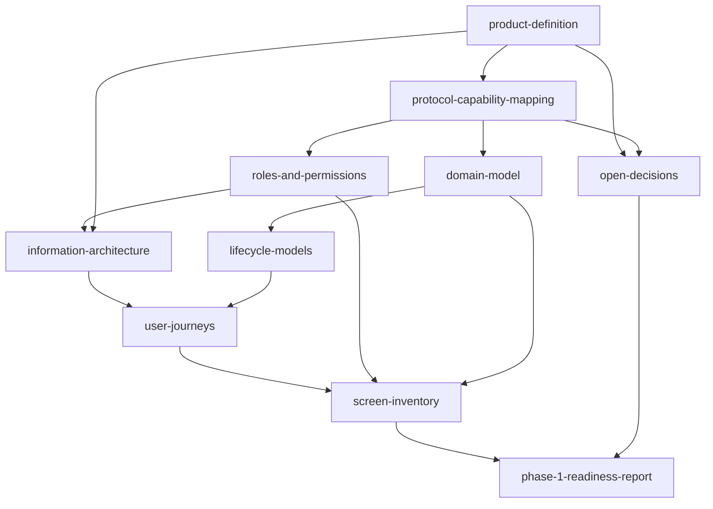

# Tobin product and UX architecture (Phase 1)

Status: **Phase 1 deliverable, draft for product-owner review.** Documentation and architecture only. No implementation, no design system, no contract or SDK change. Written 2026-11-03 against the repository at `main` (`5fa621e`).

This package defines what the redesigned Tobin web application is, who uses it, how it is organised and what the protocol underneath can actually support. It is deliberately conservative: where the vision asks for something the protocol or the repository does not provide, the documents say so instead of designing around it.

## Documents

| Document | Purpose | Read it when |
|---|---|---|
| [product-definition.md](product-definition.md) | Vision, objectives, users, use cases, value, boundaries, MVP-1 scope, exclusions, assumptions, the existing design-system reference | First. It sets the scope the rest depends on |
| [protocol-capability-mapping.md](protocol-capability-mapping.md) | What the contracts, the SDK and the current Console really do, classified, with source references and the gaps | Before believing any feature in another document |
| [roles-and-permissions.md](roles-and-permissions.md) | Identity and access model; application permissions versus on-chain authorization; permissions matrix | When deciding who may do what |
| [information-architecture.md](information-architecture.md) | Navigation evaluated and recommended; sections, pages, actions; Mermaid sitemap | When laying out the product |
| [user-journeys.md](user-journeys.md) | Seven end-to-end journeys with preconditions, steps, states and dependencies; gaps marked | When specifying flows |
| [domain-model.md](domain-model.md) | Entities, fields, ownership, visibility; Mermaid ER diagram | When designing data and services |
| [lifecycle-models.md](lifecycle-models.md) | State diagrams for organization, obligation, membership, netting cycle and settlement; verified versus proposed states | When defining statuses |
| [screen-inventory.md](screen-inventory.md) | MVP-1 screens with data, actions, states and dependencies, classified | When planning design and build |
| [open-decisions.md](open-decisions.md) | Decisions and assumptions that need the product owner | Before Phase 2 starts |
| [phase-1-readiness-report.md](phase-1-readiness-report.md) | Consistency review of the package against the repository, and readiness for Phase 2 | Last |

## How the documents fit together

`protocol-capability-mapping.md` is the foundation: every capability claim elsewhere must agree with it.

## Conventions

**Classification of findings.** Every important finding is tagged:

| Tag | Meaning |
|---|---|
| IMPLEMENTED | Exists in the repository and was verified from source (and, for contracts, on Testnet) |
| PARTIALLY IMPLEMENTED | Exists but only in part, or only in a local sandbox |
| NOT IMPLEMENTED | Verified absent |
| PLANNED | Stated as intended in repository documents, not built |
| UNVERIFIED | Could not be established from the repository; stated as an assumption |
| PROPOSED | New in this package; a recommendation, not an existing capability |

**Terminology** (used identically everywhere):

| Term | Meaning |
|---|---|
| Organization | An off-chain entity in the application: a profile, its members and its wallet addresses |
| Institution profile | The public-facing view of an Organization (one record, not two) |
| Member | A person who acts for an Organization in the application |
| Wallet / account address | A Stellar address that can authorize on-chain actions. The on-chain "participant" is an address, never an Organization |
| Clearing session ("session") | The on-chain unit that holds participants and obligations and moves through the protocol states |
| Obligation | An on-chain record inside a session: debtor, creditor, amount (one token per session) |
| Netting | Computing and agreeing the net settlement of a session's obligations (proposal and approvals) |
| Settlement | Executing the agreed net transfers atomically (`settle`) |
| Invitation | An off-chain request to join a session; on-chain admission is a separate act |

**Scope reminders.** Testnet only. MVP-1 is experimental, not audited and not production-ready; nothing here claims otherwise. The three governance signer wallets of the Testnet administrative account belong to one person; this package does not rely on or describe independent governance.

## What this package does not do

It does not choose or create a design system (Phase 2). The landing page is recorded as the existing visual reference in [product-definition.md](product-definition.md#existing-design-system-reference-for-phase-2). It does not change any code, contract, deployment or governance configuration.

## Phase 2A additions (specification correction and implementation readiness)

Added 2026-11-03. These extend the Phase 1 baseline without changing any Phase 1 decision. They were produced by verifying an external Phase 2 research draft against the repository; the draft's inaccuracies are recorded, not silently corrected.

| Document | Purpose |
|---|---|
| [phase-2-research-corrections.md](phase-2-research-corrections.md) | Every material claim of the research draft that did not match the repository, with the verified fact |
| [console-implementation-spec.md](console-implementation-spec.md) | The console specification: shell, onboarding, organizations, sessions and obligations, Discover, netting and settlement |
| [component-inventory.md](component-inventory.md) | Verified components: existing, adaptable, missing, not justified, blocked |
| [integration-readiness.md](integration-readiness.md) | Technical readiness of identity, persistence, registry, indexing, transport, RPC, wallets, authorization, submission, notifications, activity |
| [implementation-backlog.md](implementation-backlog.md) | Dependency-ordered tickets and the minimum coherent product |
| [../../design-system/README.md](../../design-system/README.md) | The verified design-system reference (tokens and components of the landing page) |

## Phase 2B additions

Technical decisions and wallet validation (investigation only): [phase-2b/README.md](phase-2b/README.md).

## Phase 2C additions

Controlled wallet validation and decision closure: [phase-2c/README.md](phase-2c/README.md).

Phase 2C account provisioning: [phase-2c/account-provisioning-report.md](phase-2c/account-provisioning-report.md).
