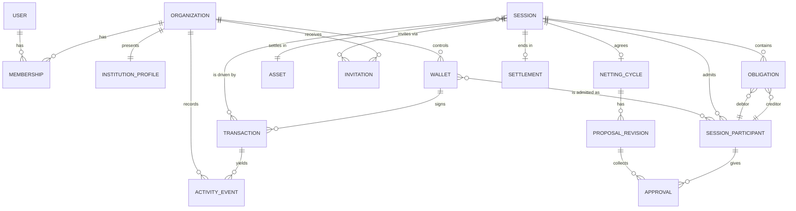

# Domain model

Deliverable E (part 1). Terms follow [README.md](README.md). Each entity is marked **on-chain** (exists in the contracts today, IMPLEMENTED), **derived** (computed from on-chain data), or **off-chain** (application data, PROPOSED, nothing exists today).

## 1. Entities

### User (off-chain, PROPOSED)
- Purpose: a person who signs in.
- Fields: id, display name, email (optional), linked wallet address(es), created at.
- Relationships: member of zero or more Organizations (MVP-1: one).
- Ownership/visibility: private to the user and their organization's administrators.
- Lifecycle: invited or created, active, disabled.

### Organization (off-chain, PROPOSED)
- Purpose: the entity that owns obligations in the application. One record also carries the public **Institution profile**.
- Fields: id, legal or display name, slug, description, public visibility (hidden, listed), created by, created at, status.
- Relationships: has Members, has Wallets, is party to Sessions through its Wallets.
- Ownership: the administrators. Visibility: profile fields per the visibility setting; everything else private.
- Lifecycle: see [lifecycle-models.md](lifecycle-models.md).

### Membership (off-chain, PROPOSED)
- Purpose: links a User to an Organization with a role.
- Fields: user, organization, role (administrator or member), status (invited, active, removed), invited by.

### Institution profile (off-chain, PROPOSED; part of Organization)
- Purpose: public presentation and discoverability.
- Fields: name, description, website (optional), published wallet addresses, visibility.
- Visibility: public when listed. Note that any address it publishes already has public on-chain history.

### Wallet (off-chain link to an on-chain account, PROPOSED)
- Purpose: associates a Stellar address with an Organization, with proof of control.
- Fields: address, label, proof of control (signature record), added by, status, network (Testnet).
- Rule: only the wallet holder can authorize on-chain; the record never grants authority.

### Clearing session (on-chain, IMPLEMENTED: `Session`)
- Purpose: the unit that holds participants and obligations and runs the protocol.
- On-chain fields: session id (32 bytes), creator, token, max participants, max obligations, state (Open, Committed, Approved, Settled), participants (admission order), obligation commitment (after freeze).
- Off-chain companion (PROPOSED): label, notes, invitation list, created in the application.
- Ownership: none beyond the creator's role of authorizing joins. Visibility: public on the ledger.

### Obligation (on-chain, IMPLEMENTED: `Obligation`)
- Purpose: one debt inside a session.
- On-chain fields: id (32 bytes, caller supplied), debtor, creditor, amount (positive integer in base units). Nothing else.
- Off-chain companion (PROPOSED): reference, description, kept in the application and bound to the obligation id; not enforced by the contract.
- Immutable once submitted; frozen at finalize.

### Obligation participant / party (on-chain, IMPLEMENTED: an address in `Session.participants`)
- Purpose: an admitted address. The application shows it as the Organization that owns the address.
- Capacity: at most 4 per session.
- Lifecycle: see [lifecycle-models.md](lifecycle-models.md); admission is permanent.

### Participation request or invitation (off-chain, PROPOSED)
- Purpose: the application-level step before the on-chain two-party admission.
- Fields: session id, invited organization or address, invited by, status (pending, accepted-by-joiner, admitted, declined, withdrawn, expired), timestamps.
- Note: "declined", "withdrawn" and "expired" exist only here; the contract has no rejection.

### Asset (on-chain, IMPLEMENTED as the session's token contract)
- Purpose: the single token a session settles in.
- Fields: token contract id, name, symbol, decimals, cap, minter (read from the token contract).
- Rule: one asset per session, fixed at creation.

### Netting cycle (derived and on-chain, IMPLEMENTED in part)
- Purpose: the agreement of a net settlement for a session: nets, proposal revisions and approvals.
- On-chain: `Proposal{digest, instructions, proposer, revision}`, `Approval{participant, digest}`, state Committed or Approved.
- Derived: net positions per participant (engine: `net = outgoing minus incoming`), whether a plan is the default plan.
- Note: a netting cycle is not a separate on-chain object; there is one per session, and proposals can be replaced.

### Netting result (derived)
- Purpose: the agreed net transfers (the current proposal's instructions) and the resulting positions.
- Fields: digest, revision, instructions, total moved, gross versus net comparison (computed locally).

### Settlement (on-chain, IMPLEMENTED: `SettlementResult`)
- Purpose: the executed result.
- On-chain fields: digest, ledger sequence, total moved, instruction count; state Settled.
- Visibility: public. Off-chain companion: the transaction hash and confirmation record kept by the application.

### Transaction (off-chain tracking of on-chain submissions, PROPOSED)
- Purpose: track a prepared, signed, submitted call through to confirmation.
- Fields: kind (create, join, submit obligation, finalize, propose, approve, settle), session, prepared call, required signers and which have signed, hash, status (prepared, awaiting signatures, submitted, confirmed, rejected, failed), ledger, timestamps, error name.
- Rule: "confirmed" only when the ledger confirms; a rejection is never shown as progress.

### Activity event (off-chain, derived from transactions, events and application actions, PROPOSED)
- Purpose: audit trail.
- Fields: actor (user and wallet), organization, action, subject (session, obligation, member), time, reference (transaction hash and ledger when on-chain).
- Visibility: organization-private by default; the on-chain part is public by nature.

## 2. ER diagram

On-chain entities: SESSION, SESSION_PARTICIPANT, OBLIGATION, ASSET (token), NETTING_CYCLE (proposal and approvals), PROPOSAL_REVISION (only the current one is stored; earlier revisions survive only as events), APPROVAL, SETTLEMENT. Off-chain: USER, MEMBERSHIP, ORGANIZATION, INSTITUTION_PROFILE, WALLET, INVITATION, TRANSACTION, ACTIVITY_EVENT.

## 3. Ownership and visibility summary

| Entity | Owner | Visibility |
|---|---|---|
| User | the user | private |
| Organization / Membership | organization administrators | private, except the profile |
| Institution profile | organization administrators | public when listed |
| Wallet link | organization administrators | private; the on-chain address is public |
| Session, Obligation, Participant, Proposal, Approval, Settlement | nobody (the contract) | public on the ledger |
| Invitation | the inviting organization | private to both parties |
| Transaction (tracking), Activity event | the organization | private; on-chain references are public |
