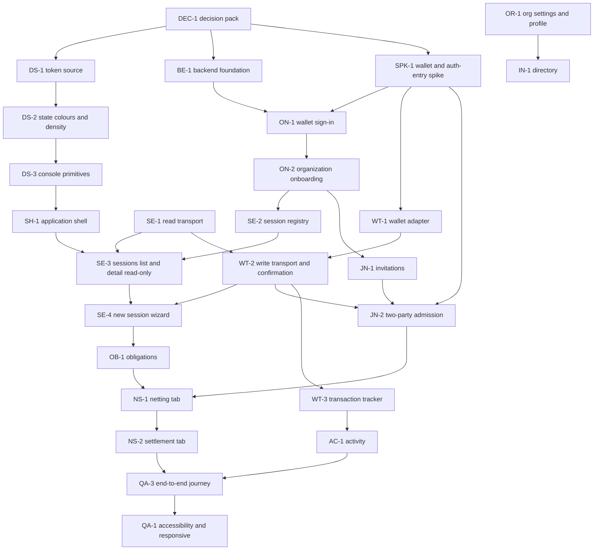

# Implementation backlog

Phase 2A. A dependency-ordered backlog organised around complete user journeys, not component creation. **No ticket here has been started.** It follows the Phase 1 baseline and the verified findings in [integration-readiness.md](integration-readiness.md), [component-inventory.md](component-inventory.md) and [console-implementation-spec.md](console-implementation-spec.md). Sizes: **S** (days), **M** (about a week or two), **L** (several weeks or involving unresolved risk). Sizes are rough and exist to show relative effort.

Per the repository's contribution rule, every ticket is delivered by a feature branch and a pull request ([../../../CONTRIBUTING.md](../../../CONTRIBUTING.md), `release/PROCESS-DEVIATIONS.md`).

## 1. The minimum coherent demonstrable product

**MCP: "Run a session on Testnet with your wallet."** Two or three organizations, each with a wallet, complete one clearing session through the application on Testnet:

sign in with a wallet, create an organization, create a session, invite by link, join (two signatures), add obligations (debtor signs), freeze, propose, approve, authorize and settle, then see the result and the history.

Included: wallet sign-in, a minimal organization record, a registry of sessions made in the product, the session workspace (Overview, Obligations, Participants, Netting, Settlement), a transaction tracker, activity. **Excluded from the MCP and moved later:** Discover browse and search, institution directory and public pages, team management, notifications, indexer, cross-session obligations register, i18n.

Why this cut: it is the smallest experience that is a real product workflow rather than disconnected screens, and every part of it maps to something the protocol supports. It is **not realistic until the wallet spike (SPK-1) succeeds**, because joins and settlement depend on signing authorization entries for other accounts.

## 2. Decisions that gate work

| Ref | DECISION REQUIRED | Gates |
|---|---|---|
| DS1 | How the console consumes the design tokens | DS-1 and every UI ticket |
| DS2, DS4 | State colours; console density scale | DS-2, DS-3 |
| D3 | Wallet-based sign-in versus email | ON-1 |
| D4 | Accept a lightweight backend with no keys and no authority; hosting | BE-1 and everything organizational |
| D6 | Session registry first, indexer later | SE-2 |
| D7, D8, A1 | Wallet choice, entry signing, signature collection UX and validity window | SPK-1, WT-*, JN-2, NS-2 |
| Dependency | Add `@stellar/stellar-sdk` or drive the CLI server-side | SE-1, WT-2 |
| Hosting | Where the console and backend run | BE-1 |
| D9 to D13, D15 | See [open-decisions.md](open-decisions.md) | Individual tickets as noted |

## 3. Dependency graph

## 4. Tickets

### Phase 0: decisions and proof

**DEC-1 Decision pack.** Objective: resolve the gating decisions above. User value: unblocks the build. Scope: product-owner answers recorded in `docs/product/architecture/open-decisions.md`. Exclusions: any code. Dependencies: none. Source paths: `docs/product/architecture/open-decisions.md`, `docs/design-system/README.md`. Acceptance: each DECISION REQUIRED has a recorded answer. Testing: n/a. Size: S. Blocking decisions: itself.

**SPK-1 Wallet and authorization-entry spike.** Objective: prove one Tobin call that needs a non-source authorization (a two-wallet `join_session`) end to end on Testnet with disposable accounts. User value: removes the largest risk. Scope: simulate, `signAuthEntry` with at least Freighter, `authorizeEntry` placement, enforcing simulation, submission, confirmation; test rejection, expiry, disconnect; record which wallets work; measure the practical validity window. Exclusions: any product UI; any contract or SDK change; Mainnet. Dependencies: DEC-1 (dependency decision). Source paths: `packages/mvp1-sdk/src/sdk/transport.ts`, `prepare.ts`, `intent.ts`, `contracts/clearing/signer/mod.rs`, `docs/product/architecture/integration-readiness.md`. Acceptance: a written spike report with a reproducible procedure, transaction hashes, wallet matrix, failure-mode results and a recommendation. Testing: manual with disposable accounts; the procedure is scripted where possible. Size: L (risk, not volume). Blocking decisions: wallet set, dependency choice.

### Phase 1: design system adaptation and shell

**DS-1 Shared token source.** Objective: make the landing tokens consumable by the console. User value: one visual language. Scope: per DS1, extract the `@theme` tokens or adopt Tailwind in the console. Exclusions: any change to landing visuals. Dependencies: DEC-1 (DS1). Source paths: `apps/landing/src/app/globals.css`, `apps/web-console/app/globals.css`, root workspaces. Acceptance: the landing renders pixel-identically before and after; the console can use the tokens. Testing: landing build, a visual comparison of key sections, lint. Size: M.

**DS-2 State colours and console density scale.** Objective: define the missing tokens (error, warning, info, success, pending; compact type and spacing scale). Scope: tokens only, documented in `docs/design-system/README.md` as approved values. Exclusions: components. Dependencies: DS-1, DS2 and DS4 decisions. Acceptance: contrast ratios verified and recorded for each pair on `paper`, `grey-100` and `ink`. Testing: a contrast check script. Size: M.

**DS-3 Console primitives.** Objective: build the missing core components listed in [component-inventory.md](component-inventory.md) section 3 as P0: Button, fields, badges (contract state and application status), banner, toast, dialog, tabs, stepper, data table with stacked mode, empty, loading and error states, address and amount displays. User value: consistent, accessible building blocks. Scope: components with tests; no screens. Exclusions: charts, motion effects. Dependencies: DS-2. Source paths: new package or folder per DS1. Acceptance: keyboard and screen-reader operable; 44px targets; each component documented with its states. Testing: unit tests with `node --test`; browser checks using the existing CDP harness pattern (`apps/web-console/test/browser/cdp.mjs`). Size: L.

**SH-1 Application shell and navigation.** Objective: the shell in the specification section 1. User value: a coherent workspace. Scope: header, navigation, content region, banners, responsive behaviour, organization and wallet placeholders. Exclusions: real identity or wallet (stubs). Dependencies: DS-3. Source paths: `apps/web-console/app/layout.tsx`, `apps/web-console/app/page.tsx`. Acceptance: navigation reachable by keyboard at 320 to 1920px; Testnet notice persistent. Testing: browser checks at 420px and 1200px (the existing journey widths). Size: M.

### Phase 2: foundations for data and identity

**SE-1 Read-only network transport.** Objective: read session, obligation, proposal, approval and settlement state from Testnet through the SDK. User value: real data instead of a sandbox. Scope: a `Transport` for reads (`getLedgerEntries` or simulation), error mapping, endpoint configuration. Exclusions: writes. Dependencies: DEC-1 (dependency decision). Source paths: `packages/mvp1-sdk/src/sdk/transport.ts`, `client.ts`, `abi.ts`. Acceptance: `getSessionStatus` returns correct data for a known Testnet session. Testing: SDK unit tests; an integration test against Testnet using the existing deployment manifest ids. Size: M. Note: this modifies the SDK, which is outside Phase 2A.

**BE-1 Backend foundation.** Objective: a minimal backend for identity, organizations, registry, invitations and activity that holds no keys. Scope: hosting, datastore, API conventions, security model, secrets handling, deployment through the PR workflow. Exclusions: any key custody; indexer. Dependencies: DEC-1 (D4, hosting). Acceptance: authenticated request path, backups, no secrets in the repository. Testing: API tests; security checklist. Size: L.

**ON-1 Wallet sign-in.** Objective: sign in by proving control of an address (per D3). Scope: challenge, signature verification, session, sign out. Exclusions: email, recovery. Dependencies: BE-1, SPK-1 (message signing behaviour). Acceptance: replay-protected challenge; wrong network or refused signature handled. Testing: unit tests for verification; a manual wallet run. Size: M.

**ON-2 Organization onboarding and wallet linking.** Objective: Journey 1. Scope: create or join an organization, details, linked wallet with proof, completion state. Exclusions: team invitations. Dependencies: ON-1. Acceptance: a new user reaches Overview with an empty state. Testing: API and browser tests. Size: M.

**SE-2 Session registry.** Objective: record the sessions an organization created or joined through the product. Scope: registry records, retrieval, reconciliation with the ledger. Exclusions: indexing other sessions. Dependencies: ON-2, D6. Acceptance: a created session appears in the Sessions list; if the ledger disagrees, the ledger wins and the discrepancy is shown. Testing: API tests; reconciliation tests. Size: M.

### Phase 3: the session workspace (the MCP journeys)

**WT-1 Wallet adapter.** Objective: connect, network check, address display, rejection and disconnect handling. Scope: Freighter first, others only as the spike allows. Dependencies: SPK-1. Acceptance: all wallet states in the shell render truthfully. Testing: a wallet stub for automated tests; manual runs. Size: M.

**WT-2 Write transport, submission and confirmation.** Objective: submit prepared calls and confirm them. Scope: simulate, collect authorizations (per the spike), assemble, send, poll, classify results (rejected at submission, included and failed, confirmed). Exclusions: Mainnet. Dependencies: SE-1, WT-1, SPK-1. Acceptance: Journey 2's `create_session` completes on Testnet and is confirmed from the ledger. Testing: Testnet integration test with disposable accounts. Size: L.

**SE-3 Sessions list and session detail (read-only).** Objective: journeys' read side (S06, S08). Dependencies: SE-1, SE-2, SH-1. Acceptance: states and next actions match the contract; contract state and application status visually distinct. Testing: component tests; browser checks. Size: M.

**SE-4 New session wizard.** Objective: Journey 2 steps 1 to 2. Scope: S07 and the signing review (S23). Dependencies: SE-3, WT-2. Acceptance: a session is created and appears in the list. Testing: integration plus browser. Size: M.

**OB-1 Obligation workflows.** Objective: S09. Scope: form with contract-mirroring validation, review step stating permanence, debtor-signed submission, list, details. Exclusions: edit, delete (not supported). Dependencies: SE-4. Acceptance: obligations appear on-chain and in the list; every contract error maps to a readable message. Testing: validation unit tests derived from the contract error table; integration. Size: M.

**JN-1 Invitations.** Objective: S04 and the invitation records. Scope: create, view, withdraw, expire (application statuses). Dependencies: ON-2. Acceptance: an invitee lands on a page showing live ledger facts. Testing: API and browser. Size: M.

**JN-2 Two-party admission.** Objective: Journey 3. Scope: S10; signature collection between joiner and creator; status display. Dependencies: JN-1, WT-2, SPK-1. Acceptance: a session admits a second organization via two wallets. Testing: Testnet integration; failure modes from the spike. Size: L.

**NS-1 Netting tab.** Objective: Journey 6 (S11). Scope: eligibility, advisory nets, freeze, propose and replace (with the approvals-cleared warning), approvals checklist, digest check. Dependencies: OB-1, JN-2. Acceptance: every approved digest is the current digest; replacement clears the display. Testing: reuse the sandbox's console tests as the specification of behaviour (`apps/web-console/test/console.test.ts`); Testnet integration. Size: L.

**NS-2 Settlement tab.** Objective: Journey 7 (S12). Scope: per-debtor authorizations, intent review, submission, tracker, settlement record, fresh-authorization retry. Dependencies: NS-1, WT-2, WT-3. Acceptance: a session reaches Settled on Testnet with confirmed balances; "settled" appears only from contract state. Testing: Testnet integration; failure drills (insufficient balance, expired authorization). Size: L.

**WT-3 Transaction tracker and records.** Objective: store and display each transaction's status and references. Dependencies: WT-2, BE-1. Acceptance: statuses distinguish prepared, awaiting signatures, submitted, rejected, failed, confirmed. Testing: unit and integration. Size: M.

**AC-1 Activity and history.** Objective: S17 and S13. Dependencies: WT-3. Acceptance: actions and transactions appear with hashes and ledgers; the history survives the RPC's retention window. Testing: API tests. Size: M.

### Phase 4: organization features and later improvements

**OR-1 Organization settings and institution profile.** Objective: Journey 4 (S18). Dependencies: ON-2. Size: M.
**IN-1 Institution directory and detail.** Objective: S15, S16 (opted-in organizations only). Dependencies: OR-1. Size: M. Blocking decisions: verification policy.
**OR-2 Team management.** OPTIONAL (S19). Dependencies: ON-2. Size: M.
**AC-2 Notifications.** OPTIONAL (S21). Dependencies: AC-1. Size: M.
**OB-2 Obligations register.** OPTIONAL (S14). Dependencies: SE-2. Size: S to M.
**PS-1 Public session page.** OPTIONAL (S22). Dependencies: SE-1. Size: S.

### Phase 5: later (FUTURE)

**DI-1 Event indexer.** Objective: continuous recording of contract events beyond the RPC retention window. Size: L. Blocking: D6, hosting.
**DI-2 Discover browse and search.** Objective: public sessions, institutions, protocols. Dependencies: DI-1, IN-1. Size: L. Blocking: protocol limits (no enumeration or restriction flag) and the matching question.
**I18N-1 Internationalization.** Dependencies: a language requirement. Size: M.

### Phase 6: quality

**QA-1 Accessibility and responsive verification.** Objective: verify keyboard, screen reader, contrast, reduced motion and layouts from 320 to 1920px across the MCP screens. Scope: an automated accessibility scan plus manual checks. Note: an accessibility scanner is not currently a repository dependency (adding one is a DECISION REQUIRED). Size: M.
**QA-2 Cross-browser and device checks.** Objective: browsers and wallet extensions that the spike supports. Size: M.
**QA-3 End-to-end Testnet journey.** Objective: an automated run of the MCP journey with a wallet stub and a documented manual run with real wallets, extending the existing browser journey harness (`apps/web-console/test/browser/journey.mjs`). Dependencies: NS-2, AC-1. Size: L.

## 5. Recommended implementation order

1. DEC-1, then SPK-1 in parallel with DS-1, DS-2 and BE-1.
2. DS-3 and SH-1 (UI foundations); SE-1 (reads).
3. ON-1, ON-2, SE-2; WT-1, WT-2.
4. SE-3, SE-4, OB-1; JN-1, JN-2.
5. NS-1, NS-2, WT-3, AC-1.
6. QA-3, QA-1, QA-2: the MCP is demonstrable here.
7. OR-1, IN-1 and the optional items; then FUTURE items.

If SPK-1 shows that a browser wallet cannot sign the required entries, the plan changes at step 3: the product would need a different signing path (for example a dedicated signer the user installs or a per-party signing page). That outcome is a **protocol-adjacent product decision**, not a reason to change the contracts.
