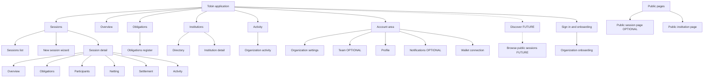

# Information architecture

Deliverable C. Terms follow [README.md](README.md); capability limits follow [protocol-capability-mapping.md](protocol-capability-mapping.md); roles follow [roles-and-permissions.md](roles-and-permissions.md).

## 1. The proposed navigation, evaluated

Proposed: **Overview, Obligations, Discover, Institutions, Netting & Settlement.**

| Proposed section | Fit with the protocol | Finding | Recommendation |
|---|---|---|---|
| Overview | fine | A dashboard is a pure application view | Keep |
| Obligations | **partly misfits** | Obligations do not exist on their own on-chain. They live inside a **clearing session** (at most 4 participants, 16 obligations, one token). A top-level "Obligations" list without the session hides the unit that carries the rules, limits and lifecycle | Make the **session** the primary working object. Keep an "Obligations" register as a cross-session view of every obligation that involves my organization |
| Discover | **not supported as imagined** | The contract has no enumeration, no public/private flag and no matching. Discovery would need an indexer and a public registry, and "netting opportunities" would need a matching service that proposes new sessions | **FUTURE** as a marketplace. In MVP-1 keep only "join by invitation or session id" and a public read-only session page |
| Institutions | fits as an application layer | Names, profiles and a directory are off-chain; they make counterparties recognisable | Keep, small in MVP-1 (opted-in directory) |
| Netting & Settlement | **misfit as a section** | Netting and settlement are not separate objects; they are stages of one session (freeze, propose, approve, settle). A separate section would duplicate the session and invite the wrong mental model (netting across sessions) | Make them **stages inside the Session detail**, and give the user a cross-session **"Needs your action"** queue on the Overview |

## 2. Recommended navigation

Primary (MVP-1):

1. **Overview**: what needs my action, my active sessions, recent activity.
2. **Sessions**: the working object. Each session has the tabs Overview, Obligations, Participants, Netting, Settlement, Activity.
3. **Obligations** (OPTIONAL in MVP-1, as screen S14): the register of obligations involving my organization across sessions (read-only; creation happens inside a session).
4. **Institutions**: directory and my organization's public profile.
5. **Activity**: organization-wide history of actions and transactions.

Reserved / future: **Discover** (marketplace of opportunities), **Developers / API** (out of scope).

Account area (menu, not primary navigation): **Organization settings** (profile, wallets, visibility), **Team** (OPTIONAL), **Profile**, **Notifications** (OPTIONAL), **Wallet connection**.

Why this shape: it keeps the protocol's real unit visible, keeps "Netting & Settlement" where the lifecycle actually lives, retains the user's five-part mental model for Overview, Obligations and Institutions, and reserves Discover without promising it.

## 3. Sections in detail

### Overview
- Purpose: orient the user and surface what must happen next.
- Primary users: analyst, administrator.
- Pages: Overview.
- Actions: open a session, start a new session, accept an invitation, go to a task.
- Information: "Needs your action" (approvals pending, authorizations due, invitations), active sessions with state, recent activity, wallet and network status (Testnet).
- Relations: links into Sessions, Activity, Institutions.

### Sessions
- Purpose: create and run clearing sessions.
- Users: analyst, administrator, counterparty representative.
- Pages: Sessions list; New session (wizard); Session detail with tabs Overview, Obligations, Participants, Netting, Settlement, Activity.
- Actions: create, invite, join, add obligation, freeze, propose or replace, approve, authorize and settle, copy a shareable link.
- Information: state, participants and their organizations, obligations, nets, proposal and digest, approvals and who is missing, each debtor's authorization, settlement record and ledger reference, what is irreversible.
- Relations: references Institutions (parties), Activity (events), Obligations register.

### Obligations (register)
- Purpose: one place to see every obligation my organization is party to, across sessions.
- Users: analyst, reviewer.
- Pages: Obligations list (filter by session, counterparty, role, state).
- Actions: open the owning session. No create, edit or delete here (protocol: permanent, session-scoped).
- Information: debtor, creditor, amount, token, session, state derived from the session.

### Discover (reserved, FUTURE)
- Purpose: browse public sessions and opportunities.
- MVP-1 stand-in: "Join with a link or session id" inside Sessions; public read-only session pages.
- Not promised: matching, opportunity detection, search across sessions.

### Institutions
- Purpose: recognise counterparties and publish my organization.
- Users: all.
- Pages: Directory; Institution detail; (own) Institution profile editor under Organization settings.
- Actions: view, invite to a session, edit own profile and visibility.
- Information: name, description, public addresses, public session history (derived from the ledger for published addresses).

### Activity
- Purpose: auditable history.
- Pages: Activity list (organization-wide); per-session Activity tab.
- Information: who did what, when, transaction hash and ledger, success or rejection, with the distinction between submitted, rejected and confirmed.

### Account area
- Organization settings: profile, public visibility, wallet addresses (with proof of control), default permissions for members.
- Team (OPTIONAL): members, roles, invitations.
- Profile: the signed-in user's details and linked wallet.
- Notifications (OPTIONAL): in-application list of tasks and events.
- Wallet configuration: connect a wallet, show address and network, switch account.
- Developers / API: NOT in MVP-1.

## 4. Sitemap

## 5. Cross-links to keep consistent

- A party is shown as its organization name when known, else as a shortened address; the address is always one click away.
- Every irreversible step has a review state first (the protocol has no undo).
- "Settled" appears only when the contract state is Settled; a rejected or unconfirmed transaction is never shown as progress.
