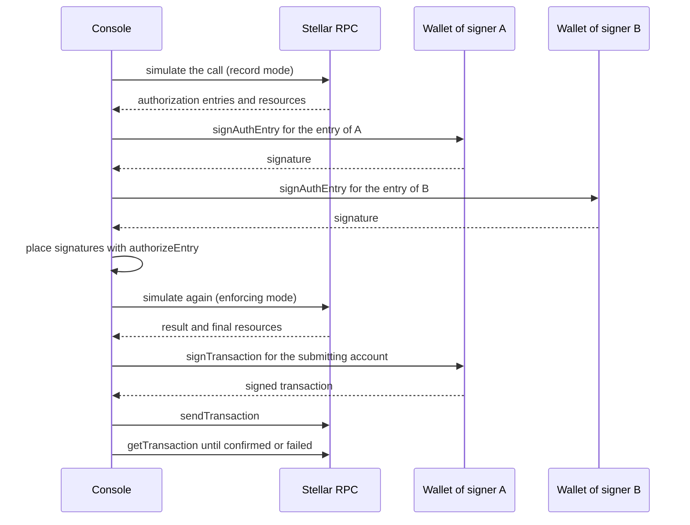

# Integration readiness

Phase 2A. Technical readiness of everything the redesigned console needs beyond the contracts. Facts were verified from repository source, from the contents of the named npm packages (downloaded to a scratch directory and read, not installed into the repository), and from read-only queries to the Stellar Testnet RPC and Horizon on 2026-11-03. Terms follow [README.md](README.md). Capability facts agree with [protocol-capability-mapping.md](protocol-capability-mapping.md).

Status keys: **IMPLEMENTED**, **PARTIAL**, **NOT IMPLEMENTED**, **UNKNOWN**. "Blocks functional implementation" means the console cannot run its core workflow on Testnet without it.

## 1. Summary

| Area | Status | Blocks a functional implementation? |
|---|---|---|
| Authentication | NOT IMPLEMENTED | Yes for an organizational product; no for a single-wallet demo |
| Organization persistence | NOT IMPLEMENTED | Yes for onboarding and organizations |
| Institution registry | NOT IMPLEMENTED | No for the core workflow; yes for directory and invitations by name |
| Session indexing and retrieval | NOT IMPLEMENTED (reads by id exist in the SDK) | Yes for a "my sessions" list |
| Obligation retrieval | PARTIAL (by session id) | No, once a session is known |
| Network transport | NOT IMPLEMENTED | **Yes** |
| Stellar RPC and Horizon | Available and verified, not integrated | Yes (consumed through the transport) |
| Wallet connectivity | NOT IMPLEMENTED (APIs exist) | **Yes** |
| Multi-signature authorization | NOT IMPLEMENTED; behaviour UNKNOWN | **Yes** (joins and settlement) |
| Transaction submission | NOT IMPLEMENTED | **Yes** |
| Transaction confirmation | NOT IMPLEMENTED | **Yes** |
| Notifications | NOT IMPLEMENTED | No |
| Activity history | NOT IMPLEMENTED | No for the core workflow; needed for audit |

## 2. Authentication

- **Current status:** NOT IMPLEMENTED. The Console has fixed demo "personas" (`apps/web-console/lib/console/controller.ts`, `Persona`); no user, session or sign-in exists (a search of `apps/web-console` and `packages/mvp1-sdk/src` for login, organization or institution code found none).
- **Evidence:** `apps/web-console/lib/server/api.ts` exposes only `/api/bootstrap` and `/api/rpc`; `lib/server/guards.ts` restricts the Console to `127.0.0.1` or `localhost` hosts and origins.
- **Missing capabilities:** user records, a session mechanism, a way to prove control of a wallet, account recovery (if email is used).
- **Required technical work:** a backend (identity and sessions) and a sign-in method. **DECISION REQUIRED (D3):** wallet-based sign-in (sign a challenge, proof of control) versus email plus a linked wallet. Wallet message signing exists in the wallet APIs (below) but its output format and which wallets support it are UNVERIFIED.
- **Dependencies:** hosting for a backend; wallet connectivity.
- **Risks:** wallet sign-in couples application identity to one key (key loss is account loss); email sign-in adds recovery and privacy obligations. Application identity must stay separate from wallet identity.
- **Blocks:** not for a one-wallet demonstration; yes for organizations and teams.

## 3. Organization persistence

- **Status:** NOT IMPLEMENTED. The sandbox state is in memory in the server process and is lost on restart (`apps/web-console/lib/server/sandbox.ts`).
- **Missing:** a database and a data-access layer for organizations, memberships, wallets, invitations, drafts, transactions and activity (the entities in [domain-model.md](domain-model.md)).
- **Required work:** choose a datastore and hosting; define schemas; backups. **DECISION REQUIRED (D4):** accept a lightweight backend that holds no keys and has no authority over funds.
- **Dependencies:** authentication. **Risks:** it becomes a second source of truth; contract state must always win when they differ. **Blocks:** onboarding and organization features.

## 4. Institution registry

- **Status:** NOT IMPLEMENTED; there is no on-chain registry or enumeration (the contract exposes no list function; verified in the capability mapping).
- **Missing:** an **application-level registry** of organizations that opted in, with published addresses. This is an application database, not on-chain data, and it is not complete or authoritative about who exists on the network.
- **Required work:** registry tables, a moderation or verification approach, search. **DECISION REQUIRED:** whether listed institutions are verified by anyone (the product must not imply verification that does not exist).
- **Dependencies:** organization persistence. **Risks:** impersonation of a name; published addresses that are not controlled by the claimant (mitigated by proof of control). **Blocks:** the directory; not the core workflow.

## 5. Session indexing and retrieval

- **Current status:** reads by exact session id exist (`get_session` in the contract; `getSession`, `getSessionStatus` in `packages/mvp1-sdk/src/sdk/client.ts`), working against the local sandbox only. There is no way to list sessions.
- **Evidence (measured on 2026-11-03):**
  - The contract has no enumeration function.
  - The Testnet RPC retains ledgers for a window of **120,960 ledgers (about 7 days)** (`getHealth`: `ledgerRetentionWindow` 120960, oldest 5414083 at latest 5535042).
  - `getEvents` works for a contract in a small ledger range (a 10-ledger window around a known `create_session` returned the two expected events), but a scan from the oldest retained ledger with a small page limit returned no result object in the one attempt made here. The exact range and pagination limits are **UNKNOWN** and must be tested.
  - Persistent contract entries have their own lifetime (TTL); the Testnet token and clearing instances needed explicit TTL management during this project.
- **Therefore:** an event stream alone does **not** give complete historical state. Events older than the retention window are gone from the RPC; an indexer must record events as they happen (and backfill within the window) and keep its own history. Current state is recoverable from `getLedgerEntries` only while entries are alive.
- **Two options, distinguished:**
  1. **Application registry** (recommended first): the product records the session ids that were created or joined through it, then reads each session's state from the ledger. Complete for sessions made in the product; knows nothing about other sessions.
  2. **Indexer** over contract events: broader, needs continuous operation and storage, can lose history if it was down longer than the retention window.
- **Missing:** either mechanism. **Dependencies:** network transport (reads), persistence. **Risks:** staleness, missed events, chain reorganization is not a concern on Stellar but RPC outages are. **Blocks:** the "my sessions" list (S06). **DECISION REQUIRED (D6).**

## 6. Obligation retrieval

- **Status:** PARTIAL. `get_obligations(session_id)` and `get_obligation` exist (`CLEARING_FUNCTIONS` in `sdk/abi.ts`); `TobinClient.getObligations` wraps them. There is no cross-session query.
- **Missing:** a cross-session view (needs the registry or indexer) and application metadata (references and descriptions) bound to obligation ids.
- **Risks:** off-chain metadata can be edited without any on-chain trace; label it "not enforced". **Blocks:** no, once a session is known.

## 7. Network transport

- **Status:** **NOT IMPLEMENTED.** `packages/mvp1-sdk/src/sdk/transport.ts` defines the `Transport` interface and `NetworkTransportNotAuthorized`, which refuses every call. The only working transport is the local sandbox (`src/local/bridge.ts`, driving the Rust bridge). The Console's `HttpTransport` talks to the local sandbox over `/api/rpc`.
- **What a transport must do** (from the interface's own comment): simulate to obtain the authorization entries, have each required signer sign its entry, assemble the transaction with a source account and fee, submit it and wait for confirmation, read the result back.
- **Required work:** implement a `Transport` for Testnet. This needs XDR construction and Soroban helpers. **The repository has no Stellar JavaScript SDK dependency** (its own `strkey.ts` and `address.ts` only). Candidates verified from package contents: `@stellar/stellar-sdk` 17.4.0 (Apache-2.0, published 2026-10-25) provides `rpc.Server` (simulate, send, get transaction, get events), transaction assembly and `authorizeEntry`. **DECISION REQUIRED:** add that dependency to the SDK or the console, or drive the Stellar CLI from a server component. The wallet kit below also depends on a Stellar SDK.
- **Dependencies:** RPC access; wallet signing. **Risks:** the SDK is documented as "no wallet, no network" and the baseline specification requires the signing workflow to be proven before the UI is considered complete. **Blocks: yes.**

## 8. Stellar RPC and Horizon

- **Current status:** not used by the SDK or Console. Used manually in this engagement.
- **Verified (read-only):** Soroban RPC `https://soroban-testnet.stellar.org`: `getHealth`, `getLatestLedger`, `getLedgerEntries`, `simulateTransaction` (with `resourceConfig.instructionLeeway`), `sendTransaction`, `getTransaction`, `getEvents`, `getVersionInfo` (version 30.0.0, protocol 29). Horizon `https://horizon-testnet.stellar.org`: accounts, transactions, fee stats.
- **Missing:** a configured endpoint, error handling and retry, rate-limit handling. The public endpoints' rate limits and any service commitments are **UNKNOWN**; a deployed product should use its own provider or node.
- **Observed behaviour to design for:** transient `504` responses occurred on reads during this project; a `tx send` that was rejected returned typed errors (`TxBadAuth`, `TxBadAuthExtra`, `TxFailed` with an operation error); simulation does not check signature weights.
- **Risks:** the Console's Content-Security-Policy (`connect-src 'self'`) and its host and origin guards (`apps/web-console/lib/server/guards.ts`) block direct browser calls to an RPC; either proxy through a server route or change the policy deliberately. **Blocks:** yes, as part of the transport.

## 9. Wallet connectivity

- **Current status:** NOT IMPLEMENTED in the repository.
- **Verified from package contents (2026-11-03):**
  - `@stellar/freighter-api` 6.0.1 (Apache-2.0) exports `isConnected`, `isAllowed`, `setAllowed`, `requestAccess`, `getAddress`, `getNetwork`, `getNetworkDetails`, `signTransaction`, `signMessage`, `signAuthEntry`, `addToken`, `WatchWalletChanges`. `signAuthEntry(entryXdr, { networkPassphrase?, address? })` returns `{ signedAuthEntry, signerAddress }`. Freighter transaction signing through this API was used successfully in this project (for ordinary transaction envelopes).
  - `@creit.tech/stellar-wallets-kit` 2.8.0 (MIT, published 2026-10-28) is a multi-wallet layer (Freighter, Albedo, xBull, LOBSTR, Rabet, Hana, HOT, Ledger, Trezor, OneKey, WalletConnect and others) with `signTransaction`, `signAuthEntry`, `signMessage`. In its own module code **Albedo and Ledger throw "does not support signAuthEntry"**; support in the other modules was not verified.
- **UNKNOWN (needs the spike):** whether the browser wallets accept the preimage the contract flow needs and return a signature in a form the assembly step can use; whether Freighter's `signAuthEntry` works for a `G` account that is not the transaction source in this exact flow; the behaviour of each wallet on rejection, timeout and account switch; React 19 and Next 16 compatibility of the kit.
- **Required work:** a wallet adapter in the console; a technical spike (section 11).
- **Risks:** uneven `signAuthEntry` support limits which wallets can be offered. **Blocks: yes.**

## 10. Multi-signature authorization

This is the central risk. Two cases must be kept apart.

1. **Transaction signing** (the transaction envelope): a single party signs as the source account. Demonstrated here with Freighter for ordinary and Soroban transactions. A classic multisig account (as the Testnet administrative account) needs several envelope signatures.
2. **Soroban authorization entries** for other addresses: in the Tobin flows, the second signer of `join_session` (the creator, if the joiner submits, or the joiner) and **each debtor in `settle`** are not the transaction source, so each must sign its own authorization entry. A generic `signTransaction` call does **not** produce these.

- **Current status:** NOT IMPLEMENTED. The repository's authorization signing is a Rust local signer (`contracts/clearing/signer/mod.rs`, `examples/authsign.rs`) using disposable test keys, with an intent model (`sdk/intent.ts`) that a signer checks before signing. The TypeScript SDK builds `PreparedCall`s that list the required authorizations (`sdk/prepare.ts`) but does not build, sign or place authorization entries.
- **Verified building block:** `@stellar/stellar-sdk` 17.4.0 `authorizeEntry(entry, signer, validUntilLedgerSeq, networkPassphrase, forAddress?)` accepts a signing callback `(preimage, payload) => Promise<signature>`, so a wallet signature can be inserted without exposing keys. Whether a wallet's `signAuthEntry` returns exactly what that callback needs is **UNVERIFIED**.
- **Repository constraint:** the signer policy requires `current < expiration <= current + 10` ledgers (about 50 seconds), and a failed settlement requires fresh authorizations (SDK `ReauthorizationRequired`). Collecting signatures from different organizations inside that window is a product problem, not only a technical one. **DECISION REQUIRED (D8):** the collection experience, and whether a longer validity is acceptable (the Soroban network limit is **UNKNOWN** here and must be checked).
- **Missing:** a signature-collection service and UI: a shared state of "which signers have signed", expiry handling, reassembly, resubmission.
- **Behaviours to specify and test:** user **rejects** (mark that signer rejected; the call is not submitted; nothing changes on-chain); **partial signing** (hold the collected signatures only until expiry; never submit a transaction that would be rejected for missing authorization; show who is missing); **disconnect or account switch** (invalidate pending signature requests for that signer; require reconnect); **timeout** (expire the request and require fresh authorizations).
- **Risks:** high. **Blocks: yes** for joins and settlement.

## 11. Technical spike (required before committing screens that depend on it)

Goal: prove, on Testnet with disposable accounts, one end-to-end Tobin call that needs a non-source authorization (for example `join_session` with two different wallets).

Steps: (1) simulate to obtain the entries; (2) sign the second party's entry with a wallet through `signAuthEntry` and `authorizeEntry`; (3) assemble, re-simulate in enforcing mode, submit, confirm; (4) record which wallets work; (5) test rejection, expiry and disconnect; (6) decide the validity window. Outputs: a written result, the chosen wallet or wallets, and the dependency decision. The spike modifies no contract.

## 12. Transaction submission and confirmation

- **Status:** NOT IMPLEMENTED in the SDK or Console.
- **Verified manually:** `sendTransaction` then `getTransaction` (statuses seen: `NOT_FOUND`, `SUCCESS`); the CLI `stellar tx send` returns typed errors on rejection; a rejected transaction is not included in a ledger and leaves the account sequence unchanged; a transaction with an unneeded extra signature is rejected (`TxBadAuthExtra`).
- **Required work:** submit with retries for transient errors; poll `getTransaction` with a timeout; distinguish rejected at submission, included and failed, and included and succeeded; store the hash and ledger; surface typed errors. **Dependencies:** transport, persistence for transaction records. **Risks:** duplicate submission, missed confirmation after a client crash (the product must reconcile by reading the ledger). **Blocks: yes.**

## 13. Notifications

- **Status:** NOT IMPLEMENTED. **Required work:** in-application notifications from backend events (invitations, "waiting on you", settled); email or push are out of MVP-1. **Dependencies:** persistence, indexing. **Blocks:** no.

## 14. Activity history

- **Status:** NOT IMPLEMENTED beyond the sandbox's in-memory log (`Model.log` in the controller).
- **Required work:** the application stores its own activity and transaction records (the RPC's event window is about 7 days); on-chain facts are cross-checked from the ledger. **Dependencies:** persistence, transport. **Risks:** history gaps if recording lapses. **Blocks:** no for the core workflow.

## 15. Hosting and security model (not previously specified)

- The Console is built to run locally only; deploying it publicly needs a different security model (authentication, a hardened Content-Security-Policy that permits the wallet and RPC calls, rate limiting).
- The landing page is deployed on Vercel from `apps/landing` (project root). No console deployment is configured; **UNKNOWN** where the backend and console would be hosted. **DECISION REQUIRED.**
- The application must hold no private keys; all signing happens in the user's wallet.

## 16. Sequence of the target authorization flow (for the spike)

Which wallet signs which step, and whether step "signAuthEntry" works for each wallet, is exactly what the spike must establish.
