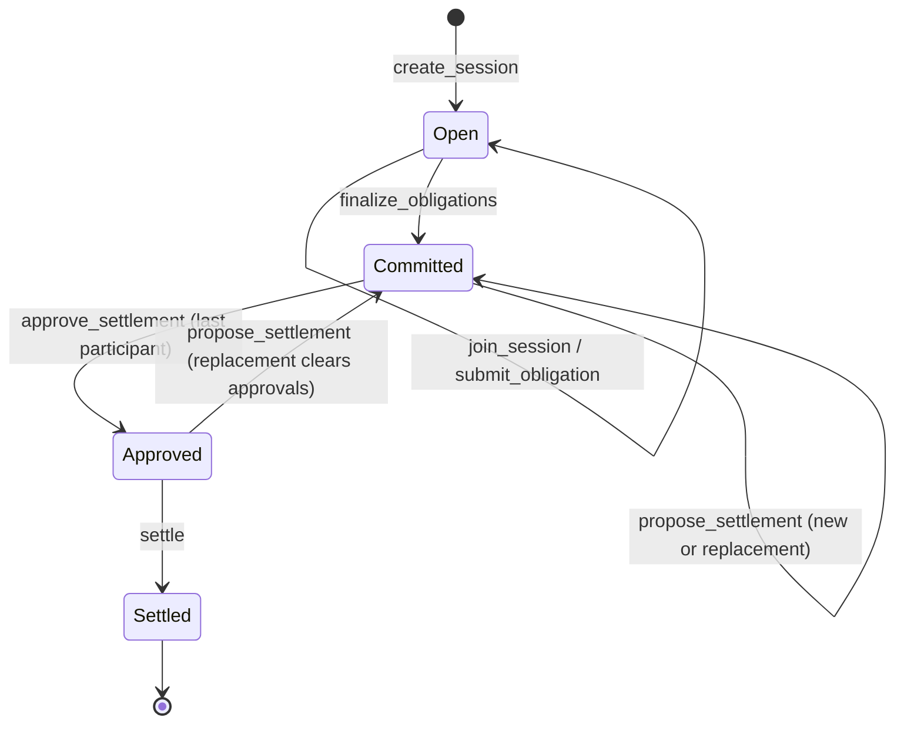
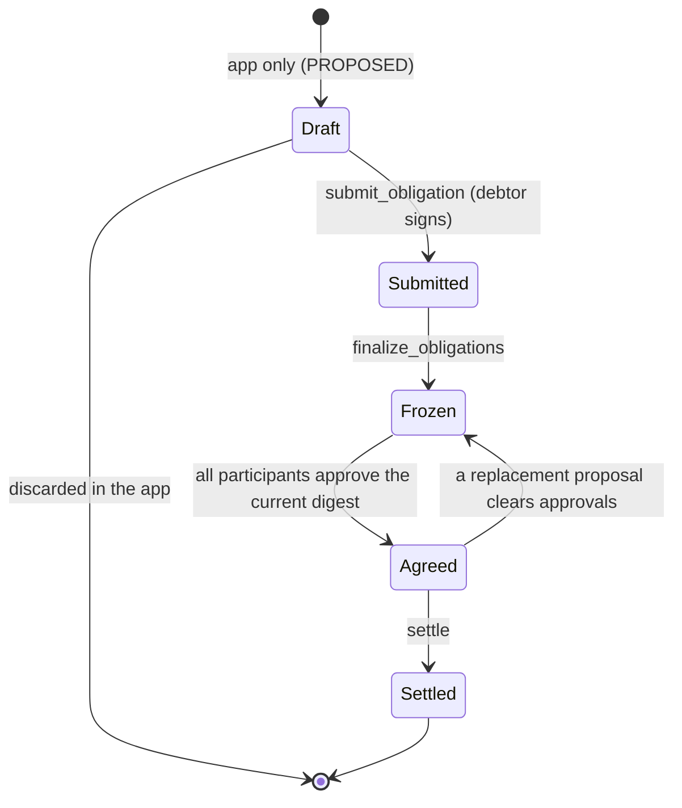
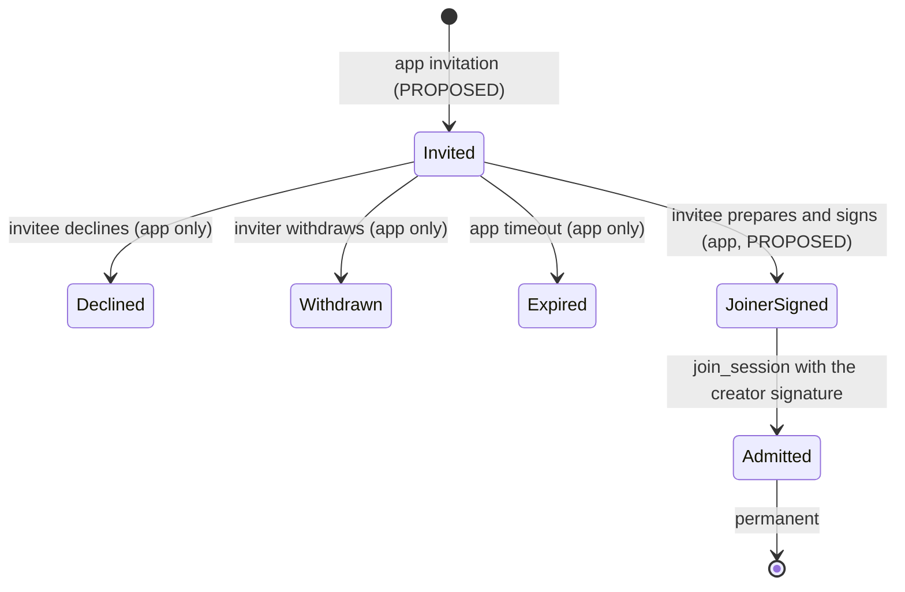
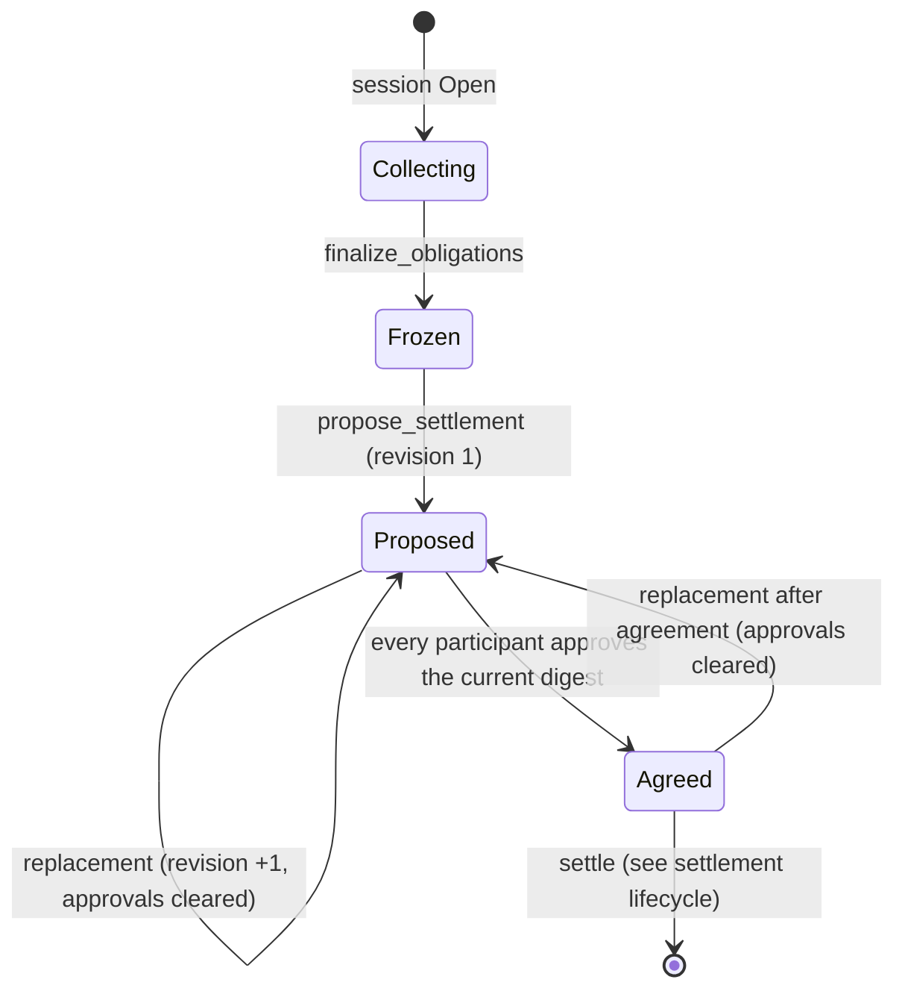
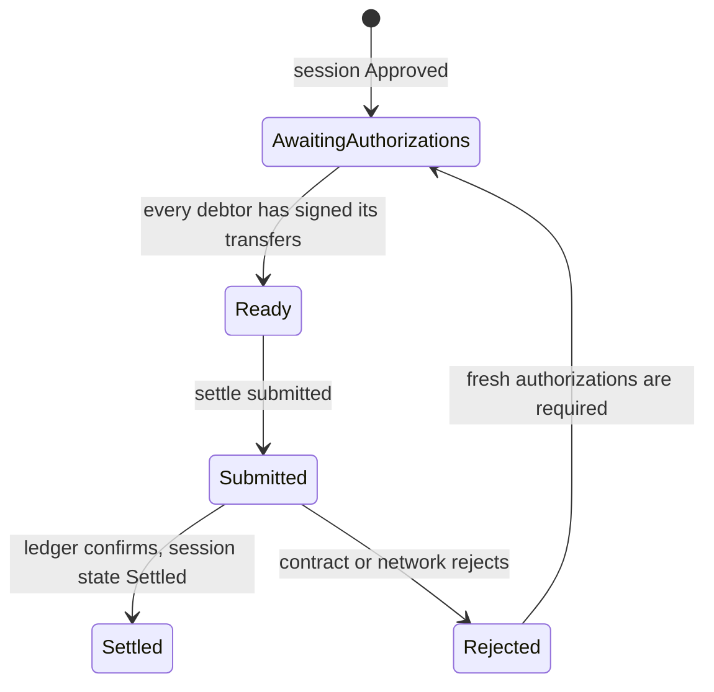
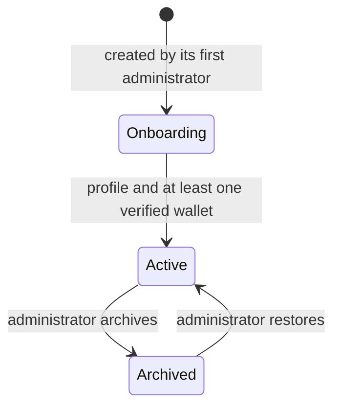

# Lifecycle models

Deliverable E (part 2). Terms follow [README.md](README.md); entities follow [domain-model.md](domain-model.md). **Verified** states and transitions come from the contract source (`State` enum and function preconditions in `contracts/clearing/src/lib.rs`). **Proposed** states exist only in the application and are labelled as such in each diagram and table. Nothing here adds a protocol state.

## 1. Session (the verified on-chain lifecycle)

Verified rules: `Open` allows joins and obligations; `finalize_obligations` needs at least 2 participants and 1 obligation and freezes everything; a proposal is data inside Committed or Approved; replacing a proposal clears every approval and returns the session to Committed; `settle` needs the current digest, all approvals and every debtor's authorization and is all-or-nothing; `Settled` is terminal (`AlreadySettled`). There is no cancel, abort, timeout or recovery: a session may stay in any state forever. An all-zero session finalizes, takes an empty proposal, is approved and settles with no token call.

## 2. Obligation

An obligation has no state field. Its status is derived from the session it belongs to. The user's candidate states are validated against the protocol below.

| Candidate state | Real? | Protocol meaning |
|---|---|---|
| Draft | **application only** (PROPOSED) | Prepared in the application before submission; nothing on-chain |
| Published | **Yes, as "Submitted"** | `submit_obligation` succeeded; the session is Open. It is visible on the ledger immediately. There is no separate "published" step |
| Awaiting participation | **Yes, derived** | The session is Open and a named party is not yet admitted or has not yet done their part; cannot submit an obligation involving a non-admitted party (`UnknownParty`) |
| Active | **Not a protocol state** | Use "Submitted" while the session is Open |
| Closed | **Not supported** | No close operation exists |
| Eligible for netting | **Yes, derived** | The session is Open with at least 2 participants and 1 obligation, so `finalize_obligations` is allowed |
| Netted | **Yes, derived (two steps)** | Frozen: session Committed; agreed: a proposal exists and all participants approved (session Approved) |
| Awaiting settlement | **Yes, derived** | The session is Approved: approvals complete, debtor authorizations and `settle` outstanding |
| Settled | **Yes** | The session is Settled |
| Failed or cancelled | **Not supported on-chain** | A failed `settle` reverts and leaves the session Approved; an abandoned session simply stays where it is |

"Draft" and its discard are application-only; every other transition is the session's.

## 3. Participant membership

Verified: on-chain admission is one call needing the joiner's **and** the creator's authorizations; it is only possible while the session is Open and below capacity (`TooManyParticipants`, `ParticipantExists`, `WrongState`). There is no on-chain invitation, rejection, leave or removal. "Declined", "Withdrawn" and "Expired" are application states that never reach the chain. Because both signatures cover one call, the application needs a signature-collection step (see the capability mapping).

## 4. Netting cycle

Verified: any admitted participant may propose; the contract accepts any valid plan, not only the engine's default; approvals count only for the current digest; the revision is part of the digest, so an approval of an older revision can never be replayed. A frozen but unproposed session is simply Committed with no proposal.

## 5. Settlement

On-chain, settlement is one atomic call. The application-level stages (PROPOSED) track the preparation and the submission of that call.

Verified: a failed settlement leaves the session Approved and changes nothing; authorizations of a failed attempt must not be reused (the SDK and Console enforce fresh authorization, `ReauthorizationRequired`); the Console already shows "settled" only when the contract reports Settled.

## 6. Organization (application only, PROPOSED)

Nothing here is verified because nothing exists. Archiving an organization never alters sessions it participates in; on-chain history is permanent.

## 7. Consistency checks

- Every transition on a session or obligation is a call listed in the capability mapping; no state is invented.
- Application-only states (Draft, Declined, Withdrawn, Expired, Onboarding, Archived, Rejected tracking) are labelled and never shown as protocol states.
- The terms Draft, Submitted, Frozen, Agreed, Settled are used consistently with the screen inventory and journeys.
