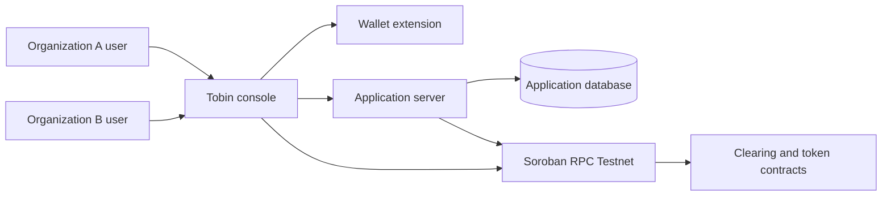
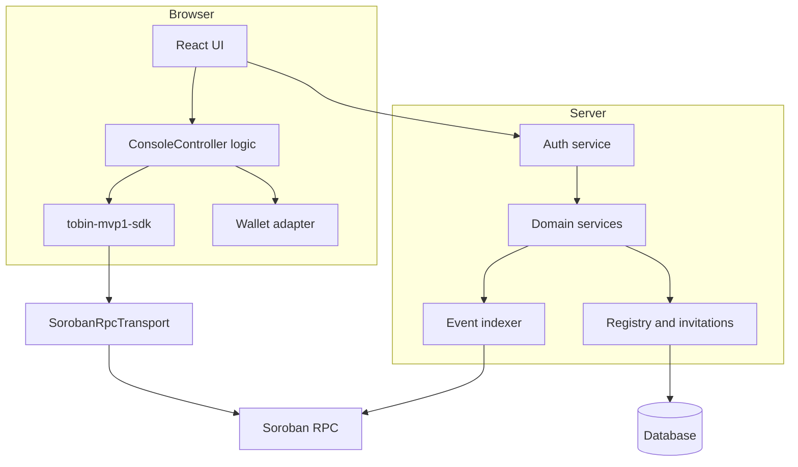
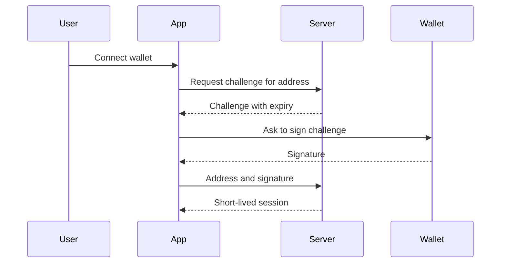
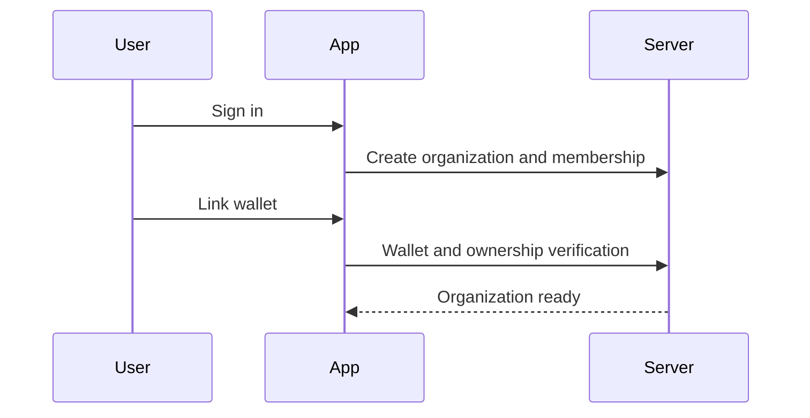
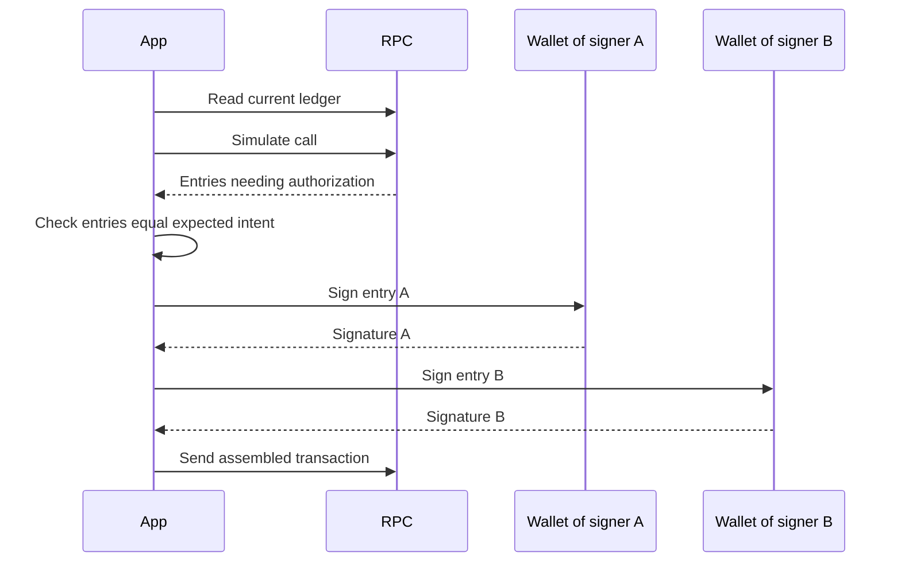
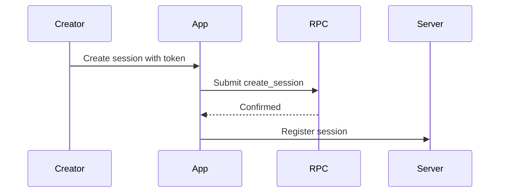
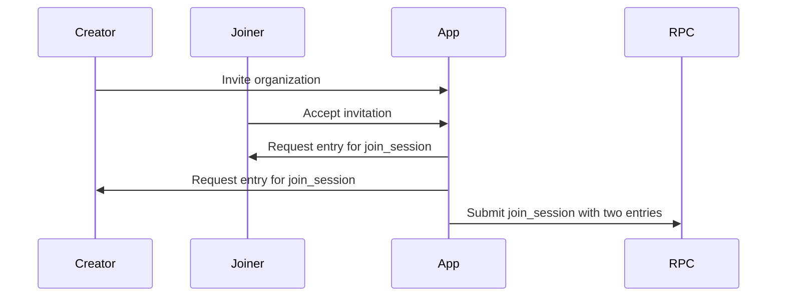
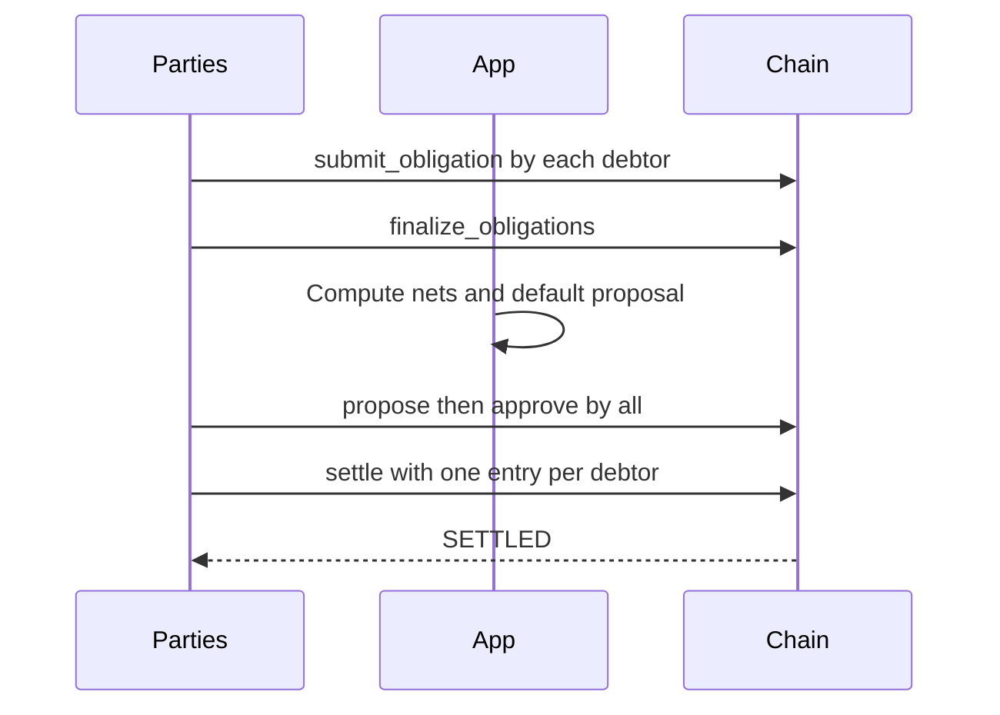
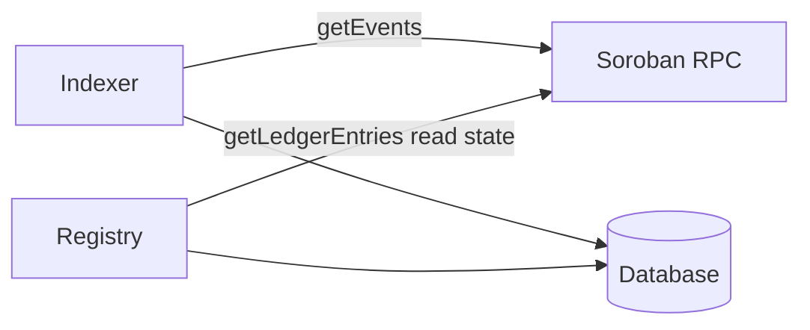
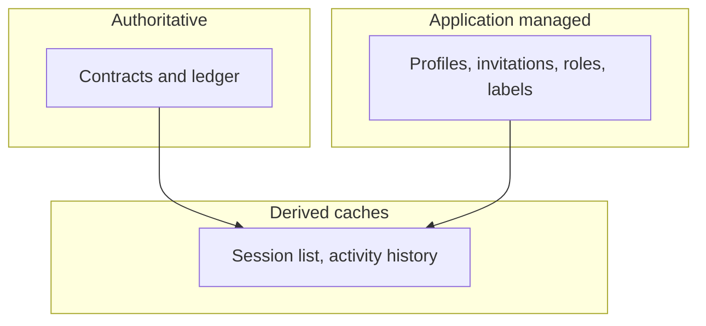

# MVP-1 architecture (Phase 2B, C)

Written 2026-11-03. **The Mermaid diagrams below were written to standard syntax and were not rendered or validated by a Mermaid tool.** They show a proposed architecture. Legend, used in every diagram's accompanying table:

- **Implemented**: exists and is tested in the repository.
- **Proposed**: designed here, not built.
- **Unverified**: depends on evidence not yet obtained (mainly wallet entry signing).
- **Deferred**: out of MVP-1 (Discover, cross-session netting).

## 1. System context

| Element | Status |
|---|---|
| Contracts | Implemented |
| Sandbox console, SDK, engine, digest | Implemented (local only) |
| Application server, database | Proposed |
| Network transport | Proposed (SDK refuses today) |
| Wallet entry signing | Unverified |

## 2. Components

SDK, controller logic: Implemented. Transport, wallet adapter, server pieces: Proposed.

## 3. Authentication sequence

Proposed. Signing form (message or never-submitted transaction) Unverified.

## 4. Onboarding sequence

Proposed.

## 5. Wallet signing sequence (entries)

Unverified at the wallet steps. Expiration within 10 ledgers of the read ledger (policy).

## 6. Session creation

## 7. Session joining

Needs two authorizations, creator and joiner. Unverified at signing.

## 8. Netting and settlement

States: Open, Committed, Approved, Settled. Contract logic Implemented; browser signing Unverified.

## 9. Backend to Stellar

The server reads only. It never sends transactions. Proposed.

## 10. Data ownership and trust boundaries

Conflicts resolve to the contracts.

## Minimum end-to-end journey

Two independent organizations authenticate; each is represented; one creates a session; the other joins; obligations are submitted; the session is finalized; netting is proposed and approved; settlement completes; both can inspect session and activity history. No marketplace, no cross-session netting. See [phase-2b-implementation-plan.md](phase-2b-implementation-plan.md).
