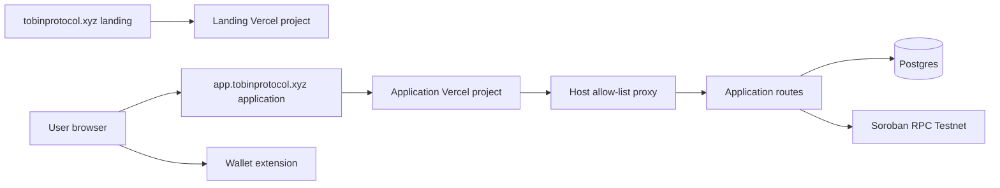
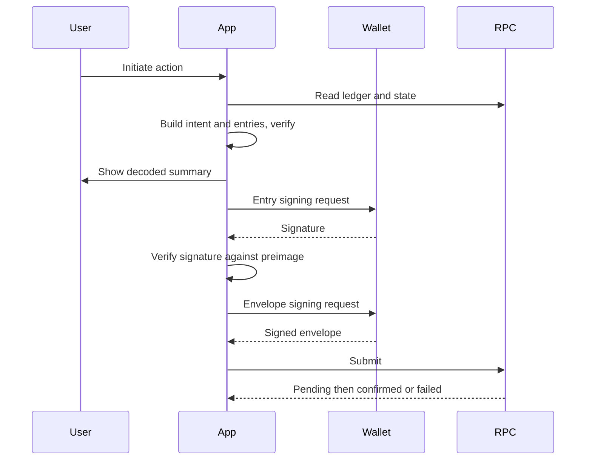
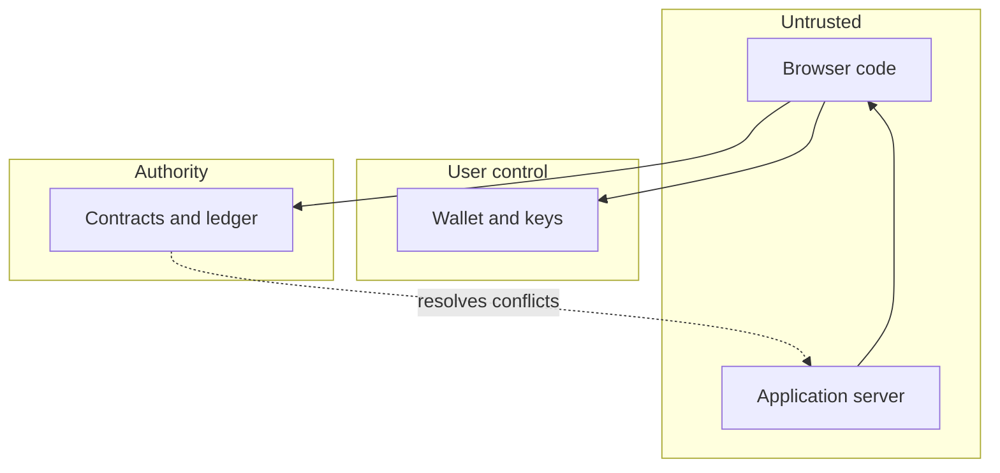

# MVP-1 architecture, revised (Phase 2C)

Written 2026-11-03. Supersedes the diagrams of `docs/product/architecture/phase-2b/mvp-1-architecture.md` where they differ (the Phase 2B file is kept; that earlier-phase document is intentionally not part of the pull request that introduced this file, so it is cited as text, not as a link). Mermaid diagrams were **structurally checked by reading only; they were not rendered** (no renderer is available in this environment). Status: Proposed unless stated.

## Changes from Phase 2B

1. Hosting: a separate Vercel project for the application on `app.tobinprotocol.xyz`; landing stays in its own project (owner decision D4).
2. Wallet entry signing remains **Unverified**; the signing path is gated on T3 to T7.
3. Authentication separated from entry signing and envelope signing.
4. Registry recovery limits stated (history can be incomplete).

## Context and hosting

## Responsibilities

| Component | Responsibility | Must not |
|---|---|---|
| Browser app | Build calls with the SDK, show decoded intent, request signatures, submit through the transport | Trust server-supplied entries without recomputing intent |
| Wallet | Holds keys, signs entries/envelopes/challenges | n/a |
| Application server | Profiles, organizations, memberships, invitations, registry, activity, reconciliation | Hold keys, sign, submit for users, override chain state |
| Indexer | Reads events and state, records the last ledger | Treat events as sole truth |
| Contracts | Authority on session state | n/a |

## Distinct stages of one action

Authentication (sign-in) is a separate earlier flow and is never reused as authorization.

## Trust boundaries

Data flows: the server never sits between the wallet and the chain. Chain reads and submissions go from the browser; the indexer reads independently.
