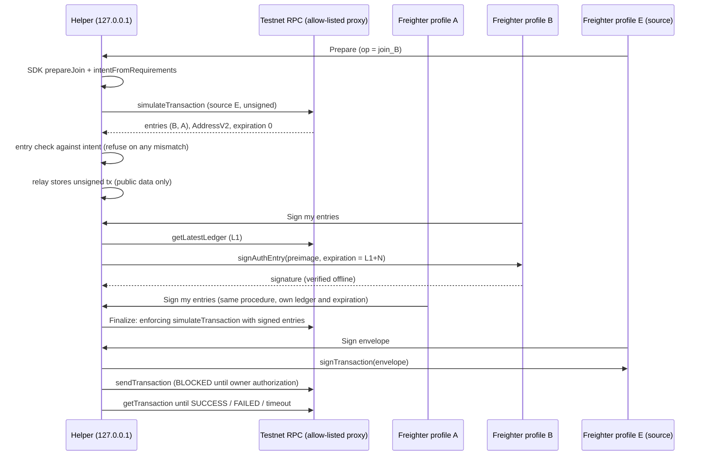

# W2 authorization flow

Design under test (helper, not product). SDK `prepare` and `intent` are reused unchanged; the helper adds only what `Transport.invoke` lacks.

## Authorization requirements from source
| Operation | Entries | Signers | Notes |
|---|---|---|---|
| `create_session` | 1 | creator | |
| `join_session` | 2 | joiner and creator, same tree, own nonce and expiry each | needs both in one transaction |
| `settle` | one per debtor, each with nested token transfer | out of W2 scope | cannot be tested without token balances |

## Where each guarantee comes from
- Which account must sign what: the contract (`require_auth`), mirrored by SDK `prepare`.
- That a wallet is never asked to sign anything but the expected tree: the helper's intent check (SDK `intent` plus the helper's entry comparison).
- Expiry: assigned by the helper at signing time and enforced by the network; the 10-ledger cap is the helper's/signer tooling's rule.
- Confirmation: only `getTransaction` status `SUCCESS`.

## Findings on the existing abstraction (OBSERVED in code)
`Transport.invoke(call)` has no place for: simulation, entry collection from several wallets over minutes, source account, fee, submission, polling. A network transport must be split into prepare, collect, submit/confirm phases. `prepare` and `intent` are sufficient as they are.
