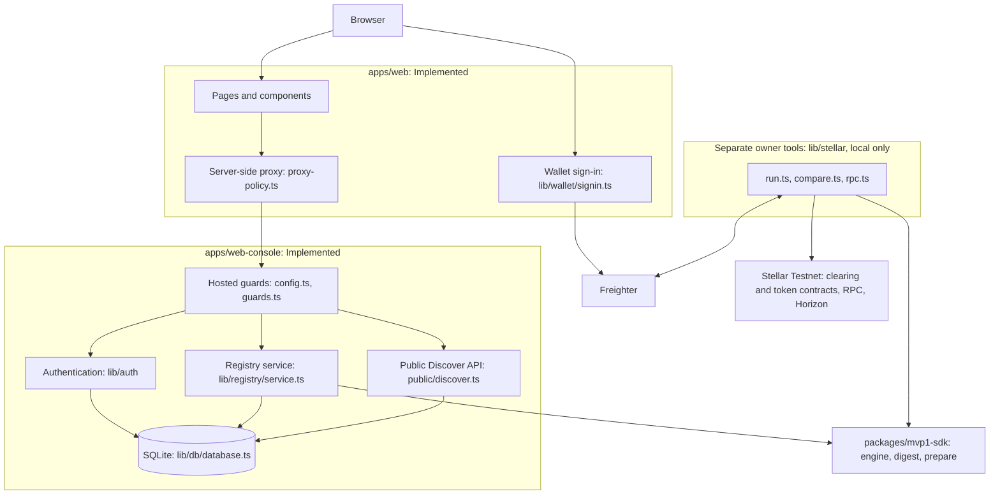
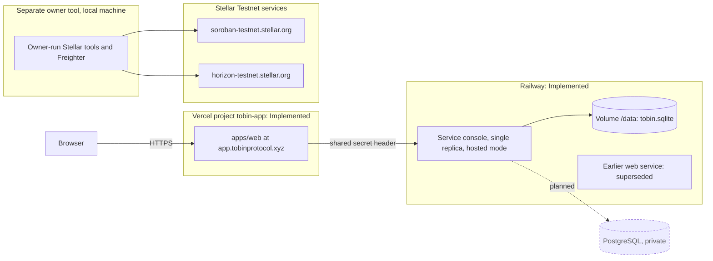

# Tobin architecture

Status: technical document of the SCF Build Award (Open Track) submission package, 2026-11-09. Our own recommended documentation; it answers the handbook requirement that technical architecture is complete at application and Open Track points 1, 2 and 8.
Evidence basis: source read for this document (`contracts/clearing/src/lib.rs`, `contracts/token/src/lib.rs`, `packages/mvp1-sdk`, `apps/web`, `apps/web-console`), `contracts/deployments/testnet.json`, `docs/product/architecture/mvp-1.5/` (closure, verification, evidence), `docs/backend-implementation/RAILWAY-TESTNET-PILOT.md` (hosting record dated 2026-11-09, owner-reported, not re-verified by us). Same-author evidence throughout; no independent security review exists.

This document says WHAT exists and WHERE. The rules are in [technical-specification.md](technical-specification.md), the chain side in [stellar-integration.md](stellar-integration.md), the two applications in [ui-and-console.md](ui-and-console.md), the endpoints in [api-reference.md](api-reference.md). Two diagrams are embedded here; the other diagram sources are in [../diagrams/](../diagrams/).

## 1. Components

| Component | Path | Responsibility | Holds |
|---|---|---|---|
| Web application (canonical UI) | `apps/web` | Next.js 16 / React 19 user interface for institutions. No database. Calls the console API only through a server-side proxy (`app/api/[...path]/route.ts`, `lib/proxy-policy.ts`). Freighter is used in the browser for wallet sign-in (message signing) only (`lib/wallet/signin.ts`). | no keys, no records |
| Console (backend and operator tools) | `apps/web-console` | Next.js route handlers over one SQLite file: authentication, organizations, sessions, obligations, calculations, institutional approvals, settlement preparation, execution-precondition records, signer-set snapshots. Also the owner-run Stellar tools, a local sandbox and a mock API. | all application records; no signing key |
| SDK and engine | `packages/mvp1-sdk` | Netting engine (`engine/`), digest encoder (`digest.ts`), prepared contract calls with their authorization requirements (`sdk/prepare.ts`), local bridge client. Shared by the console and tests. | nothing persistent |
| Clearing contract `TobinClearingV1` | `contracts/clearing` | On-chain session lifecycle, validation of a proposed plan, approvals, debtor-authorized transfers. | session, obligations, proposal, approvals, settlement result |
| Test token `TobinTestToken` | `contracts/token` | Capped Soroban token used for settlement. A subset of the standard token interface. | balances, supply |
| Stellar Testnet services | `https://soroban-testnet.stellar.org` (RPC), `https://horizon-testnet.stellar.org` (Horizon) | Simulation, submission, reads. Hard-coded in `lib/stellar/rpc.ts:12` and `lib/stellar/live.ts:115`. | the chain |
| Freighter | browser extension | Wallet sign-in challenge signing; in the owner-run tools, authorization-entry and transaction-envelope signing. | the user's keys |
| Landing and docs | `apps/landing`, `apps/docs` | Marketing page and documentation site. Not part of the settlement path. | n/a |

A third and fourth surface exist inside the console build and are outside the product boundary: the MVP-1 local sandbox (`/`, `/api/bootstrap`, `/api/rpc`, needs the Rust bridge) and the W0 mock console (`/w0`, `/api/w0/*`, in-memory). A hosted console refuses both (`lib/server/config.ts:21`; `app/api/w0/[...path]/route.ts:7`).

### Component architecture (diagram)

The hosted path is browser, proxy, guards, then the authentication, registry and public services over one SQLite file; the registry service uses the SDK engine to compute calculations and batches. The owner tools in `lib/stellar` use the same SDK, talk to Freighter and to Stellar, and have no arrow to or from the registry service or the database: that absence is the current state (section 4, steps 6 to 8). Sources: `apps/web/lib/proxy-policy.ts`, `apps/web-console/lib/server/{config,guards}.ts`, `lib/registry/service.ts`, `lib/stellar/run.ts`.

## 2. Trust boundaries

| Boundary | What crosses it | Control (code) |
|---|---|---|
| Browser to web app | page requests, API calls | Per-request CSP nonce and security headers (`apps/web/proxy.ts`, `lib/server/headers.ts`); page access decided server-side from the console's answer (`lib/access/decide.ts`) |
| Web app to console | only `/api/auth`, `/api/registry`, `/api/public/v1` (GET); methods GET and POST; body at most 8 KiB | `lib/proxy-policy.ts:7-21`; CSRF checks on the real browser request (`lib/server/csrf.ts`); in hosted mode a shared secret (`x-tobin-proxy-auth`) and the client address as seen by one trusted hop (`x-tobin-client-ip`) |
| Console to database | SQL, parameterised | Immutability triggers on history tables; transactions `BEGIN IMMEDIATE` (`lib/db/database.ts`) |
| Console to Stellar | RPC and Horizon reads, simulation; submission only in the owner-run tool | No key in the server; the tool submits only an envelope already signed in the owner's browser and only after the typed confirmation (`lib/stellar/run.ts:138`) |
| Browser to wallet | challenge text, authorization entries, envelopes | The wallet shows and signs; the server verifies the signature and rebuilds the signed text itself (`lib/registry/wallet-proof.ts`, `lib/auth/wallet-challenge.ts`) |
| Contract to token | `transfer(from, to, amount)` on the session token | The token's own `from.require_auth()` (`contracts/token/src/lib.rs:125`) |

Seven authorities are kept apart, and none implies another: wallet connection; verified wallet ownership (a signature over a server-issued challenge); authenticated Tobin user; institutional membership and role (`admin`, `member`); reviewer grant (a separate grant, not implied by `admin`); settlement initiation (admin only in the console); Stellar signing authority (the keys). A role in Tobin never signs anything; a signature never grants a role (`lib/registry/service.ts:1-2`, `lib/stellar/owner-access.ts:1-3`).

## 3. On-chain and off-chain responsibility

Derived from `contracts/clearing/src/lib.rs`. "Contract" means enforced by the contract code on the network that runs it; "application" means enforced only by the console; "policy" means a rule of the owner-run tool or a written policy that nothing on chain checks.

| Concern | Contract | Application only | Policy / owner tool only |
|---|---|---|---|
| Participant admission | joiner and creator both authorize (`lib.rs:332-333`); at most 4 (`lib.rs:30`) | session participants are users of one organization (`service.ts:288`) | which Stellar account represents a participant (verified-wallet mapping, `service.ts:793`) |
| Obligations | positive amount, distinct known parties, unique id, at most 16, no `i128` overflow of any sum (`lib.rs:345-395`); debtor authorizes | asset identity, free-text reference, void/edit with revision, one asset per session | mapping application obligations one-to-one to on-chain ones (`execution-plan.ts:96`) |
| Netting | recomputes nets from the frozen obligations (`lib.rs:866`) | engine computes the calculation and the default plan | none |
| Plan validity | accepts any plan that satisfies `validate_plan` (`lib.rs:921-996`); never compares with the engine | engine's default plan; batch integrity checks | that the on-chain proposal equals the approved batch (`compare.ts`, stop on difference) |
| Approval of a result | every admitted participant approves the current digest (`lib.rs:499-551`) | reviewer decision on a calculation and on a batch, bound to hashes; separation of duties | none |
| Debit authorization | each debtor authorizes `settle(session, digest, own total)` plus its transfers (`lib.rs:631`) | none | 10-ledger entry lifetime is a tool value, not checked on chain or on the signed entry (see specification section 9) |
| Who submits | anyone; no caller argument (`lib.rs:555`) | only the owner-run tool submits | typed confirmation, one step at a time, no automatic retry |
| Settlement result | state Settled and result record written in the same invocation as the transfers; a failing transfer reverts it (`lib.rs:640-656`) | not written back to application records | read-back and reconciliation by the tool |
| Time limits, abort, default, recovery, admin override | none exist (`lib.rs:20`) | none | none |

What the contract does not guarantee is listed in [technical-specification.md](technical-specification.md) section 8.

## 4. Lifecycle data flow and current status

| Step | Where | Current implementation status |
|---|---|---|
| 1 Obligations recorded | console (`createObligation`), UI in `apps/web` and `apps/web-console` | Implemented; application record only. Admin role required to write |
| 2 Netting | console runs the SDK engine, stores an immutable calculation | Implemented; current/stale by input hash |
| 3 Institutional approval of the calculation | console, reviewer grant, separation of duties | Implemented; a database decision, not a signature |
| 4 Settlement preparation | console builds an immutable batch (instructions plus hash); a reviewer other than the preparer decides (the calculation's approver is not barred, see specification section 6) | Implemented; the hosted app stops here |
| 5 Execution preconditions | console records an execution (`awaiting-signer`) and plan attempts (`awaiting-signer`) from verified accounts | Implemented as records; routes exist (`.../execution/start`, `.../attempts/begin`) but `apps/web` shows them read-only. Database execution state is never advanced past `awaiting-signer` by any HTTP route; `advanceSettlementExecution` and `advanceExecutionAttempt` have no route |
| 6 Preparation, signing, submission | local owner-run tools (`/wallet-check`, `/cosign-check`, `/settle-run`) with Freighter | Implemented for a hard-coded one-unit scenario; not available in the hosted deployment |
| 7 Read-back | the same tool reads RPC and Horizon by hash and compares with the plan (`compare.ts`) | Implemented in the tool; results are not stored in the database |
| 8 Reconciliation record in the application | would call `advanceExecutionAttempt(... 'confirmed' / 'reconciled')` | Not implemented as a flow: no code path connects the tool's outcome to the database; `session.provenance` `chain-confirmed` cannot be set by any route |

Consequence stated once: the Testnet settlement recorded in the MVP-1.5 evidence was produced by the owner-run tool from a plan hard-coded in `lib/stellar/run.ts:32-38`, not from a batch prepared and approved in the database. Deriving the on-chain plan from an approved application batch is implemented as a pure function (`buildExecutionPlan`) and unit-tested with synthetic data, but the end-to-end path (database batch, then hosted or local execution, then write-back) has not been run. The operator command that configures assets can only add native or issued assets (`scripts/db.ts:32-39`), while the plan builder requires a Soroban token contract identity (`execution-plan.ts:81`), so a contract-kind asset cannot be configured through the shipped tooling.

## 5. Current deployment topology (owner-reported, 2026-11-09)

Source: `docs/backend-implementation/RAILWAY-TESTNET-PILOT.md` (working-tree copy, "Topology update"). We did not call the deployments.

| Item | Value |
|---|---|
| Web app | Vercel project `tobin-app`, root `apps/web`, served at `https://app.tobinprotocol.xyz`; production deployment `dpl_GtbBUWS6XoyqAo4KGKsjchmPEmtj` (2026-11-09 21:26 UTC), uploaded with the Vercel CLI from a clean export of `main` at `8b2030d` (no Git integration: the commit is the uploader's `sourceCommit` metadata, not a Vercel-recorded Git SHA). The earlier deployment (19:27 UTC) predated the Discover API wiring |
| Console | Railway service `console`, public Railway domain (guards: Host allow-list, shared proxy secret), deployment `37e219ca` SUCCESS 2026-11-09 19:16 UTC uploaded with the Railway CLI (no commit hash recorded), image `Dockerfile.console`, volume at `/data` holding `/data/tobin.sqlite`, one replica; runs `db migrate` on start |
| Mode | `TOBIN_DEPLOYMENT_MODE=hosted` on both: the console refuses to start without Host allow-list, proxy secret of 32 or more characters, public origin and database path (`lib/server/config.ts:84-100`); it serves only `/api/auth`, `/api/registry`, `/api/public` and the probes (`config.ts:21`) and requires the proxy secret on every non-probe request (`guards.ts:183`) |
| Database | SQLite via `node:sqlite`, WAL, one file |
| Chain | Stellar Testnet only |
| Other Railway service | an earlier `web` service still runs and is superseded; it no longer holds the current secret |

Live-verified on 2026-11-09 for the Discover page at desktop, tablet and mobile widths: it calls the public stats, institutions, settlements and assets endpoints (all 200); the lists are empty because no organization is public yet, and the settlement and asset statistics are null. Verified by the owner on the live deployment (per the record): probes, security headers, register, session cookie, create organization, sign-in after redeploy (volume persisted), Discover endpoints, a cross-origin POST refused with `CSRF_ORIGIN`; console `/api/registry/orgs` without the secret returns 403 and `/api/rpc`, `/api/bootstrap`, `/api/w0/x`, `/api/stellar/run` return 404 even with the secret.

Not verified (same record, and our reading): that `X-Forwarded-For` last entry is the client address on Vercel (`TOBIN_TRUSTED_PROXY_HOPS=1` is an assumption); behaviour under load and rate limiting from Vercel egress addresses; backups and restore of the volume; rollback; log retention. Registration is open. Because the console is public, the proxy secret is the only barrier in front of its API routes. The variable names listed in the record do not include `TOBIN_STELLAR_CLEARING_CONTRACT`, and the configured asset (`TOBIN_ASSET_ISSUER`) is a classic Testnet USD asset (`Dockerfile.console:10-11`), so execution plans cannot be built on that deployment (inference from code and the variable list; not tested live). The hosted app does not sign, submit or confirm anything. A Railway deployment alone is not an institutional pilot.

### Deployment and infrastructure (diagram)

Environment boundaries: the web app and the console are both in hosted mode; the console is publicly addressable but accepts only requests with the Host allow-list and the shared proxy secret, and serves only `/api/auth`, `/api/registry`, `/api/public` and probes. The hosted services have no line to Stellar. Neither deployment carries a Git-recorded SHA: the production web deployment `dpl_GtbBUWS6XoyqAo4KGKsjchmPEmtj` (2026-11-09 21:26 UTC) was uploaded with the Vercel CLI from a clean export of `main` at `8b2030d`, so the commit is the uploader's metadata (`sourceCommit`), not a Vercel-recorded Git SHA, and the previous deployment (19:27 UTC) predated the Discover API wiring; the console deployment `37e219ca` (2026-11-09 19:16 UTC) was uploaded with the Railway CLI and records no commit hash. Sources: owner record `docs/backend-implementation/RAILWAY-TESTNET-PILOT.md`, `apps/web-console/lib/server/config.ts`, `lib/stellar/rpc.ts:12`; PostgreSQL is planned (section 6). Deployment ids come from the 2026-11-09 verification and were not re-checked here.

## 6. Planned topology (not built)

Source: `docs/backend-implementation/ADR-0001-approved-backend-decisions.md` (accepted 2026-11-09) and `IMPLEMENTATION-STATUS.md` phase table. Phases P3 to P8 are "not started" or "out of scope" in that table. The milestone names are used as in [../product/roadmap.md](../product/roadmap.md); milestones are not tranches.

| Element | Planned | Phase / decision |
|---|---|---|
| Database | PostgreSQL through `pg`, no ORM, text ids kept, `json` not `jsonb` for order-sensitive positions, two roles (application, migration owner), bounded pool | BD-02, BD-03, BD-12 to BD-17; phases P3 (async store), P4 (PostgreSQL), P5 (SQLite migration rehearsals) |
| Services | the two-app split stays; database private | BD-04, BD-20; P6 staging on Railway |
| Registration | invitation-controlled; email verification and recovery before any open registration | BD-10, BD-11; P7. First-organization bootstrap is open (U-11) |
| Batch review | a reviewer different from the calculation approver must approve the batch (needs at least two reviewers); today only the batch preparer is barred | BD-08; P7. Not enforced today (specification section 6) |
| Wallet linking, aggregate reads, idempotency | built in P7 | BD-09, BD-22 |
| Settlement execution in the hosted app, write-back of confirmed outcomes | designed only | P8, "not approved and not started"; the owner-run tools stay local until then (BD-05) |
| Signing keys | never in the backend | BD-19 |
| Mainnet | not enabled, not approved, not built and not part of this submission | BD-23 |

Further diagram sources (trust boundaries, on-chain and off-chain, planned deployment, data model) are in [../diagrams/README.md](../diagrams/README.md).
