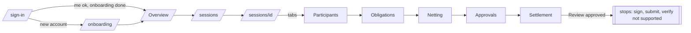

# 06 User flows as implemented

Derived from source (components and `lib/`). Nothing here was executed by this audit. "BE" = backend operation. All flows are Testnet/local-draft; none touches the chain.

| # | Flow | Start | Actions and screens | Backend ops | Decisions | Success / failure | Permissions | Limitations |
|---|---|---|---|---|---|---|---|---|
| 1 | First sign-in + onboarding | `/sign-in` | Choose Wallet (default) or Email; Create account (name, email, password >= 8) or Freighter sign; `AppGate` sends to `/onboarding`; step "profile" (name) then choose Create org (details -> review -> create) or Join (one-time code); then `/` | `auth/register` or wallet challenge/verify; `auth/profile`; `POST registry/orgs` or `invitations/accept`; `auth/workspace` | Method; create vs join | Success redirects to Overview. Failure inline (named wallet states; server messages) | none | Join needs an out-of-band token; no email verification or reset seen in UI |
| 2 | Returning sign-in | `/sign-in` or expired (`?expired=1`) | Same forms; if `me` exists redirect to `/` | `auth/login` or wallet | | 401 elsewhere redirects here | | Wallet users need Freighter in this browser |
| 3 | Organization management | Organization tab | Profile: edit name/description/visibility; Members; Invitations; Wallets (read-only) | `registry/orgs/:id/update`, members/role/status/remove, reviewers, invitations | Confirm dialogs for role, reviewer, suspend, remove | Server reason shown on refusal; last-admin blocked in client and server | Admin | Type and jurisdiction immutable |
| 4 | Member invitation | Org > Invitations | Enter email or Stellar address + role; submit; dialog shows one-time token once (Copy); hand over manually; invitee uses Join code in onboarding; admin can revoke | `POST orgs/:id/invitations`, `.../revoke`, `invitations/accept` | role | Token not retrievable later; state Pending/Accepted/Revoked/Expired(derived) | Admin | No email delivery |
| 5 | Create session | Overview or Sessions "Create session" | Wizard: name (<=80), pick participants, review, create; result lists added and failed participants; "Open session workspace" | `POST sessions {label}` then `POST participants` per member | which members | Partial failure possible (session exists, some participants failed) | Admin | A "local draft", not on-chain |
| 6 | Open session | Any session link | Workspace loads 6 queries, shows stepper + tabs + next action | GET detail/participants/obligations/readiness/authorization/settlement | | 404 -> "Session not found" (maybe other org) | Member+ read | No ready/close controls |
| 7 | Record obligation | Workspace > Obligations (right panel) | Debtor, creditor, amount (base units), asset (select from supported or free code), reference; "Review obligation" dialog; confirm | `POST .../obligations` | | Server validation messages mapped to fields (`lib/obligations/rules.ts`); disabled with < 2 active participants | Admin, configuring | Invalidates calculation and review. No edit in UI |
| 8 | Void obligation | Obligations > row > side panel | "Void obligation" dialog, optional reason (<=200) | `POST .../:o/void` | | Stays on record as voided | Admin, configuring | Irreversible; no edit |
| 9 | View history | Obligation side panel (`?ob=`) | History of transitions from session activity | session detail | | | Read | Per obligation only |
| 10 | Initiate netting | Netting tab right panel | "Run netting", confirmation dialog (what is included/left out), run | `POST .../calculate` | confirm | New calculation replaces current; review no longer applies | Admin | Error shown via `reasonOf` |
| 11 | Review results | Netting tab | Positions by asset (debtors, creditors, zero), original vs net, eligible/excluded, details panel | `GET calculation`, `readiness` | | stale badge when inputs changed | Read | |
| 12 | Replace calculation | Netting tab | Run again after changes; stepper says "stale" | calculate | | | Admin | Old reviews invalidated |
| 13 | Review approvals | Workspace Approvals tab (or `/approvals` -> Open) | Read "what is being reviewed", Approve or Reject (reason required) with dialogs | `POST .../authorization/approve|reject` | approve/reject | Server separation-of-duties message on refusal | Reviewer grant | One reviewer, no N-of-M; not a Stellar signature |
| 14 | Review settlement batch | Settlement tab | Prepared batch, instructions, fingerprint, reconciliation diff; Approve/Reject dialogs | `GET batch`, `POST .../batches/:b/approve|reject` with `instructionsHash` | approve blocked if diff fails | Reject still allowed | Reviewer, not preparer | |
| 15 | Handle mismatch | Settlement tab | Red section "does not match the approved result" lists issues (server and browser checks); approval disabled; reject allowed; re-prepare after reject | validation inside batch view | | | | |
| 16 | Prepare settlement | Settlement panel | Prepare dialog with preview checks; attempt number increments when re-preparing | `POST .../settlement/prepare {calculationId, attempt?}` | | Disabled with first failing check as reason | Admin | Nothing signed or submitted; ends at Review. After approval: "Nothing more can be done here" |
| 17 | Manage wallets | `/wallets`, header wallet popover | Header: Connect Freighter / Check again; `/wallets`: view, details, Disconnect | `auth/wallet/remove` | | | Own | No link/verify UI (email users cannot add a wallet) |
| 18 | Disconnect wallet | `/wallets` > Details | destructive dialog; signs out sessions that used it; server refuses if last sign-in method | `POST auth/wallet/remove` | | | Own | Does not touch the Stellar account |
| 19 | Inspect activity | `/activity`, session Activity tab | Filters (type, session, from/to UTC, result), side panel for a record with link to the section | sessions detail reads | | | Read | Cross-session capped at 10; no member/invitation events |
| 20 | Access Discover | Command panel or typed URL | `/discover` explanation + links | none | | | | Unsupported |

## Notes on complexity
- Longest happy path to "settlement approved": create session (3 steps) -> add participants -> record obligations (each: form + review dialog) -> run netting (dialog) -> a *different* reviewer approves calculation (dialog) -> admin prepares settlement (dialog) -> a *different* reviewer approves batch (dialog). This requires at least two people (admin and a reviewer who is not the actor of each step) by server rules [per `can.ts` header and settlement panel copy]. Source of those server rules in `apps/web-console/lib/registry/service.ts` was not read line by line here: partially unverified.
- Flows 7 to 16 are well-guarded (explicit disabled reasons, confirmations, server messages surfaced).
- The flow cannot continue past Review: sign/submit/verify are absent.
